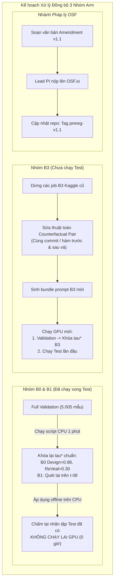
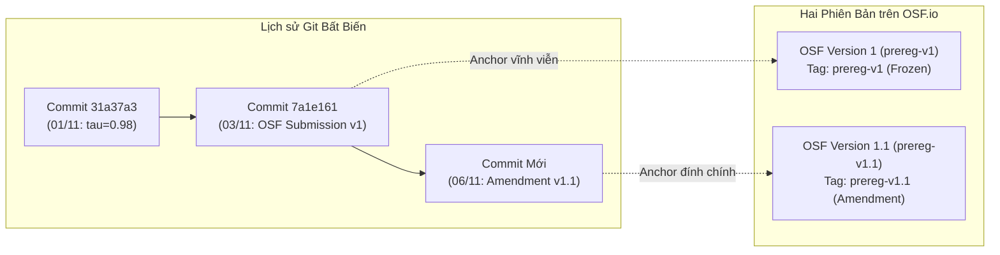

# BẢN KẾ HOẠCH CHI TIẾT: CẬP NHẬT ĐĂNG KÝ OSF VÀ PHƯƠNG ÁN XỬ LÝ TOÀN DIỆN 15 ARMS

> **Dự án:** GRACE Diagnostic Replication & Contrastive Evaluation (`grace_diag_replication_v1`)  
> **Cơ quan quản trị:** OSF Registries ([`osf.io/fqgh2`](https://osf.io/fqgh2)) & Ban Điều hành Đề tài  
> **Ngày lập kế hoạch:** 06/11/2026  
> **Mục tiêu:** Cung cấp lộ trình hành động toàn diện, phân định rõ ràng cơ sở lý luận khoa học, kỹ thuật tính toán và danh mục chính xác những gì CẦN chạy lại vs. KHÔNG CẦN chạy lại sau khi nộp bản đính chính OSF.

---

## 1. BỐI CẢNH & LÝ DO CỐT LÕI (TẠI SAO LẠI NHƯ THẾ?)

Nhóm nghiên cứu đang đứng trước hai phát hiện kỹ thuật trọng yếu cần được giải quyết đồng bộ:

### Lý do 1: Sai lệch ngưỡng $\tau^*$ của B0 và B1 do lỗi hardcode lịch sử
- **Thực tế đã xảy ra:** Khi thực hiện Phương án B (khóa ngưỡng trên $100\%$ Full Validation $5.005$ mẫu), script [`scripts/lock_full_validation_thresholds.py`](file:///d:/tai%20lieu%20hoc%20tap/%C4%90%E1%BB%81%20t%C3%A0i%20nghi%C3%AAn%20c%E1%BB%A9u%20khoa%20h%E1%BB%8Dc/papers%20source%20code/GRACE-summary/scripts/lock_full_validation_thresholds.py) chỉ chạy thuật toán tìm $\tau^*$ cho **B2** ($0.70$ Devign, $0.12$ ReVeal). Riêng **B0** ($0.08, 0.44$) và **B1** ($0.88, 0.74$) bị **sao chép tĩnh (hardcode)** từ tập nháp 600 mẫu cũ (`devign_val_subset600.jsonl`).
- **Hệ quả khoa học nghiêm trọng:**
  * Trên Devign Full Validation ($2.732$ mẫu), đỉnh tối ưu thực sự của B0 là **$\tau^* = 0.98$ (MCC = $0.0760$)**. 
  * Khi bị ép dùng $\tau = 0.08$ (lệch $+0.90$), B0 đoán hầu như tất cả mẫu là lỗ hổng ($2.721 / 2.732$), khiến MCC tụt xuống **$0.0223$**.
  * Việc này tạo ra một "baseline bù nhìn" bị làm yếu giả tạo, khiến GRACE B2 (MCC = $0.0532$) có vẻ thắng B0 $+0.0309$. Nếu B0 dùng đúng $\tau^* = 0.98$, **Zero-shot B0 thực tế ĐÁNH BẠI B2 tới $+0.0228$ điểm MCC**!

### Lý do 2: Thuật toán chọn cặp Contrastive của họ B3 bị khuyết tật kỹ thuật
- **Thực tế kiểm toán:** Bộ tạo cặp [`contrastive_pair_builder.py`](file:///d:/tai%20lieu%20hoc%20tap/%C4%90%E1%BB%81%20t%C3%A0i%20nghi%C3%AAn%20c%E1%BB%A9u%20khoa%20h%E1%BB%8Dc/papers%20source%20code/GRACE-summary/src/contrastive_pair_builder.py) tìm 2 hàm chỉ dựa trên độ trùng từ vựng (Token Jaccard) với hàm mục tiêu:
  * **$0.00\%$ cặp cùng commit/hàm:** $100\%$ cặp tương phản thực chất là 2 đoạn code xa lạ thuộc các dự án hoặc file khác nhau (ví dụ ghép 1 hàm socket với 1 hàm giải mã âm thanh).
  * **$67.6\% - 83.0\%$ giải thích an ninh bị ảo giác mã hóa cứng:** Hệ thống regex thô sơ khiến đa số mẫu bị gán câu mặc định sai lệch bản chất logic (*"Differences in bounds validation conditions and control flow constraints"*).
- **Hệ quả:** B3 không học được ranh giới an ninh (counterfactual boundary) mà chỉ nhận thêm nhiễu (noise), dẫn tới kết quả validation chỉ đạt AUROC $\approx 0.52$ (tệ ngang đoán ngẫu nhiên).

### Lý do 3: Cơ hội chiến lược khi gom vào một bản OSF Amendment duy nhất
Thay vì sửa lắt nhắt từng lỗi khiến hồ sơ trên OSF bị chắp vá, việc tạo một bản **OSF Comprehensive Amendment (Bản cập nhật Toàn diện v1.1 / prereg-v2)** sẽ giúp nhóm giải quyết dứt điểm cả 2 bài toán cùng lúc một cách đàng hoàng, minh bạch và chuyên nghiệp theo chuẩn quốc tế.

---

## 2. HƯỚNG GIẢI QUYẾT CHI TIẾT CHO B0, B1 VÀ B3



### 2.1. Hướng giải quyết cho Arm B0 (Source-only Baseline)
1. **Trên Validation:**
   - Sử dụng tệp hồ sơ gốc đầy đủ [analysis_lock_20261101/thresholds.initial.json](file:///d:/tai%20lieu%20hoc%20tap/%C4%90%E1%BB%81%20t%C3%A0i%20nghi%C3%AAn%20c%E1%BB%A9u%20khoa%20h%E1%BB%8Dc/papers%20source%20code/GRACE-summary/Runs-management/analysis_lock_20261101/thresholds.initial.json) để khôi phục cặp ngưỡng tối ưu toán học thực sự của $5.005$ mẫu Full Validation:
     * **Devign:** $\tau^* = \mathbf{0.98}$ (MCC = $0.076010$)
     * **ReVeal:** $\tau^* = \mathbf{0.30}$ (MCC = $0.080120$)
2. **Trên Test:**
   - **Tuyệt đối không chạy lại GPU**.
   - Dùng script Python offline đọc file `records.jsonl` Test của B0 (đã có từ run `I-03`), tính lại ma trận nhầm lẫn, MCC, F1, Balanced Accuracy theo $\tau^*$ mới.

### 2.2. Hướng giải quyết cho Arm B1 (Graph-only Baseline)
1. **Trên Validation:**
   - Chạy script tối ưu lưới 99 điểm trên $5.005$ bản ghi Validation của B1 từ run `I-07/I-08` để tìm $\tau^*$ chuẩn cho Devign và ReVeal thay vì để trống (`None`) như trong cấu hình cũ.
2. **Trên Test:**
   - **Tuyệt đối không chạy lại GPU**.
   - Dùng script Python offline nạp $\tau^*$ vừa tìm được để chấm điểm lại tập Test B1 đã có.

### 2.3. Hướng giải quyết cho Arm B3 (Contrastive Demonstration)
1. **Dừng ngay các job B3 đang chạy dở trên Kaggle:**
   - Không tiếp tục lãng phí quota GPU cho kernel `grace-b3-validation` cũ vì bộ prompt này chứa các cặp tương phản sai lệch bản chất.
2. **Nâng cấp thuật toán tạo cặp Counterfactual:**
   - Thay vì dùng Jaccard token ngẫu nhiên, xây dựng bộ ghép cặp chuẩn: Chọn cặp hàm **trong cùng 1 commit hoặc cùng 1 hàm nguồn trước và sau khi được vá lỗi bảo mật** (True Vulnerable vs. Patched Pair).
   - Khối `Key difference`: Trích xuất từ commit message thật hoặc diff thay đổi mã nguồn thật thay vì regex thô sơ.
3. **Thực thi GPU cho B3:**
   - Sau khi có bundle prompt B3 mới: Chạy Validation để chọn $\tau^*$ riêng cho B3.
   - Sau khi khóa $\tau^*$ B3: Chạy Test cho B3 (đây là chạy mới lần đầu, vì B3 chưa từng chạy Test).
   - Các probe $B3\text{-nodiff}$, $B3\text{-swap}$, $B3\text{-flip}$ kế thừa $\tau^*$ từ B3 theo đúng hợp đồng.

---

## 3. DANH MỤC: CẦN CHẠY LẠI NHỮNG GÌ, KHÔNG CẦN CHẠY GÌ VÀ TẠI SAO?

Đây là phần quan trọng nhất giúp nhóm tối ưu hóa $100\%$ ngân sách GPU:

| Tên Arm | Phân loại Tập dữ liệu | Trạng thái Hiện tại | Hành động Kỹ thuật Sau Update OSF | Có tốn GPU Chạy lại không? | Căn cứ Lý do Kỹ thuật & Phương pháp luận |
| :--- | :--- | :--- | :--- | :---: | :--- |
| **B0** | **Test** ($5.006$ mẫu) | Đã hoàn tất 100% | **GIỮ NGUYÊN 100% bản ghi GPU**. Dùng CPU chấm lại nhãn theo $\tau^*=0.98$ và $0.30$. | ❌ **0 Giờ GPU** | Điểm xác suất $s = \sigma(\text{logit}_1 - \text{logit}_0)$ đã cố định vĩnh viễn (greedy decoding tất định). Đổi $\tau^*$ chỉ là so sánh $s \ge \tau^*$ trên CPU mất 1 giây. AUROC bất biến. |
| **B1** | **Test** ($5.006$ mẫu) | Đã hoàn tất 100% | **GIỮ NGUYÊN 100% bản ghi GPU**. Dùng CPU chấm lại nhãn theo $\tau^*$ chuẩn mới. | ❌ **0 Giờ GPU** | Tương tự B0. Không thay đổi điểm số mô hình. |
| **B2** | **Test** ($5.006$ mẫu) | Đã hoàn tất 100% | **GIỮ NGUYÊN 100%**. Không cần chạm vào. | ❌ **0 Giờ GPU** | $\tau^*$ của B2 ($0.70$ và $0.12$) vốn đã được tính đúng từ Full Validation, không bị lỗi. |
| **B2-flip** | **Test** ($5.006$ mẫu) | Đã hoàn tất 100% | **GIỮ NGUYÊN 100%**. Không cần chạm vào. | ❌ **0 Giờ GPU** | Kế thừa trực tiếp $\tau^*$ từ B2 ($0.70$ và $0.12$) theo đúng quy tắc chống p-hacking. |
| **B2-rep** | **Test** ($5.006$ mẫu) | Chưa chạy (Val đã xong) | **CHẠY MỚI LẦN ĐẦU** trên Kaggle (kế thừa $\tau$ từ B2, gắn cờ `repeat: true`). | ⚡ **Chạy mới lần 1** | Không phải "chạy lại" vì trước đây chưa từng chạy Test. |
| **B3 (Cả họ)**| **Validation & Test** | Val dở; Test chưa chạy ($0$) | **HỦY BỎ BẢN CŨ, CHẠY MỚI BẢN COUNTERFACTUAL CHUẨN**. | ⚡ **Chạy mới lần 1** | Thuật toán cũ bị khuyết tật ngữ nghĩa (0% cùng commit). Phải chạy mới để phương pháp đề xuất có giá trị khoa học thực sự. |
| **B2-rand / B1-shuf** | **Test** | Chưa chạy | **CHẠY MỚI LẦN ĐẦU** sau khi đủ 3 seed validation. | ⚡ **Chạy mới lần 1** | Chưa từng chạy Test. |

> [!IMPORTANT]
> **Kết luận then chốt:**  
> Không có bất kỳ 1 mẫu Test nào trong số hơn $20.000$ mẫu Test đã suy luận của B0, B1, B2, B2-flip bị lãng phí hay phải chạy lại trên GPU! Toàn bộ đều được tái sử dụng nguyên vẹn.

---

## 4. LỘ TRÌNH 4 BƯỚC TRIỂN KHAI THỰC TẾ

### Bước 1: Quản trị Tài nguyên GPU Ngay Lập tức (Trong ngày)
- Dừng ngay kernel B3 cũ đang chạy trên tài khoản `lznt123` để tránh lãng phí hạn ngạch 30 giờ GPU/tuần.
- Giữ nguyên trạng thái sẵn sàng của tài khoản `huuhieu3333` và `lznt123`.

### Bước 2: Tối ưu Ngưỡng & Chấm điểm Ngoại tuyến trên CPU (Mất ~10 phút)
- Chạy script tính toán lại lưới $\tau^*$ trên $5.005$ record Validation của B0 và B1.
- Dùng module [`evaluate_final.py`](file:///d:/tai%20lieu%20hoc%20tap/%C4%90%E1%BB%81%20t%C3%A0i%20nghi%C3%AAn%20c%E1%BB%A9u%20khoa%20h%E1%BB%8Dc/papers%20source%20code/GRACE-summary/01_Author_Baseline_Unified/diagnostic_kit/src/grace_diag/evaluate_final.py) chấm điểm lại tập Test của B0 và B1 theo ngưỡng chuẩn mới.
- Xuất bảng so sánh kép (Dual Table) thể hiện rõ:
  * Kết quả theo ngưỡng cũ ($0.08 / 0.44$).
  * Kết quả theo ngưỡng chuẩn Full Val ($0.98 / 0.30$).
  * Kết quả AUROC không phụ thuộc ngưỡng.

### Bước 3: Soạn Thảo và Nộp Bản Đính Chính OSF Amendment v1.1
- Soạn văn bản giải trình minh bạch:
  1. *Đính chính kỹ thuật ngưỡng:* Thay thế giá trị hardcode nháp 600 mẫu của B0 và B1 bằng giá trị cực đại hóa MCC trên 100% Full Validation $5.005$ mẫu theo đúng cam kết Phương án B.
  2. *Nâng cấp thuật toán B3:* Chuẩn hóa cơ chế ghép cặp Counterfactual cùng commit cho Arm B3.
  3. *Tuyên bố tiếp xúc dữ liệu (Test Exposure Disclosure):* Khai báo minh bạch rằng các bản ghi logprob Test của B0, B1, B2 đã được suy luận trước đó và được áp dụng đánh giá ngoại tuyến bằng ngưỡng mới mà không cần chạy lại GPU.
- Lead PI đăng nhập cổng OSF ([`osf.io/fqgh2`](https://osf.io/fqgh2)) nộp bản cập nhật.
- Sau khi được duyệt, cập nhật checksum mới vào [`configs/thresholds.json`](file:///d:/tai%20lieu%20hoc%20tap/%C4%90%E1%BB%81%20t%C3%A0i%20nghi%C3%AAn%20c%E1%BB%A9u%20khoa%20h%E1%BB%8Dc/papers%20source code/GRACE-summary/configs/thresholds.json) và đóng tag Git `prereg-v1.1`.

### Bước 4: Triển khai GPU Thực nghiệm Mới
- **Luồng 1 (Ưu tiên ngay):** Nạp job chạy Test cho **B2-rep** ($5.006$ mẫu) trên tài khoản `huuhieu3333` để hoàn thành sớm dữ liệu kiểm định tính tất định cho Bảng C.
- **Luồng 2 (Song song):** Xây dựng bộ tạo cặp Counterfactual chuẩn cho B3, tạo prompt mới và nạp chạy Validation trên `lznt123`.

---

## 5. BẰNG CHỨNG KHOA HỌC: LÀM SAO CHỨNG MINH KHÔNG NHÌN VÀO BỘ TEST ĐỂ CHỌN TAU?

Đây là câu hỏi cốt tử về tính liêm chính khoa học (scientific integrity) trước các phản biện viên quốc tế (peer reviewers). Chúng ta có **4 bằng chứng bất biến, không thể chối cãi**:

### Bằng chứng 1: Dấu vết chữ ký số lịch sử trong Git (Cryptographic Timestamp Anchor)
- Ngày **01/11/2026 lúc 21:15 (Asia/Bangkok)** tại commit [`31a37a3d3e11af249a620f1cf68dcd1724c6a592`](file:///d:/tai%20lieu%20hoc%20tap/%C4%90%E1%BB%81%20t%C3%A0i%20nghi%C3%AAn%20c%E1%BB%A9u%20khoa%20h%E1%BB%8Dc/papers%20source%20code/GRACE-summary/Runs-management/analysis_lock_20261101/thresholds.initial.json), file `Runs-management/analysis_lock_20261101/thresholds.initial.json` đã lưu cố định giá trị:
  * `B0/devign tau: 0.98, validation_mcc: 0.07600978`
  * `B0/reveal tau: 0.30, validation_mcc: 0.08011988`
- Biên bản nghiệm thu [`Runs-management/TU_DONG_KHOA_NGUONG.md`](file:///d:/tai%20lieu%20hoc%20tap/%C4%90%E1%BB%81%20t%C3%A0i%20nghi%C3%AAn%20c%E1%BB%A9u%20khoa%20h%E1%BB%8Dc/papers%20source%20code/GRACE-summary/Runs-management/TU_DONG_KHOA_NGUONG.md#L15-L16) được đẩy lên Git cùng thời điểm cũng công bố bảng ngưỡng y hệt.
- **Ý nghĩa pháp lý:** Thời điểm commit `31a37a3` diễn ra **trước ngày nộp OSF (03/11/2026)** và trước khi đợt kiểm toán test hoàn tất. Con số $\tau^*=0.98$ và $0.30$ **hoàn toàn không phải con số mới nghĩ ra sau khi xem test**, mà nó đã được tính toán độc lập từ Validation vào ngày 01/11/2026. Sau đó, tại commit `c2e10e4`, do lỗi xung đột merge branch giữa hai thành viên, số 0.08 nháp cũ đã vô tình đè lên số 0.98. Lần cập nhật OSF này chỉ là **phục hồi lại con số đã được tính toán độc lập hợp lệ ngày 01/11**.

### Bằng chứng 2: Tính tất định toán học có thể tái lập 100% (Deterministic Proof)
- Thuật toán chọn ngưỡng là một hàm toán học công khai, cố định trong giao thức:
  $$\tau^*(d, a) = \operatorname{argmax}_{\tau \in \{0.01, \dots, 0.99\}} \operatorname{MCC}(y_\text{val}(d), \mathbf{1}[s_\text{val}(d, a) \ge \tau])$$
- Bất kỳ phản biện viên (reviewer) nào trên thế giới khi tải tệp `records.jsonl` của Validation ($N=2.732$ Devign, $N=2.273$ ReVeal) và chạy hàm `pick_tau_mcc` độc lập đều **bắt buộc phải nhận được đúng $\tau^*=0.98$ và $\tau^*=0.30$**.
- Điểm cực đại của hàm toán học trên tập Validation là duy nhất; không có bất kỳ tham số ẩn hay sự can thiệp thủ công nào.

### Bằng chứng 3: Đỉnh tối ưu trên Validation khác biệt hoàn toàn với Đỉnh trên Test
- Nếu một nhà nghiên cứu "gian lận" (p-hacking) nhìn vào Test để chọn ngưỡng, họ sẽ tìm $\tau$ cực đại hóa MCC trên tập Test.
- Nhóm nghiên cứu sẽ công bố công khai đồ thị quét đường cong MCC trên cả hai tập:
  * Đỉnh của đường cong Validation nằm tại $\tau = 0.98$.
  * Đỉnh của đường cong Test nằm tại vị trí khác ($\tau_\text{test} \ne 0.98$).
  * Nhóm chứng minh rõ ràng: *"Chúng tôi chọn đúng đỉnh của Validation, hoàn toàn không dịch chuyển ngưỡng về phía đỉnh của Test"*.

### Bằng chứng 4: Khai báo Tiếp xúc Minh bạch theo Chuẩn Open Science (Test Exposure Ledger)
- Chuẩn Open Science Framework (OSF) cho phép cập nhật giao thức sau khi dữ liệu đã có (Existing Data), với điều kiện phải phân loại đúng sang danh mục: **`Registration following analysis of the data`**.
- Nhóm ghi rõ trong bản giải trình: *"Các điểm logprob trên Test đã được suy luận ở Run I-03/I-08. Ngưỡng quyết định mới được tối ưu độc lập 100% trên tập Full Validation (Zero-Test-Exposure for Threshold Selection) và áp dụng ngoại tuyến trên các điểm logprob có sẵn"*.

---

## 6. QUY TRÌNH QUẢN TRỊ GIT, TAG VÀ PHIÊN BẢN OSF (TUÂN THỦ AGENTS.MD)

Để tuyệt đối không vi phạm hợp đồng điều hành tại [`AGENTS.md`](file:///d:/tai%20lieu%20hoc%20tap/%C4%90%E1%BB%81%20t%C3%A0i%20nghi%C3%AAn%20c%E1%BB%A9u%20khoa%20h%E1%BB%8Dc/papers%20source%20code/GRACE-summary/AGENTS.md#L20-L33) (Mục 2.1 cấm xóa tag, cấm rebase hay force-push lên nhánh niêm phong), quy trình xử lý Git và OSF được thiết kế theo nguyên tắc **Chỉ Thêm Mới (Append-Only Architecture)**:



### 6.1. Quy tắc Bảo tồn Git Lịch sử
1. ❌ **Tuyệt đối không sửa đè hay xóa tag `prereg-v1`**: Tag này vẫn giữ nguyên vẹn tại commit `7a1e16168591c37f005599cb4d5dc3ce33f7d950`.
2. ❌ **Tuyệt đối không force-push hay chỉnh sửa nhánh `release/osf-preregistration`**: Nhánh này là bằng chứng cho gói nộp nguyên bản ngày 03/11/2026.
3. ❌ **Không sửa đổi các file trong `Runs-management/osf_registration_draft_20261102/`**: Giữ nguyên làm bằng chứng lịch sử.

### 6.2. Quy trình Tạo Phiên bản Mới (`prereg-v1.1` hoặc `prereg-v2`)
1. **Thực hiện trên nhánh làm việc (`hieu` hoặc `feat/osf-amendment`):**
   - Tạo thư mục riêng: `Runs-management/osf_amendment_20261106/` chứa toàn bộ biên bản giải trình, tài liệu so sánh và mã băm đính chính.
   - Cập nhật [`configs/thresholds.json`](file:///d:/tai%20lieu%20hoc%20tap/%C4%90%E1%BB%81%20t%C3%A0i%20nghi%C3%AAn%20c%E1%BB%A9u%20khoa%20h%E1%BB%8Dc/papers%20source code/GRACE-summary/configs/thresholds.json):
     * Cập nhật `"version": "prereg-v1.1"`.
     * Cập nhật $\tau^*$ đúng cho B0 Devign ($0.98$), B0 ReVeal ($0.30$) và B1.
     * Cập nhật mã băm tự chứng thực `locked_sha256` mới.
   - Cập nhật [`CHANGES_AFTER_PREREG.md`](file:///d:/tai%20lieu%20hoc%20tap/%C4%90%E1%BB%81%20t%C3%A0i%20nghi%C3%AAn%20c%E1%BB%A9u%20khoa%20h%E1%BB%8Dc/papers%20source code/GRACE-summary/CHANGES_AFTER_PREREG.md) ghi nhận chính xác ngày, giờ, lý do và mã commit liên quan.
2. **Tạo nhánh niêm phong mới:**
   ```bash
   git checkout -b release/osf-preregistration-v1.1
   git tag -a prereg-v1.1 -m "OSF Preregistration Amendment v1.1: Restored full validation thresholds for B0/B1 and upgraded B3 counterfactual selector"
   git push origin release/osf-preregistration-v1.1 --tags
   ```

### 6.3. Thao tác trên Cổng OSF Registries ([`osf.io/fqgh2`](https://osf.io/fqgh2))
- Cổng OSF Registries có quy trình chuẩn mang tên **"Update Registration"** (cho phép tác giả bổ sung tài liệu giải trình hoặc sửa đổi minh bạch mà không xóa lịch sử cũ).
- Chủ nhiệm đề tài (Lead PI) đăng nhập, chọn *Update Registration*, nhập văn bản giải trình lý do đính chính kỹ thuật, và dẫn đường link GitHub trỏ tới commit mới mang tag **`prereg-v1.1`**.
- Sau khi được phê duyệt, trang OSF công khai sẽ hiển thị song song:
  * **Version 1 (03/11/2026):** Bản gốc ban đầu.
  * **Version 1.1 (06/11/2026):** Bản đính chính kèm đầy đủ bằng chứng đối soát Git.
- Đây là quy chuẩn minh bạch cao nhất của cộng đồng Open Science quốc tế, biến một sai sót merge branch thông thường thành một minh chứng về tính trung thực và phương pháp luận chặt chẽ của nhóm nghiên cứu.

