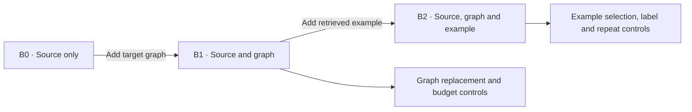
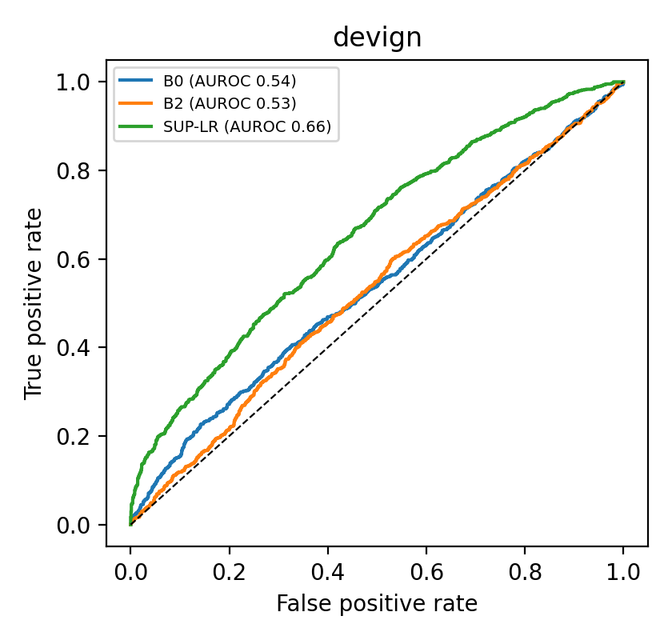
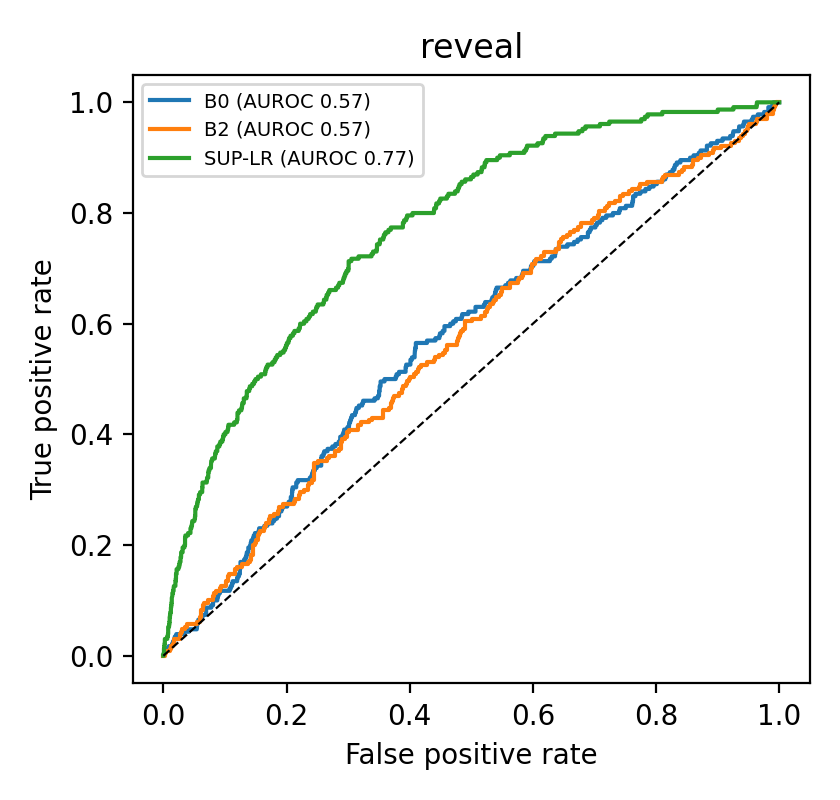
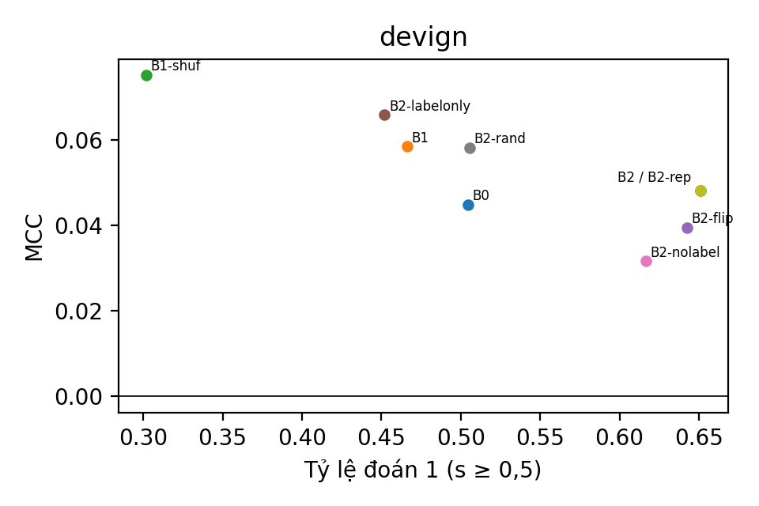
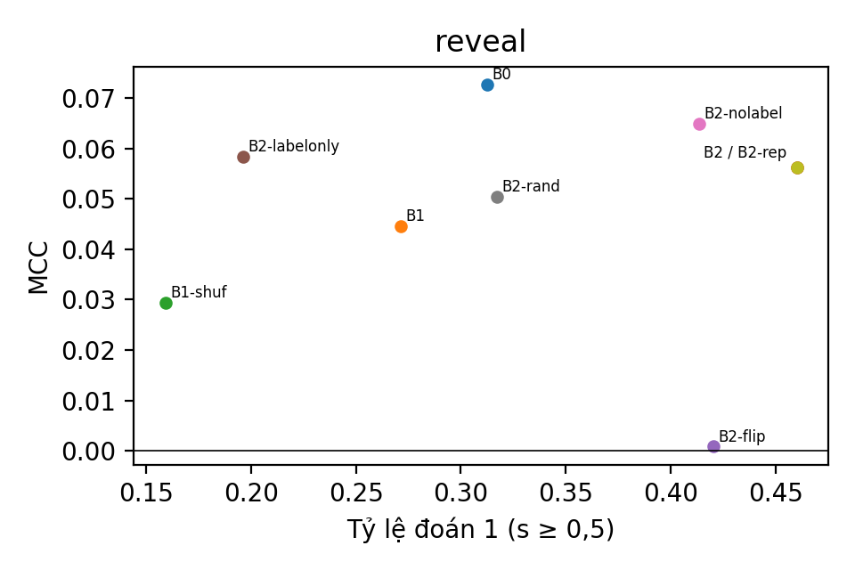

# Does GRACE Generalize Beyond GPT-4? A Diagnostic Replication with an Open-Weight Code Model

## Abstract

We replicated GRACE, a method that adds program graphs and retrieved examples to a language model for function-level vulnerability detection. We used quantized Qwen3-Coder-30B-A3B-Instruct on the official Devign and ReVeal test sets (2,732 and 2,274 functions, respectively). Compared with the source-only prompt, adding the graph and a retrieved example changed AUROC by −0.0100 (95% CI [−0.0280, 0.0078]) on Devign and −0.0079 ([−0.0357, 0.0183]) on ReVeal. Both upper bounds fell below the 0.02 improvement margin. The MCC conclusion depended on which thresholds we used, especially on Devign. At the locked B2 thresholds, flipping the example label changed 20.28% and 10.69% of predictions after accounting for changes in repeated inference. Logistic regression on frozen code embeddings exceeded B2 by 0.1593 MCC on Devign and 0.1939 on ReVeal. At shared thresholds, the intervals for adding the LLM score to a supervised meta-model excluded a gain of 0.02 MCC.

**Keywords:** software vulnerability detection, diagnostic replication, in-context learning, program graphs, selective inference

## 1. Introduction

[GRACE](https://doi.org/10.1016/j.jss.2024.112031) classifies functions by giving a language model the source code, a textual representation of the program graph, and similar labeled examples. Lu et al. report gains with GPT-4 on Devign (FFmpeg+Qemu), ReVeal and Big-Vul. We test whether those gains carry over to an open-weight model with a recorded checkpoint and inference configuration. In particular, we ask whether each prompt addition improves the ranking of vulnerable functions or mainly changes how often the model predicts vulnerability.

We start with a source-only prompt, add the target graph, then add a retrieved example. We vary the graph, the example code and its label in separate comparisons. We also compare the resulting detector with supervised classifiers trained on benchmark labels. The paired meta-models test whether the LLM score helps after a query. The routing experiment tests whether the classifier can identify cases worth querying in advance.

We report paired confidence intervals on the full Devign and ReVeal test splits, isolate the effects of graph context and examples, and compare the prompt variants with supervised baselines. The reproducibility artifacts retain both the registered and retrospectively corrected thresholds.

## 2. Background and related work

Graph-based detectors such as [Devign](https://arxiv.org/abs/1909.03496) and [ReVeal](https://arxiv.org/abs/2009.07235) learn from program structure. [GRACE](https://doi.org/10.1016/j.jss.2024.112031) instead gives a language model a textual graph and retrieves examples by similarity. [Kaniewski et al.](https://arxiv.org/abs/2609.37669) studied individual components of retrieval-augmented vulnerability detectors and found that performance depended on the backbone and evaluation setup.

[Min et al.](https://aclanthology.org/2022.emnlp-main.759/) distinguish what examples convey about the input distribution, label space and format from what they convey about which label goes with which input. We vary example code and labels to probe that distinction in vulnerability detection. [Ding et al.](https://arxiv.org/abs/2403.18624) document label noise and overlap across benchmark splits. We report results on the official splits and repeat the main comparison after filtering out test functions that overlap with training code.

Frozen [CodeT5](https://aclanthology.org/2021.emnlp-main.685/) embeddings and static code metrics give us two ways to build supervised baselines. When the LLM is available as a second predictor, a router must decide whether to query it before seeing its score. We count how often the queried model corrects a baseline error and how often it replaces a correct baseline prediction with an error.

## 3. Replication protocol

### 3.1 Data and splits

We use the official Devign and ReVeal splits and treat vulnerability as the positive class. Validation contains 2,732 Devign and 2,273 ReVeal functions. Test contains 2,732 Devign functions (1,255 labeled vulnerable) and 2,274 ReVeal functions (230 labeled vulnerable).

We build the retrieval banks from training data. We remove exact matches to held-out functions, keep one representative per group of duplicates with consistent labels, and discard groups with conflicting labels. The cleaned banks contain 21,691 Devign and 17,636 ReVeal examples. For the overlap analysis, we exclude exact and near matches to training code from test. We flag near matches at a token 3-gram Jaccard similarity of 0.90 or higher. This leaves 2,472 Devign and 1,978 ReVeal test functions. [Registration and data protocol](https://osf.io/fqgh2/)

### 3.2 Model, prompts and experimental arms

We use Qwen3-Coder-30B-A3B-Instruct with Q4_K_M GGUF quantization and an 8,192-token context. The reference runs use `llama-cpp-python` 0.3.16 with greedy decoding. At the first output position, we take logits `z₀` and `z₁` for the two label tokens and compute `s = exp(z₁) / (exp(z₀) + exp(z₁))`. We record raw response formatting and score validity separately. See §3.5 for runtime exceptions.

The prompt places the target code first, then the graph and example blocks, and ends with a slot for the binary answer. We cap target code at 3,000 tokens and each of the other two blocks at 1,500 tokens. We serialize graph context from a Joern code property graph. B1 takes the first 25 nodes and 25 edges at most. For retrieval, we use CodeT5 representations and rerank candidates by lexical and syntactic similarity. When an example includes a label, it comes from the training bank. The target label stays out of the prompt.

| Arm | Prompt change or control |
|---|---|
| B0 | Target source and task instruction (zero-shot reference). |
| B1 | B0 with serialized graph context. |
| B1-shuf | B1 with the graph of another function matched within ±10% in node count under the same graph budget. Seed 42 is the main paired comparison. |
| B1-full | Graph serialization that fills the graph budget, interpreted with the renderer history in §3.5. |
| B2 | B1 with one retrieved demonstration and its training label. |
| B2-rand | B1 with a randomly selected demonstration and its training label. |
| B2-nolabel | B2 with the demonstration label removed. |
| B2-labelonly | B2 with the demonstration code removed and its label retained. |
| B2-flip | B2 with the demonstration label inverted. |
| B2-rep | Repeat of B2 with the same prompt and an isolated repeat cache tag. |
| B1-H2, B3 family | Evidence-focused graph and contrastive-pair variants, reported as exploratory. |

B1 adds the graph to B0. B2 adds a labeled retrieved example to B1. The controls let us replace the graph, vary the example code or label, or repeat the same prompt to check prediction stability.

*Protocol schematic. The main sequence adds one prompt component at each step.*

### 3.3 Supervised anchors and selective inference

SUP-LR fits logistic regression to 768-dimensional frozen CodeT5 embeddings. SUP-MLP uses the same embeddings and one hidden layer of width 128. SUP-METRIC fits logistic regression to 26 static code metrics. We report seed 42 in the main tables and retain runs for seeds 43 and 44 in the artifacts. ALL-0 and ALL-1 predict the same class for every function. A Bernoulli expert matched to the LLM’s positive prediction rate serves as a reference for repair counts.

The logistic meta-models share 34 baseline features and three stratified group folds. P_pre uses only features available before querying the LLM. P_post adds the B2 score, an indicator of score validity and interactions with the baseline prediction. Both analyses use the P_pre decision when the LLM score is invalid. In the shared-threshold analysis, we choose the cutoff on P_pre out-of-fold validation scores and apply it to both models. We also compare the models at their separately selected cutoffs.

For routing, we use the supervised H3-B gate as the default classifier. We compare a benefit router trained on validation data, a confidence router, random selection over 20 seeds and an oracle that uses test labels to find cases the LLM can correct. Each router receives the same query budget within a dataset. A repair occurs when the LLM corrects a baseline error. A harm occurs when it replaces a correct baseline prediction with an error.

### 3.4 Metrics and inference

We compute AUROC from continuous scores and summarize the precision–recall curve from the same scores with average precision (AP, reported as AUPRC in the tables). We report MCC, balanced accuracy, F1 and positive prediction rate at specified cutoffs. For comparisons of positive prediction rates, all arms use 0.5. On validation, we select the cutoff with the highest MCC on a grid from 0.01 to 0.99 in steps of 0.01, breaking ties toward 0.5. B2-flip and B2-rep use the B2 cutoff. We evaluate the registered and retrospectively corrected B0/B1 thresholds separately.

We match scores by test ID and compute 95% percentile intervals with 5,000 paired cluster bootstrap draws (seed 20261117), resampling commits on Devign (2,068 test clusters) and source-file hashes on ReVeal (646). The improvement margins are 0.02 AUROC and 0.03 MCC for the prompt comparisons, 0.15 MCC for SUP-LR versus B2, and 0.02 MCC for the meta-model comparison. We use the confidence interval to decide whether a contrast meets its margin. Two-sided McNemar tests compare paired classification errors at the thresholds used for each MCC row. Table B uses PA1 Holm adjustments over 22 tests per B0/B1 threshold policy, including the exploratory B2/B3 and B1/B1-H2 comparisons and the P_pre/P_post comparison at separate validation cutoffs. The last comparison tests post-query predictions. H5.3 evaluates pre-query routing at a fixed budget. The kit adjusts over 18 available tests and therefore can give different adjusted p-values.

### 3.5 Registration, exposure and deviations

We inspected Tier 1 test metrics on both benchmarks before registration. In run I-06 we also viewed raw B2-flip label outputs for 230 Devign test functions. The exposure ledger records which results were available for each arm. We treat the comparisons already examined as evidence from existing data. [OSF registration](https://osf.io/fqgh2/) · [Exposure ledger](https://github.com/kazunguyen/GRACE-summary/blob/28405417703f24c594045074bdbe57b8c11a2d5e/preregistration_en.md#12-exposure-ledger--3-condition-audit-for-keep-vs-rerun)

| Item | Consequence for interpretation |
|---|---|
| B0/B1 thresholds | Full-validation recomputation took place after test exposure. We retain the original registered values and label results using the updated values as retrospective. |
| B1-full renderer | After test exposure we corrected the test renderer. The two test versions differ on 4,753 of 5,006 prompts. The corrected renderer reproduced the graph blocks of all 5,005 validation prompts, so the corrected test uses the existing validation cutoffs of 0.99 (Devign) and 0.01 (ReVeal). [Renderer audit](https://github.com/kazunguyen/GRACE-summary/blob/28405417703f24c594045074bdbe57b8c11a2d5e/worklogs/2026-11-12_bao_cao_metric_cac_arm_hoan_tat.md#L405) |
| B2-rand ReVeal, seeds 42/43 | Each run combines two runtime contracts. Both used SciPy 1.16.3. Seed 44 used one contract across ReVeal test and gave the same conclusion at the AUROC margin. We lack a same-ID, same-prompt comparison across the two contracts. |
| B2-nolabel, B2-labelonly and B2-rep test | Records, model, scores, and process logs match for the six test processes. Evidence for native GPU layer placement and full provenance from those processes is incomplete. [Runtime audit](https://github.com/kazunguyen/GRACE-summary/blob/28405417703f24c594045074bdbe57b8c11a2d5e/Runs-management/runtime_session_reconciliation_20261110/REPORT.md#L9) |
| B1-H2 and B3 family | The graph evidence variant and contrastive-pair variants are exploratory in Option 1. The reported B3 configuration used a fixed pair per dataset. |
| Workshop scope | Full mechanism relevance and benchmark label adjudication are deferred. The 30-case A/B review is a descriptive pilot. |

## 4. Results

### 4.1 Replication (RQ1)

The AUROC intervals rule out a gain of 0.02 for B2 over B0 on both benchmarks. The differences were −0.0100 [−0.0280, 0.0078] on Devign and −0.0079 [−0.0357, 0.0183] on ReVeal (95% CIs). Under the registered thresholds, Devign’s MCC interval still allows a gain of 0.03. ReVeal’s interval rules it out. Under the retrospective thresholds, both MCC intervals rule out that gain.

**Table A. Selected test metrics, seed 42 for fitted and prompted arms.** MCC uses the cutoff in parentheses. B0/B1 use the retrospective cutoffs, and B2 and SUP-LR use their validation locks. The F1 column uses the common 0.5 rule. ALL-0 always predicts negative, ALL-1 always predicts positive, and RAND(p) predicts positive with probability equal to the test prevalence. Dashes indicate that the export does not report the corresponding metric.

| Arm | Devign AUROC | Devign AUPRC | Devign MCC (τ) | Devign F1 @ 0.5 | ReVeal AUROC | ReVeal AUPRC | ReVeal MCC (τ) | ReVeal F1 @ 0.5 |
|---|---:|---:|---:|---:|---:|---:|---:|---:|
| ALL-0 | — | — | — | 0.0000 | — | — | — | 0.0000 |
| ALL-1 | — | — | — | 0.6295 | — | — | — | 0.1837 |
| RAND(p) | — | — | — | 0.4594 | — | — | — | 0.1011 |
| B0 | 0.5405 | 0.5153 | 0.0922 (0.98) | 0.5042 | 0.5740 | 0.1260 | 0.0874 (0.30) | 0.2019 |
| B1 | 0.5335 | 0.5023 | 0.0788 (0.98) | 0.4943 | 0.5841 | 0.1238 | 0.0523 (0.63) | 0.1795 |
| B2 | 0.5305 | 0.4856 | 0.0597 (0.70) | 0.5592 | 0.5662 | 0.1221 | 0.0645 (0.12) | 0.1959 |
| SUP-LR | 0.6559 | 0.6321 | 0.2190 (0.37) | 0.5434 | 0.7709 | 0.2841 | 0.2584 (0.15) | 0.2323 |

**Table B. Selected paired test contrasts.** Values are differences in the stated direction with 95% paired cluster bootstrap intervals and the ledger verdict at the specified margin δ. The MCC rows also show raw two-sided McNemar p and PA1 Holm-adjusted p. For comparisons that keep their cutoffs under both policies, we show the Holm value from the retrospective family. AUROC uses continuous scores. No bootstrap draw degenerated for the rows shown.

| Contrast | Metric and policy | Devign Δ [95% CI] and verdict | Devign raw / Holm p | ReVeal Δ [95% CI] and verdict | ReVeal raw / Holm p |
|---|---|---|---:|---|---:|
| B2 − B0 | AUROC | −0.0100 [−0.0280, 0.0078] · Gain ≥ δ excluded | — / — | −0.0079 [−0.0357, 0.0183] · Gain ≥ δ excluded | — / — |
| B2 − B0 | MCC, registered | +0.0306 [−0.0080, 0.0681] · Inconclusive | 0.0070 / 0.0633 | −0.0211 [−0.0634, 0.0207] · Gain ≥ δ excluded | < 10⁻⁴ / < 10⁻⁴ |
| B2 − B0 | MCC, retrospective | −0.0325 [−0.0750, 0.0106] · Gain ≥ δ excluded | 0.0012 / 0.0132 | −0.0229 [−0.0630, 0.0153] · Gain ≥ δ excluded | < 10⁻⁴ / < 10⁻⁴ |
| B2 − B2-rand | AUROC | −0.0013 [−0.0158, 0.0140] · Gain ≥ δ excluded | — / — | −0.0143 [−0.0352, 0.0064] · Gain ≥ δ excluded | — / — |
| B2 − B2-rand | MCC, locked | +0.0254 [−0.0152, 0.0673] · Inconclusive | 0.1930 / 0.8045 | +0.0192 [−0.0299, 0.0675] · Inconclusive | < 10⁻⁴ / < 10⁻⁴ |
| B2-nolabel − B1 | AUROC | −0.0066 [−0.0183, 0.0052] · Gain ≥ δ excluded | — / — | −0.0120 [−0.0288, 0.0049] · Gain ≥ δ excluded | — / — |
| B2-nolabel − B1 | MCC, registered | −0.0123 [−0.0437, 0.0181] · Gain ≥ δ excluded | 0.2836 / 0.6513 | +0.0303 [−0.0132, 0.0733] · Inconclusive | < 10⁻⁴ / < 10⁻⁴ |
| B2-nolabel − B1 | MCC, retrospective | −0.0270 [−0.0587, 0.0058] · Gain ≥ δ excluded | 0.0170 / 0.1193 | +0.0312 [−0.0130, 0.0755] · Inconclusive | < 10⁻⁴ / < 10⁻⁴ |
| B2-labelonly − B1 | AUROC | +0.0128 [0.0050, 0.0204] · Inconclusive | — / — | +0.0165 [0.0041, 0.0294] · Inconclusive | — / — |
| B1 − B0 | AUROC | −0.0070 [−0.0197, 0.0057] · Gain ≥ δ excluded | — / — | +0.0101 [−0.0092, 0.0287] · Inconclusive | — / — |
| B1 − B0 | MCC, registered | +0.0349 [−0.0084, 0.0759] · Inconclusive | < 10⁻⁴ / 0.0010 | −0.0324 [−0.0708, 0.0049] · Gain ≥ δ excluded | < 10⁻⁴ / < 10⁻⁴ |
| B1 − B0 | MCC, retrospective | −0.0134 [−0.0459, 0.0183] · Gain ≥ δ excluded | 0.4159 / 1.0000 | −0.0351 [−0.0743, 0.0014] · Gain ≥ δ excluded | < 10⁻⁴ / < 10⁻⁴ |
| B1 − B1-shuf | AUROC | −0.0096 [−0.0233, 0.0041] · Gain ≥ δ excluded | — / — | +0.0064 [−0.0161, 0.0296] · Inconclusive | — / — |
| B1 − B1-shuf | MCC, registered | −0.0207 [−0.0600, 0.0198] · Gain ≥ δ excluded | 0.1303 / 0.6513 | +0.0154 [−0.0220, 0.0547] · Inconclusive | < 10⁻⁴ / < 10⁻⁴ |
| B1 − B1-shuf | MCC, retrospective | −0.0060 [−0.0426, 0.0322] · Inconclusive | 0.7263 / 1.0000 | +0.0145 [−0.0250, 0.0559] · Inconclusive | < 10⁻⁴ / < 10⁻⁴ |
| SUP-LR − B2 | MCC, locked | +0.1593 [0.0952, 0.2267] · Gain meets δ | < 10⁻⁴ / < 10⁻⁴ | +0.1939 [0.1136, 0.2714] · Gain meets δ | < 10⁻⁴ / < 10⁻⁴ |

B2 MCC was below 0.15 on both test sets. On Devign, B2 reached an F1 of 0.5592 at the common 0.5 cutoff (Table A) and 0.5485 at the locked B2 cutoff. The always-vulnerable baseline reached 0.6295. Lu et al. report F1 of 0.6511 on FFmpeg+Qemu and 0.4313 on ReVeal in their main comparison. Those figures come from a different model and evaluation sample. Our B2−B0 comparison holds the model and test IDs fixed. [Original study](https://doi.org/10.1016/j.jss.2024.112031)

*Figure 1. ROC curves for selected prompt arms and the supervised logistic anchor on each official test set. The diagonal marks chance ranking.*

### 4.2 Demonstration effects (RQ2)

At the locked B2 cutoffs, flipping the demonstration label produced net sensitivities of 20.28 percentage points [18.75, 21.76] on Devign and 10.69 [9.15, 12.25] on ReVeal (95% CIs). The flip changed 554 and 243 predictions, respectively. Repeating B2 changed none of the 5,006 predictions. Devign’s interval lies above the specified 15-point threshold, and ReVeal’s lies below it.

**Table C. Demonstration label sensitivity at the locked B2 thresholds.** The CI is for the net percentage-point change, obtained by subtracting the repeat change rate from the flip change rate.

| Dataset | N | B2 threshold | Flip changes | Repeat changes | Net percentage points [95% CI] |
|---|---:|---:|---:|---:|---:|
| Devign | 2,732 | 0.70 | 554 | 0 | 20.28 [18.75, 21.76] |
| ReVeal | 2,274 | 0.12 | 243 | 0 | 10.69 [9.15, 12.25] |

For B2−B2-rand and B2-nolabel−B1, both datasets had AUROC upper bounds below 0.02 (Table B). On ReVeal, the seed 44 comparison used a single runtime contract and gave B2−B2-rand ΔAUROC of −0.0087 [−0.0304, 0.0142]. B2-labelonly exceeded B1 by 0.0128 [0.0050, 0.0204] AUROC on Devign and 0.0165 [0.0041, 0.0294] on ReVeal. Both point estimates fall below 0.02. Because the B2−B1 intervals contain zero, we apply the Option 1 equivalence rule for B2-labelonly versus B2. The upper bounds on the absolute AUROC difference are 0.0345 on Devign and 0.0588 on ReVeal, above the 0.02 equivalence margin. On ReVeal, B2-labelonly exceeded B2 by 0.0344 AUROC [0.0103, 0.0588]. Two of the three demonstration content criteria were met. Equivalence remains unestablished.

### 4.3 Graph effects (RQ3)

Adding the graph to B0 changed AUROC by −0.0070 [−0.0197, 0.0057] on Devign and +0.0101 [−0.0092, 0.0287] on ReVeal (95% CIs), ruling out a 0.02 gain on Devign only. The B1−B1-shuf contrast led to the same decision on both datasets (Table B). B1-full reached AUROC of 0.5311 on Devign and 0.5782 on ReVeal, compared with 0.5335 and 0.5841 for B1. The B1-full renderer history limits how much of this difference we can attribute to the graph budget. Appendix B reports B1-H2 by evidence availability.

### 4.4 Ranking and operating points (RQ4)

Adding a retrieved example raised the positive prediction rate at the shared cutoff of 0.5, while the B2−B1 ΔAUROC intervals contained zero (Devign −0.0030 [−0.0186, 0.0122], ReVeal −0.0179 [−0.0400, 0.0041]). Positive prediction rates rose from 46.63% to 65.08% on Devign and from 27.13% to 46.00% on ReVeal. The highest AUROC among the evaluated LLM arms was 0.6005 for B2-labelonly on ReVeal, below the specified ceiling of 0.62.

*Figure 2. Positive prediction rate versus MCC at the common 0.5 decision rule for seed-42 prompt arms. Each panel shows one dataset.*

### 4.5 Supervised baselines and incremental value (RQ5)

SUP-LR exceeded B2 by 0.1593 MCC [0.0952, 0.2267] on Devign and 0.1939 [0.1136, 0.2714] on ReVeal (95% CIs). Both point estimates exceed 0.15 and both intervals lie above zero. SUP-LR reached AUROC of 0.6559 on Devign and 0.7709 on ReVeal. Only ReVeal met the separate AUROC criterion of 0.68. When we added the B2 score to P_pre’s feature set, the shared-threshold intervals ruled out an MCC gain of 0.02 (Table D).

**Table D. Value of the B2 score after the query.** Both models in each row use the same cutoff selected on P_pre validation predictions.

| Dataset | Shared τ | P_pre MCC | P_post MCC | ΔMCC P_post − P_pre [95% CI] |
|---|---:|---:|---:|---:|
| Devign | 0.53 | 0.2866 | 0.2858 | −0.0008 [−0.0095, 0.0080] |
| ReVeal | 0.20 | 0.3769 | 0.3690 | −0.0078 [−0.0169, −0.0010] |

With separate validation cutoffs, ReVeal’s upper MCC bound rises to 0.0260. At the shared cutoff, its interval lies entirely below zero.

Relative to the H3-B gate on the full test sets, B2 repaired 397 Devign errors and 164 ReVeal errors, while introducing 718 and 875 errors, respectively. The 97.5th percentiles of repairs by the matched random expert were 465.05 and 176.15. Always-negative and always-positive experts on Devign repaired 764 and 257 cases and harmed 998 and 713, respectively. On ReVeal the corresponding repair/harm counts were 201/116 and 114/1,843. The oracle that selects a correct decision when either model is right attained 77.16% and 93.36% accuracy, against gate accuracies of 62.63% and 86.15%.

At a 10% query budget, the benefit router changed balanced accuracy relative to random routing by +0.0204 [0.0138, 0.0270] on Devign and −0.0487 [−0.0748, −0.0249] on ReVeal. Only ReVeal met the H5.3 criteria for ruling out a benefit from routing. Appendix C reports the other budgets.

### 4.6 Retrieval relevance and errors (RQ6)

Both raters selected the retrieved B2 example in all 30 pilot cases (15 per dataset, Cohen’s κ = 1.00 before adjudication). For each case, the packet paired a retrieved B2 example with a random B2-rand example from seed 42. Raters saw the target and both examples under A/B labels. The packet withheld the source arm, benchmark labels and model outcomes. Raters chose an example and scored sink, variable, guard and evidence. The coordinator decoded A/B after receiving both forms.

| Pilot outcome | Devign | ReVeal | Overall |
|---|---:|---:|---:|
| Targets rated by both reviewers | 15 | 15 | 30 |
| Agreement on final A/B choice | 15/15 | 15/15 | 30/30 |
| Retrieved B2 example selected by both | 15/15 | 15/15 | 30/30 |
| Cases requiring adjudication | 0 | 0 | 0 |

The raters selected A in 15 cases and B in 15. They also agreed in all eight rubric columns, which largely tracked the final choice. Their explanations mostly cited shared function families, APIs or modules. We report the pilot descriptively. The unanimous choices leave no separate relevance groups for estimating a difference in accuracy or its confidence interval. Phase 2 covers mechanism-level relevance, conditional accuracy and label adjudication. One form was already in the repository when the second rater completed scoring. The worklog for the later submission states that the rater did not open the earlier form during scoring.

## 5. Discussion

B2 predicted vulnerability more often than B1 at the shared cutoff, even though the paired AUROC intervals contained zero. Flipping the example label also changed classifications while leaving the target and example code fixed. Reporting AUROC alongside MCC or F1 makes it possible to distinguish changes in ranking from changes at a particular cutoff.

The raters favored retrieved examples for their code and functional similarity. On the full test sets, the AUROC intervals ruled out the specified gain over random examples. A larger review that labels the underlying defect mechanism could test whether that form of relevance is more informative than code similarity.

SUP-LR gives a reference for judging a model that sees only a prompt. The shared-threshold meta-model tests the harder question of whether an LLM score adds information once a classifier has used its baseline features. The router results suggest that any selective use of B2 would require a policy that can identify likely repairs before querying. The oracle shows the room available under perfect knowledge of those repairs.

## 6. Threats to validity

**Internal validity.** We inspected test data before registration. The retrospective B0/B1 correction changes threshold-dependent results, particularly on Devign. ReVeal’s B2-rand runs for seeds 42 and 43 combine two runtime contracts. Seed 44 repeats the contrast under one runtime contract. The B1-full renderer history also limits the graph-budget comparison.

**Construct validity.** Function-level benchmark labels may contain errors or omit context from other functions. Filtering duplicates addresses identifiable training overlap. The common-cutoff positive prediction rate measures how often the model assigns the vulnerable label. The 30-case ratings mostly reflect functional similarity and leave mechanism relevance and label noise for a larger review.

**External and statistical validity.** We evaluated one quantized open-weight checkpoint, two benchmarks and one prompt budget. The original GPT-4 study also used a different evaluation sample. Graph comparisons on ReVeal still allow gains of the specified size. Appendix D reports older API runs as exploratory evidence because outputs could change for identical prompts and some provider responses were empty. The B3, B1-H2 and blind review findings describe the exploratory configurations and samples reported here.

## 7. Conclusion

In this Qwen replication, the paired AUROC intervals rule out a gain of 0.02 from the full GRACE prompt over the source-only prompt on Devign and ReVeal. The Devign MCC conclusion depends on the threshold policy. At a shared cutoff, adding the B2 score to the supervised meta-model falls short of the 0.02 MCC improvement margin on both datasets. The protocol and analysis artifacts are available in the [OSF registration](https://osf.io/fqgh2/) and the [project repository](https://github.com/kazunguyen/GRACE-summary).

## References

1. Lu, G., Ju, X., Chen, X., Pei, W., and Cai, Z. (2024). GRACE: Empowering LLM-based software vulnerability detection with graph structure and in-context learning. *Journal of Systems and Software*, 212, 112031. [DOI](https://doi.org/10.1016/j.jss.2024.112031)
2. Zhou, Y., Liu, S., Siow, J., Du, X., and Liu, Y. (2019). Devign: Effective Vulnerability Identification by Learning Comprehensive Program Semantics via Graph Neural Networks. *NeurIPS*. [Paper](https://arxiv.org/abs/1909.03496)
3. Chakraborty, S., Krishna, R., Ding, Y., and Ray, B. (2022). Deep Learning Based Vulnerability Detection: Are We There Yet? *IEEE Transactions on Software Engineering*. [Paper](https://arxiv.org/abs/2009.07235)
4. Wang, Y., Wang, W., Joty, S., and Hoi, S. C. H. (2021). CodeT5: Identifier-aware Unified Pre-trained Encoder-Decoder Models for Code Understanding and Generation. *EMNLP*. [Paper](https://aclanthology.org/2021.emnlp-main.685/)
5. Min, S., et al. (2022). Rethinking the Role of Demonstrations: What Makes In-Context Learning Work? *EMNLP*. [Paper](https://aclanthology.org/2022.emnlp-main.759/)
6. Ding, Y., et al. (2024). Vulnerability Detection with Code Language Models: How Far Are We? [Preprint](https://arxiv.org/abs/2403.18624)
7. Kaniewski, S., Krämer, T., Bächle, J., Enzweiler, M., Menth, M., and Heer, T. (2026). Retrieve, Reproduce, Reveal: Dissecting Retrieval-Augmented Software Vulnerability Detection. [Preprint](https://arxiv.org/abs/2609.37669)

## Appendix A. Sensitivity to train overlap

After excluding exact and near matches to training code, B2−B0 ΔAUROC was −0.0204 [−0.0385, −0.0022] on Devign and −0.0242 [−0.0593, 0.0105] on ReVeal. Under the registered thresholds, ΔMCC was +0.0179 [−0.0211, 0.0573] and −0.0273 [−0.0695, 0.0168]. Under the retrospective thresholds, it was −0.0497 [−0.0940, −0.0049] and −0.0339 [−0.0737, 0.0068]. The overlap analysis preserves the conclusion that the AUROC intervals exclude a +0.02 gain, and the registered Devign MCC interval still permits a gain of 0.03.

## Appendix B. Exploratory graph evidence and contrastive demonstrations

For B1-H2 relative to B1, the evidence-present groups gave ΔAUROC of +0.031 [−0.004, 0.065] (934 Devign functions) and +0.061 [−0.008, 0.127] (408 ReVeal functions). The corresponding evidence-missing estimates were +0.002 [−0.014, 0.019] and +0.002 [−0.020, 0.024]. The evidence groups have wide intervals, and the analysis is conditional on evidence availability.

The exploratory B3 configuration used one fixed demonstration pair per dataset. Relative to B2 at 0.5, its positive prediction rate changed by −1.10 and +17.02 percentage points on Devign and ReVeal. Its AUROC differences were +0.0047 [−0.0135, 0.0228] and −0.0369 [−0.0650, −0.0079]. These estimates describe the fixed-pair runs.

## Appendix C. Budget sensitivity

| Dataset | Budget | Queries | Benefit BA | Random BA (mean) | Benefit repairs / harms |
|---|---:|---:|---:|---:|---:|
| Devign | 5% | 137 | 0.6448 | 0.6336 | 34 / 15 |
| Devign | 10% | 274 | 0.6482 | 0.6279 | 55 / 25 |
| Devign | 25% | 683 | 0.6444 | 0.6104 | 128 / 97 |
| ReVeal | 5% | 114 | 0.6643 | 0.6943 | 47 / 24 |
| ReVeal | 10% | 228 | 0.6402 | 0.6888 | 68 / 41 |
| ReVeal | 25% | 569 | 0.6065 | 0.6651 | 85 / 93 |

*The random baseline is the mean over 20 equal-budget draws. Repairs and harms compare the final routed prediction with the H3-B gate before routing.*

## Appendix D. Historical API runs and dev-100

Before the open-weight replication, we explored GRACE variants through commercial APIs. The historical audit reproduced metrics for 36 full-test runs (18 per dataset, 90,108 run–target pairs). The largest absolute difference from a stored metric was below 0.001. The table summarizes those runs and the separately reported DeepSeek and dev-100 results. These analyses predate the current evaluation and serve as exploratory context.

| Historical analysis | Devign | ReVeal |
|---|---|---|
| 36-run API ledger, range across configurations (test MCC) | 0.0510 to 0.1079 | −0.0088 to 0.0706 |
| Qwen3-Coder-480B on Vertex, baseline → full V1+V2 (test MCC) | 0.0691 → 0.0721 | 0.0226 → 0.0505 |
| DeepSeek-V4.1-Flash, full GRACE → H2-guarded (test MCC) | 0.067 → 0.054 | 0.097 → 0.066 |
| Qwen3-Coder-480B, B2 → B3 on dev-100 (MCC) | −0.030 → −0.110 | 0.145 → 0.189 |
| B3 net label sensitivity on dev-100 | 18% | 13% |

On dev-100, the Devign positive prediction rate rose from 29% to 66% in the contrastive comparison. The proposal reports that the ΔMCC interval included zero. It also reports 31% net label sensitivity for B2 and 4% variation in repeated inference. The historical API audit recorded six changed labels under identical prompt hashes in two Vertex calls and 9,206 empty provider responses. [All 36 runs](https://github.com/kazunguyen/GRACE-summary/blob/dung/%5BOfficial%5D-Paper/evidence/historical_api_36.csv) · [Historical results in §2.1 and §2.3 of the proposal](https://github.com/kazunguyen/GRACE-summary/blob/dung/docs/20261111/Option1-De_cuong_nghien_cuu_GRACE_hop_nhat.docx)

## Draft source map

- [Option 1 unified proposal](https://github.com/kazunguyen/GRACE-summary/blob/dung/docs/20261111/Option1-De_cuong_nghien_cuu_GRACE_hop_nhat.docx), [shortened roadmap](https://github.com/kazunguyen/GRACE-summary/blob/dung/docs/20261111/Option1-Danh_gia_tien_do_va_lo_trinh_GRACE_2026-11-11.docx) and [registration text in the repository](https://github.com/kazunguyen/GRACE-summary/blob/28405417703f24c594045074bdbe57b8c11a2d5e/preregistration_en.md).
- Tables A–C. [Registered kit CSVs](https://github.com/kazunguyen/GRACE-summary/tree/dung/%5BOfficial%5D-Paper/evidence/tables_prereg), [retrospective kit CSVs](https://github.com/kazunguyen/GRACE-summary/tree/dung/%5BOfficial%5D-Paper/evidence/tables_corrected), [full PA1 contrasts](https://github.com/kazunguyen/GRACE-summary/blob/28405417703f24c594045074bdbe57b8c11a2d5e/Runs-management/analysis_pa1_20261111/full_tables/contrasts.csv) and [12 November metric report](https://github.com/kazunguyen/GRACE-summary/blob/28405417703f24c594045074bdbe57b8c11a2d5e/worklogs/2026-11-12_bao_cao_metric_cac_arm_hoan_tat.md). H3.1c in the kit CSVs is the exploratory B1-H2 contrast.
- Paper Table C uses the full and locked_B2 rows from the [PA1 label sensitivity ledger](https://github.com/kazunguyen/GRACE-summary/blob/28405417703f24c594045074bdbe57b8c11a2d5e/Runs-management/analysis_pa1_20261111/full_tables/sensitivity.csv). Kit Table C uses the common 0.5 cutoff.
- Table D and routing. [Shared-threshold analysis](https://github.com/kazunguyen/GRACE-summary/blob/dung/%5BOfficial%5D-Paper/evidence/h52_shared_threshold.json) and [metric report §1.5](https://github.com/kazunguyen/GRACE-summary/blob/28405417703f24c594045074bdbe57b8c11a2d5e/worklogs/2026-11-12_bao_cao_metric_cac_arm_hoan_tat.md#L194).
- RQ6. [30-case review worklog and decoded A/B summary](https://github.com/kazunguyen/GRACE-summary/blob/28405417703f24c594045074bdbe57b8c11a2d5e/worklogs/2026-11-12_step8_cham_mu_30_ca.md).
- [Readback after validation completion](https://github.com/kazunguyen/GRACE-summary/blob/dung/worklogs/2026-11-13_pa1_bo_sung_validation_va_doi_chieu_bang.md) and [independent audit](https://github.com/kazunguyen/GRACE-summary/blob/28405417703f24c594045074bdbe57b8c11a2d5e/worklogs/2026-11-13_pa1_doi_soat_doc_lap_le_anh_duy.md). The audit distinguishes the confidence intervals Duy recomputed from those checked against existing outputs.
