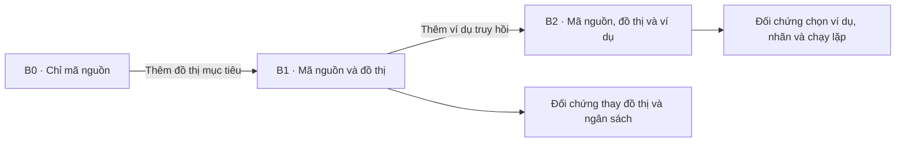
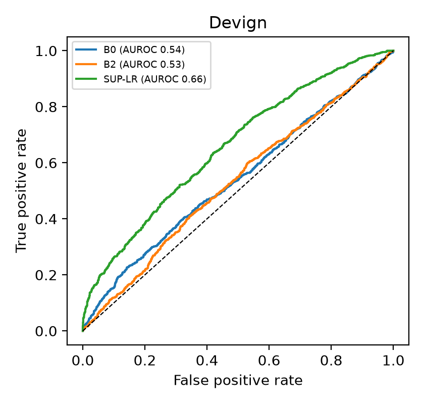
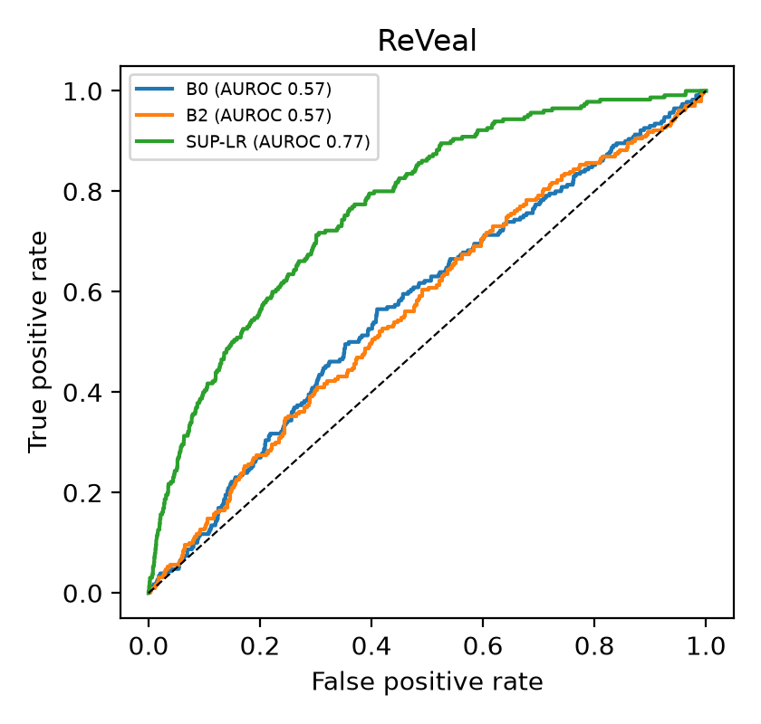
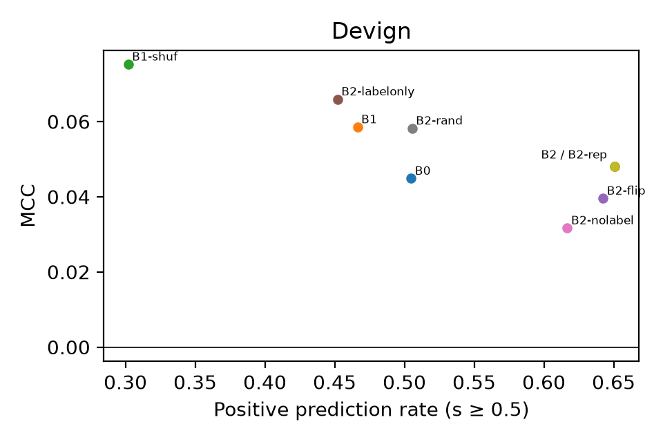
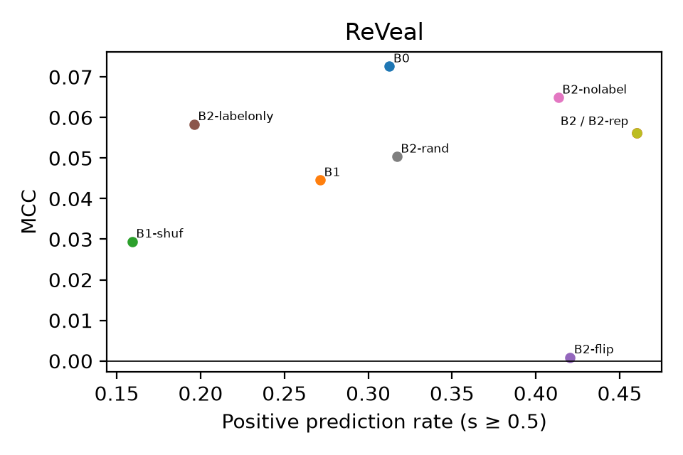

# GRACE có khái quát được ngoài GPT-4? Nghiên cứu tái lập có chẩn đoán với mô hình mã trọng số mở

## Tóm tắt

Chúng tôi tái lập GRACE, phương pháp đưa đồ thị chương trình và ví dụ truy hồi vào mô hình ngôn ngữ để phát hiện lỗ hổng ở cấp hàm. Thí nghiệm dùng Qwen3-Coder-30B-A3B-Instruct đã lượng tử hóa trên hai tập kiểm thử chính thức gồm 2.732 hàm Devign và 2.274 hàm ReVeal. So với prompt chỉ có mã nguồn, khi thêm đồ thị và một ví dụ truy hồi, AUROC thay đổi −0,0100 (KTC 95% [−0,0280; 0,0078]) trên Devign và −0,0079 ([−0,0357; 0,0183]) trên ReVeal. Cận trên của cả hai khoảng đều thấp hơn biên cải thiện 0,02. Kết luận về MCC phụ thuộc vào bộ ngưỡng, nhất là trên Devign. Ở ngưỡng B2 đã khóa, độ nhạy ròng khi đảo nhãn ví dụ là 20,28% và 10,69% sau khi trừ tỷ lệ đổi dự đoán khi chạy lặp. Hồi quy logistic trên embedding mã nguồn cố định vượt B2 về MCC, với chênh lệch 0,1593 trên Devign và 0,1939 trên ReVeal. Khi hai mô hình dùng cùng ngưỡng, khoảng tin cậy loại trừ mức tăng MCC 0,02 từ việc bổ sung điểm LLM vào mô hình kết hợp.

**Từ khóa:** phát hiện lỗ hổng phần mềm, nghiên cứu tái lập có chẩn đoán, học trong ngữ cảnh, đồ thị chương trình, suy luận chọn lọc

## 1. Giới thiệu

[GRACE](https://doi.org/10.1016/j.jss.2024.112031) phân loại từng hàm bằng cách đưa mã nguồn, đồ thị chương trình ở dạng văn bản và các ví dụ tương tự có nhãn vào mô hình ngôn ngữ. Lu và cộng sự báo cáo kết quả cải thiện với GPT-4 trên Devign (FFmpeg+Qemu), ReVeal và Big-Vul. Chúng tôi kiểm tra liệu kết quả đó có lặp lại với một mô hình trọng số mở có checkpoint và cấu hình suy luận được ghi lại hay không. Cụ thể, mỗi thành phần thêm vào prompt có giúp mô hình xếp các hàm có lỗ hổng lên cao hơn hay chủ yếu làm đổi tần suất dự đoán có lỗ hổng?

Chúng tôi bắt đầu từ prompt chỉ có mã nguồn, lần lượt thêm đồ thị của hàm mục tiêu và một ví dụ truy hồi. Các phép so sánh riêng thay đồ thị, mã ví dụ hoặc nhãn ví dụ. Chúng tôi cũng so bộ phát hiện này với các bộ phân loại có giám sát học từ nhãn của bộ dữ liệu. Cặp mô hình kết hợp kiểm tra điểm LLM có giúp ích sau khi truy vấn hay không. Thí nghiệm định tuyến kiểm tra khả năng nhận ra trước mẫu nào đáng truy vấn.

Chúng tôi báo cáo khoảng tin cậy ghép cặp trên toàn bộ tập kiểm thử Devign và ReVeal, xem xét riêng tác động của đồ thị và ví dụ, rồi so các biến thể prompt với các mốc có giám sát. Hồ sơ tái lập lưu cả bộ ngưỡng đăng ký và bộ ngưỡng hiệu chỉnh hồi cứu.

## 2. Bối cảnh và công trình liên quan

Các bộ phát hiện dựa trên đồ thị như [Devign](https://arxiv.org/abs/1909.03496) và [ReVeal](https://arxiv.org/abs/2009.07235) học từ cấu trúc chương trình. [GRACE](https://doi.org/10.1016/j.jss.2024.112031) đưa đồ thị dạng văn bản vào mô hình ngôn ngữ và truy hồi ví dụ theo độ tương tự. [Kaniewski và cộng sự](https://arxiv.org/abs/2609.37669) phân tích từng thành phần của các bộ phát hiện lỗ hổng có truy hồi và ghi nhận hiệu năng phụ thuộc vào mô hình nền và thiết lập đánh giá.

[Min và cộng sự](https://aclanthology.org/2022.emnlp-main.759/) phân biệt thông tin ví dụ cung cấp về phân phối đầu vào, tập nhãn và định dạng với thông tin về nhãn nào ứng với đầu vào nào. Chúng tôi thay mã và nhãn ví dụ để xem hai vai trò này biểu hiện ra sao trong phát hiện lỗ hổng. [Ding và cộng sự](https://arxiv.org/abs/2403.18624) ghi nhận nhiễu nhãn và trùng lặp giữa các tập dữ liệu. Chúng tôi báo cáo kết quả trên các tập chính thức và lặp lại phép so chính sau khi lọc các hàm kiểm thử trùng hoặc gần trùng với mã huấn luyện.

Embedding [CodeT5](https://aclanthology.org/2021.emnlp-main.685/) cố định và các chỉ số tĩnh của mã nguồn cho phép xây dựng hai loại mốc có giám sát. Khi dùng LLM làm bộ dự đoán thứ hai, bộ định tuyến phải quyết định có gọi LLM trước khi biết điểm của nó. Chúng tôi đếm số lần LLM sửa được lỗi của mô hình nền và số lần LLM thay một dự đoán đúng bằng dự đoán sai.

## 3. Giao thức tái lập

### 3.1 Dữ liệu và cách chia tập

Chúng tôi dùng các tập dữ liệu chính thức của Devign và ReVeal, với nhãn có lỗ hổng là lớp dương. Tập xác thực gồm 2.732 hàm Devign và 2.273 hàm ReVeal. Tập kiểm thử gồm 2.732 hàm Devign (1.255 hàm mang nhãn có lỗ hổng) và 2.274 hàm ReVeal (230 hàm mang nhãn có lỗ hổng).

Chúng tôi lấy ví dụ từ tập huấn luyện. Khi làm sạch kho, chúng tôi bỏ các ví dụ trùng hẳn với hàm trong tập xác thực hoặc tập kiểm thử, giữ một đại diện cho mỗi nhóm trùng có nhãn nhất quán và bỏ nhóm có nhãn mâu thuẫn. Kho sau khi lọc có 21.691 ví dụ Devign và 17.636 ví dụ ReVeal. Để kiểm tra ảnh hưởng của trùng lặp, chúng tôi loại khỏi tập kiểm thử những hàm trùng hoặc gần trùng với mã huấn luyện. Hai mẫu được đánh dấu gần trùng nếu độ tương tự Jaccard trên các cụm 3 token từ 0,90 trở lên. Sau khi lọc, tập kiểm thử còn 2.472 hàm Devign và 1.978 hàm ReVeal. [Đăng ký và giao thức dữ liệu](https://osf.io/fqgh2/)

### 3.2 Mô hình, prompt và các nhánh thí nghiệm

Chúng tôi dùng Qwen3-Coder-30B-A3B-Instruct lượng tử hóa GGUF Q4_K_M với cửa sổ ngữ cảnh 8.192 token. Các lượt tham chiếu dùng `llama-cpp-python` 0.3.16 và giải mã tham lam. Ở vị trí đầu tiên của đầu ra, chúng tôi lấy logit `z₀` và `z₁` của hai token nhãn để tính `s = exp(z₁) / (exp(z₀) + exp(z₁))`. Chúng tôi kiểm tra riêng định dạng phản hồi thô và tính hợp lệ của điểm. Mục 3.5 nêu các ngoại lệ về môi trường chạy.

Trong prompt, mã của hàm mục tiêu đứng trước khối đồ thị và khối ví dụ. Vị trí cuối dành cho câu trả lời nhị phân. Mã mục tiêu dùng tối đa 3.000 token, còn đồ thị và ví dụ dùng tối đa 1.500 token mỗi khối. Chúng tôi chuyển đồ thị thuộc tính mã do Joern tạo sang dạng văn bản. B1 lấy tối đa 40 nút và 80 cạnh đầu tiên. Khi truy hồi ví dụ, chúng tôi dùng biểu diễn CodeT5 rồi xếp hạng lại ứng viên theo độ tương tự từ vựng và cú pháp. Nhãn đi kèm ví dụ lấy từ kho huấn luyện. Nhãn của hàm mục tiêu không xuất hiện trong prompt.

| Nhánh | Thay đổi prompt hoặc đối chứng |
|---|---|
| B0 | Mã nguồn mục tiêu và hướng dẫn tác vụ, làm mốc zero-shot. |
| B1 | B0 có thêm ngữ cảnh đồ thị đã tuần tự hóa. |
| B1-shuf | B1 dùng đồ thị của hàm khác, ghép trong phạm vi ±10% số nút và cùng ngân sách đồ thị. Seed 42 là phép so ghép cặp chính. |
| B1-full | Tuần tự hóa đồ thị để lấp đầy ngân sách đồ thị, được diễn giải cùng lịch sử trình dựng prompt ở §3.5. |
| B2 | B1 có thêm một ví dụ được truy hồi và nhãn huấn luyện của ví dụ đó. |
| B2-rand | B1 có thêm một ví dụ được chọn ngẫu nhiên và nhãn huấn luyện. |
| B2-nolabel | B2 nhưng bỏ nhãn ví dụ. |
| B2-labelonly | B2 nhưng bỏ mã ví dụ và giữ nhãn ví dụ. |
| B2-flip | B2 nhưng đảo nhãn ví dụ. |
| B2-rep | Chạy lặp B2 với cùng prompt và thẻ cache repeat được cô lập. |
| B1-H2 và nhóm B3 | Các biến thể đồ thị tập trung vào bằng chứng và cặp tương phản, được báo cáo là thăm dò. |

B1 thêm đồ thị vào B0. B2 thêm ví dụ truy hồi có nhãn vào B1. Các đối chứng cho phép thay đồ thị, thay mã hoặc nhãn ví dụ, hoặc chạy lại cùng prompt để kiểm tra độ ổn định của dự đoán.

*Sơ đồ giao thức. Chuỗi chính lần lượt thêm từng thành phần vào prompt.*

### 3.3 Mốc có giám sát và suy luận chọn lọc

SUP-LR dùng hồi quy logistic trên embedding CodeT5 cố định 768 chiều. SUP-MLP dùng cùng embedding với một tầng ẩn 128 nút. SUP-METRIC dùng hồi quy logistic trên 26 chỉ số tĩnh của mã nguồn. Bảng chính báo cáo seed 42, còn hồ sơ tái lập lưu kết quả của seed 43 và 44. ALL-0 và ALL-1 luôn dự đoán một lớp cho mọi hàm. Để đối chiếu số ca sửa đúng, chúng tôi dùng một bộ dự đoán ngẫu nhiên Bernoulli có xác suất dự đoán lớp dương bằng tỷ lệ của LLM.

Hai mô hình kết hợp dùng hồi quy logistic với 34 đặc trưng nền và 3 fold phân tầng theo nhóm. P_pre chỉ dùng đặc trưng có sẵn trước khi truy vấn LLM. P_post bổ sung điểm B2, cờ điểm hợp lệ và các tương tác với dự đoán của mô hình nền. Khi điểm LLM không hợp lệ, cả hai phép phân tích dùng quyết định của P_pre. Trong phép so tại ngưỡng chung, chúng tôi chọn ngưỡng từ điểm dự đoán ngoài fold của P_pre trên tập xác thực rồi áp dụng cho cả hai mô hình. Chúng tôi cũng so hai mô hình tại các ngưỡng chọn riêng.

Trong thí nghiệm định tuyến, H3-B là bộ phân loại mặc định. Chúng tôi so bộ định tuyến theo lợi ích dự kiến học trên tập xác thực, bộ định tuyến theo độ tin cậy, cách chọn ngẫu nhiên với 20 seed và một đối chứng lý tưởng (oracle) dùng nhãn kiểm thử để tìm những ca LLM có thể sửa. Trong mỗi bộ dữ liệu, các phương án có cùng ngân sách truy vấn. Một ca được sửa khi LLM dự đoán đúng ở mẫu mà mô hình nền dự đoán sai. Một ca phát sinh lỗi khi LLM thay dự đoán đúng của mô hình nền bằng dự đoán sai.

### 3.4 Chỉ số và suy luận thống kê

Chúng tôi tính AUROC từ điểm liên tục và dùng average precision (AP, ghi là AUPRC trong bảng) để tóm tắt đường cong precision–recall. MCC, độ chính xác cân bằng (BA), F1 và tỷ lệ dự đoán dương được tính tại các ngưỡng đã định. Khi so tỷ lệ dự đoán dương, tất cả các nhánh dùng ngưỡng 0,5. Trên tập xác thực, chúng tôi chọn ngưỡng có MCC cao nhất trong lưới 0,01 đến 0,99, bước 0,01. Nếu nhiều ngưỡng cùng đạt MCC cao nhất, chọn ngưỡng gần 0,5 nhất. B2-flip và B2-rep dùng ngưỡng của B2. Với B0/B1, chúng tôi đánh giá riêng bộ ngưỡng đăng ký và bộ ngưỡng hiệu chỉnh hồi cứu.

Chúng tôi ghép điểm theo ID kiểm thử và tính khoảng tin cậy phân vị 95% từ 5.000 lượt bootstrap ghép cặp theo cụm (seed 20261117). Đơn vị lấy mẫu lại là commit trên Devign (2.068 cụm kiểm thử) và mã băm tệp nguồn trên ReVeal (646 cụm). Biên cải thiện là 0,02 AUROC và 0,03 MCC cho các phép so prompt, 0,15 MCC cho SUP-LR so với B2, và 0,02 MCC cho phép so hai mô hình kết hợp. Kết luận theo biên dựa trên khoảng tin cậy. Kiểm định McNemar hai phía so lỗi phân loại ghép cặp tại ngưỡng của từng hàng MCC. Giá trị p McNemar kiểm định chênh lệch lỗi ghép cặp, không phải kiểm định ΔMCC. Hai arm có thể dùng ngưỡng riêng và tỷ lệ dự đoán dương khác nhau. Bảng B dùng p Holm của PA1 theo họ 22 phép cho mỗi bộ ngưỡng B0/B1. Họ này gồm cả hai phép thăm dò B2/B3 và B1/B1-H2, cùng phép so P_pre/P_post ở hai ngưỡng riêng chọn trên tập xác thực. Phép so P_pre/P_post đánh giá dự đoán sau truy vấn. H5.3 đánh giá quyết định gọi mô hình trước truy vấn ở một ngân sách cố định. Bộ công cụ hiệu chỉnh theo 18 phép có kết quả, nên p Holm có thể khác.

### 3.5 Đăng ký, mức độ tiếp xúc và sai lệch

Chúng tôi đã xem các chỉ số kiểm thử của nhóm Tier 1 trên cả hai bộ dữ liệu trước khi đăng ký. Trong lượt I-06, nhóm cũng đã xem nhãn dự đoán thô do B2-flip trả về cho 230 hàm kiểm thử Devign. Nhật ký ghi rõ nhóm đã xem những kết quả nào ở từng nhánh. Những phép so đã được xem được báo cáo là bằng chứng từ dữ liệu đã có. [Đăng ký OSF](https://osf.io/fqgh2/) · [Bảng kê tiếp xúc](https://github.com/kazunguyen/GRACE-summary/blob/28405417703f24c594045074bdbe57b8c11a2d5e/preregistration_en.md#12-exposure-ledger--3-condition-audit-for-keep-vs-rerun)

| Hạng mục | Hệ quả khi diễn giải |
|---|---|
| Ngưỡng B0/B1 | Tính lại trên toàn bộ validation diễn ra sau khi đã tiếp xúc test. Chúng tôi giữ các giá trị đăng ký ban đầu và ghi kết quả dùng giá trị cập nhật là hồi cứu. |
| Trình dựng prompt B1-full | Sau khi tiếp xúc tập kiểm thử, chúng tôi sửa trình dựng prompt cho lượt test. Hai phiên bản test khác nhau ở 4.753/5.006 prompt. Bản sửa tái tạo đúng phần đồ thị của cả 5.005 prompt xác thực, nên lượt test đã sửa giữ ngưỡng 0,99 trên Devign và 0,01 trên ReVeal. [Kiểm toán trình dựng prompt](https://github.com/kazunguyen/GRACE-summary/blob/28405417703f24c594045074bdbe57b8c11a2d5e/worklogs/2026-11-12_bao_cao_metric_cac_arm_hoan_tat.md#L405) |
| B2-rand ReVeal, seed 42/43 | Mỗi lượt gộp bản ghi từ hai cấu hình môi trường chạy. Cả hai dùng SciPy 1.16.3. Seed 44 dùng một cấu hình cho toàn bộ tập kiểm thử ReVeal và cho cùng kết luận theo biên AUROC. Chưa có phép so cùng ID và prompt giữa hai cấu hình. |
| B2-nolabel, B2-labelonly và B2-rep trên tập kiểm thử | Đã đối chiếu bản ghi, mô hình, điểm số và log của sáu tiến trình. Bằng chứng về việc nạp các lớp lên GPU và hồ sơ môi trường của chính các tiến trình này còn thiếu. [Kiểm toán môi trường chạy](https://github.com/kazunguyen/GRACE-summary/blob/28405417703f24c594045074bdbe57b8c11a2d5e/Runs-management/runtime_session_reconciliation_20261110/REPORT.md#L9) |
| B1-H2 và nhóm B3 | Các biến thể đồ thị có bằng chứng và cặp tương phản là thăm dò theo Phương án 1. Cấu hình B3 được báo cáo dùng một cặp ví dụ cố định cho mỗi bộ dữ liệu. |
| Phạm vi bài hội thảo | Giai đoạn 2 sẽ đánh giá đầy đủ mức độ liên quan về cơ chế và phân xử nhãn. Đợt chấm A/B 30 ca cung cấp kết quả mô tả. |

## 4. Kết quả

### 4.1 Tái lập (RQ1)

Khoảng tin cậy của ΔAUROC loại trừ mức tăng 0,02 khi so B2 với B0 trên cả hai bộ dữ liệu. Chênh lệch là −0,0100 [−0,0280; 0,0078] trên Devign và −0,0079 [−0,0357; 0,0183] trên ReVeal (KTC 95%). Với ngưỡng đăng ký, khoảng MCC của Devign vẫn cho phép mức tăng 0,03, còn khoảng của ReVeal loại trừ mức tăng này. Khi dùng ngưỡng hiệu chỉnh hồi cứu, cả hai khoảng MCC đều loại trừ mức tăng đó.

**Bảng A. Chỉ số kiểm thử của một số nhánh, seed 42 cho các mô hình.** MCC dùng ngưỡng ghi trong ngoặc. B0/B1 dùng ngưỡng hồi cứu, B2 và SUP-LR dùng ngưỡng đã khóa trên tập xác thực. Cột F1 dùng quy tắc chung 0,5. ALL-0 luôn dự đoán âm, ALL-1 luôn dự đoán dương, còn RAND(p) dự đoán dương với xác suất bằng tỷ lệ mẫu dương trên tập kiểm thử. Dấu gạch ngang chỉ những chỉ số mà bản xuất để trống.

| Nhánh | Devign AUROC | Devign AUPRC | Devign MCC (τ) | Devign F1 @ 0,5 | ReVeal AUROC | ReVeal AUPRC | ReVeal MCC (τ) | ReVeal F1 @ 0,5 |
|---|---:|---:|---:|---:|---:|---:|---:|---:|
| ALL-0 | — | — | — | 0,0000 | — | — | — | 0,0000 |
| ALL-1 | — | — | — | 0,6295 | — | — | — | 0,1837 |
| RAND(p) | — | — | — | 0,4594 | — | — | — | 0,1011 |
| B0 | 0,5405 | 0,5153 | 0,0922 (0,98) | 0,5042 | 0,5740 | 0,1260 | 0,0874 (0,30) | 0,2019 |
| B1 | 0,5335 | 0,5023 | 0,0788 (0,98) | 0,4943 | 0,5841 | 0,1238 | 0,0523 (0,63) | 0,1795 |
| B2 | 0,5305 | 0,4856 | 0,0597 (0,70) | 0,5592 | 0,5662 | 0,1221 | 0,0645 (0,12) | 0,1959 |
| SUP-LR | 0,6559 | 0,6321 | 0,2190 (0,37) | 0,5434 | 0,7709 | 0,2841 | 0,2584 (0,15) | 0,2323 |

**MCC theo ngưỡng đăng ký cho B0 và B1.** Devign: B0 0,0292 (τ = 0,08), B1 0,0641 (τ = 0,88). ReVeal: B0 0,0856 (τ = 0,44), B1 0,0532 (τ = 0,74). Các giá trị B0/B1 trong Bảng A ở trên dùng ngưỡng hồi cứu.

**Bảng B. Một số phép so ghép cặp trên tập kiểm thử.** Bảng ghi chiều chênh lệch, KTC 95% từ bootstrap ghép cặp theo cụm và kết luận của PA1 theo biên δ. Các hàng MCC có p McNemar hai phía và p hiệu chỉnh Holm. Với các cặp dùng cùng ngưỡng ở cả hai bộ, bảng ghi p Holm theo họ hiệu chỉnh hồi cứu. AUROC tính từ điểm liên tục. Các hàng trong bảng có 0 lượt bootstrap suy biến.

| Phép so | Chỉ số và ngưỡng | Devign Δ [KTC 95%] và kết luận | Devign p thô / Holm | ReVeal Δ [KTC 95%] và kết luận | ReVeal p thô / Holm |
|---|---|---|---:|---|---:|
| B2 − B0 | AUROC | −0,0100 [−0,0280; 0,0078] · Loại trừ mức tăng ≥ δ | — / — | −0,0079 [−0,0357; 0,0183] · Loại trừ mức tăng ≥ δ | — / — |
| B2 − B0 | MCC, đăng ký | +0,0306 [−0,0080; 0,0681] · Chưa đủ bằng chứng | 0,0070 / 0,0633 | −0,0211 [−0,0634; 0,0207] · Loại trừ mức tăng ≥ δ | < 10⁻⁴ / < 10⁻⁴ |
| B2 − B0 | MCC, hồi cứu | −0,0325 [−0,0750; 0,0106] · Loại trừ mức tăng ≥ δ | 0,0012 / 0,0132 | −0,0229 [−0,0630; 0,0153] · Loại trừ mức tăng ≥ δ | < 10⁻⁴ / < 10⁻⁴ |
| B2 − B2-rand | AUROC | −0,0013 [−0,0158; 0,0140] · Loại trừ mức tăng ≥ δ | — / — | −0,0143 [−0,0352; 0,0064] · Loại trừ mức tăng ≥ δ | — / — |
| B2 − B2-rand | MCC, ngưỡng khóa | +0,0254 [−0,0152; 0,0673] · Chưa đủ bằng chứng | 0,1930 / 0,8045 | +0,0192 [−0,0299; 0,0675] · Chưa đủ bằng chứng | < 10⁻⁴ / < 10⁻⁴ |
| B2-nolabel − B1 | AUROC | −0,0066 [−0,0183; 0,0052] · Loại trừ mức tăng ≥ δ | — / — | −0,0120 [−0,0288; 0,0049] · Loại trừ mức tăng ≥ δ | — / — |
| B2-nolabel − B1 | MCC, đăng ký | −0,0123 [−0,0437; 0,0181] · Loại trừ mức tăng ≥ δ | 0,2836 / 0,6513 | +0,0303 [−0,0132; 0,0733] · Chưa đủ bằng chứng | < 10⁻⁴ / < 10⁻⁴ |
| B2-nolabel − B1 | MCC, hồi cứu | −0,0270 [−0,0587; 0,0058] · Loại trừ mức tăng ≥ δ | 0,0170 / 0,1193 | +0,0312 [−0,0130; 0,0755] · Chưa đủ bằng chứng | < 10⁻⁴ / < 10⁻⁴ |
| B2-labelonly − B1 | AUROC | +0,0128 [0,0050; 0,0204] · Chưa đủ bằng chứng | — / — | +0,0165 [0,0041; 0,0294] · Chưa đủ bằng chứng | — / — |
| B1 − B0 | AUROC | −0,0070 [−0,0197; 0,0057] · Loại trừ mức tăng ≥ δ | — / — | +0,0101 [−0,0092; 0,0287] · Chưa đủ bằng chứng | — / — |
| B1 − B0 | MCC, đăng ký | +0,0349 [−0,0084; 0,0759] · Chưa đủ bằng chứng | < 10⁻⁴ / 0,0010 | −0,0324 [−0,0708; 0,0049] · Loại trừ mức tăng ≥ δ | < 10⁻⁴ / < 10⁻⁴ |
| B1 − B0 | MCC, hồi cứu | −0,0134 [−0,0459; 0,0183] · Loại trừ mức tăng ≥ δ | 0,4159 / 1,0000 | −0,0351 [−0,0743; 0,0014] · Loại trừ mức tăng ≥ δ | < 10⁻⁴ / < 10⁻⁴ |
| B1 − B1-shuf | AUROC | −0,0096 [−0,0233; 0,0041] · Loại trừ mức tăng ≥ δ | — / — | +0,0064 [−0,0161; 0,0296] · Chưa đủ bằng chứng | — / — |
| B1 − B1-shuf | MCC, đăng ký | −0,0207 [−0,0600; 0,0198] · Loại trừ mức tăng ≥ δ | 0,1303 / 0,6513 | +0,0154 [−0,0220; 0,0547] · Chưa đủ bằng chứng | < 10⁻⁴ / < 10⁻⁴ |
| B1 − B1-shuf | MCC, hồi cứu | −0,0060 [−0,0426; 0,0322] · Chưa đủ bằng chứng | 0,7263 / 1,0000 | +0,0145 [−0,0250; 0,0559] · Chưa đủ bằng chứng | < 10⁻⁴ / < 10⁻⁴ |
| SUP-LR − B2 | MCC, ngưỡng khóa | +0,1593 [0,0952; 0,2267] · Mức tăng đạt δ | < 10⁻⁴ / < 10⁻⁴ | +0,1939 [0,1136; 0,2714] · Mức tăng đạt δ | < 10⁻⁴ / < 10⁻⁴ |

MCC của B2 thấp hơn 0,15 trên cả hai tập kiểm thử. Trên Devign, F1 của B2 là 0,5592 ở ngưỡng chung 0,5 (Bảng A) và 0,5485 ở ngưỡng B2 đã khóa. Mốc luôn dự đoán có lỗ hổng đạt F1 0,6295. Trong phép so chính của bài gốc, Lu và cộng sự báo cáo F1 là 0,6511 trên FFmpeg+Qemu và 0,4313 trên ReVeal. Các số đó đến từ một mô hình và mẫu đánh giá khác. Phép so B2−B0 ở đây dùng cùng mô hình và cùng ID kiểm thử. [Bài báo GRACE gốc](https://doi.org/10.1016/j.jss.2024.112031)

*Hình 1. Đường cong ROC của một số nhánh prompt và mốc logistic có giám sát trên từng tập test chính thức. Đường chéo biểu thị khả năng xếp hạng ngẫu nhiên.*

### 4.2 Tác động của ví dụ (RQ2)

Ở ngưỡng B2 đã khóa, đảo nhãn ví dụ cho độ nhạy ròng 20,28 điểm phần trăm [18,75; 21,76] trên Devign và 10,69 [9,15; 12,25] trên ReVeal (KTC 95%). Số dự đoán đổi lần lượt là 554 và 243. Chạy lặp B2 không làm đổi dự đoán nào trên 5.006 hàm. Khoảng tin cậy của Devign nằm trên mốc 15 điểm phần trăm, còn khoảng của ReVeal nằm dưới mốc này.

**Bảng C. Độ nhạy với nhãn ví dụ tại ngưỡng B2 đã khóa.** Khoảng tin cậy tính cho thay đổi ròng theo điểm phần trăm, bằng tỷ lệ thay đổi khi đảo nhãn trừ tỷ lệ thay đổi khi chạy lặp.

| Bộ dữ liệu | N | Ngưỡng B2 | Số đổi khi đảo nhãn | Số đổi khi lặp | Điểm phần trăm ròng [KTC 95%] |
|---|---:|---:|---:|---:|---:|
| Devign | 2.732 | 0,70 | 554 | 0 | 20,28 [18,75; 21,76] |
| ReVeal | 2.274 | 0,12 | 243 | 0 | 10,69 [9,15; 12,25] |

Trong hai phép so B2−B2-rand và B2-nolabel−B1, cận trên của KTC cho ΔAUROC đều dưới 0,02 trên cả hai bộ dữ liệu (Bảng B). Trên ReVeal, phép so ở seed 44 dùng một cấu hình môi trường chạy và cho ΔAUROC B2−B2-rand là −0,0087 [−0,0304; 0,0142]. B2-labelonly cao hơn B1 0,0128 [0,0050; 0,0204] AUROC trên Devign và 0,0165 [0,0041; 0,0294] trên ReVeal. Cả hai ước lượng điểm đều dưới 0,02. Do khoảng tin cậy của B2−B1 chứa 0, chúng tôi dùng tiêu chí tương đương trong Phương án 1 cho B2-labelonly và B2. Cận trên của chênh lệch tuyệt đối về AUROC là 0,0345 trên Devign và 0,0588 trên ReVeal, đều vượt biên tương đương 0,02. Trên ReVeal, B2-labelonly cao hơn B2 0,0344 AUROC [0,0103; 0,0588]. Hai trong ba điều kiện về nội dung ví dụ đạt yêu cầu. Chưa xác lập được tương đương.

### 4.3 Tác động của đồ thị (RQ3)

Thêm đồ thị vào B0 làm AUROC thay đổi −0,0070 [−0,0197; 0,0057] trên Devign và +0,0101 [−0,0092; 0,0287] trên ReVeal (KTC 95%). Chỉ Devign loại trừ mức tăng 0,02. Phép so B1−B1-shuf cho cùng kết luận trên từng bộ dữ liệu (Bảng B). B1-full đạt AUROC 0,5311 trên Devign và 0,5782 trên ReVeal, so với 0,5335 và 0,5841 của B1. Do lịch sử sửa trình dựng prompt, khó quy toàn bộ chênh lệch cho ngân sách đồ thị. Phụ lục B trình bày B1-H2 theo nhóm có và thiếu bằng chứng.

### 4.4 Xếp hạng và điểm hoạt động (RQ4)

Thêm ví dụ truy hồi làm tăng tỷ lệ dự đoán dương tại ngưỡng chung 0,5. KTC của ΔAUROC B2−B1 đều chứa 0 (Devign −0,0030 [−0,0186; 0,0122], ReVeal −0,0179 [−0,0400; 0,0041]). Tỷ lệ dự đoán dương tăng từ 46,63% lên 65,08% trên Devign và từ 27,13% lên 46,00% trên ReVeal. AUROC cao nhất trong các nhánh LLM là 0,6005 ở B2-labelonly trên ReVeal, dưới mốc 0,62.

*Hình 2. Tỷ lệ dự đoán dương và MCC tại quy tắc quyết định chung 0,5 cho các nhánh prompt seed 42. Mỗi biểu đồ ứng với một bộ dữ liệu.*

### 4.5 Mốc có giám sát và giá trị bổ sung (RQ5)

SUP-LR cao hơn B2 0,1593 MCC [0,0952; 0,2267] trên Devign và 0,1939 [0,1136; 0,2714] trên ReVeal (KTC 95%). Cả hai ước lượng điểm đều vượt 0,15 và cả hai khoảng tin cậy nằm trên 0. AUROC của SUP-LR là 0,6559 trên Devign và 0,7709 trên ReVeal. Chỉ ReVeal đạt tiêu chí AUROC riêng là 0,68. Khi thêm điểm B2 vào bộ đặc trưng của P_pre, các khoảng tin cậy tại ngưỡng chung loại trừ mức tăng MCC 0,02 (Bảng D).

**Bảng D. Giá trị của điểm B2 sau truy vấn.** Hai mô hình trong mỗi hàng dùng cùng ngưỡng, được chọn từ dự đoán của P_pre trên tập xác thực.

| Bộ dữ liệu | τ chung | MCC P_pre | MCC P_post | ΔMCC P_post − P_pre [KTC 95%] |
|---|---:|---:|---:|---:|
| Devign | 0,53 | 0,2866 | 0,2858 | −0,0008 [−0,0095; 0,0080] |
| ReVeal | 0,20 | 0,3769 | 0,3690 | −0,0078 [−0,0169; −0,0010] |

Khi dùng hai ngưỡng xác thực chọn riêng, cận trên của chênh lệch MCC trên ReVeal tăng lên 0,0260. Tại ngưỡng chung, khoảng tin cậy của ReVeal nằm hoàn toàn dưới 0.

So với H3-B trên toàn bộ tập kiểm thử, B2 sửa 397 lỗi và gây thêm 718 lỗi trên Devign. Trên ReVeal, B2 sửa 164 lỗi và gây thêm 875 lỗi. Phân vị 97,5% của số ca sửa được nhờ bộ dự đoán ngẫu nhiên có cùng tỷ lệ dự đoán dương là 465,05 và 176,15. Trên Devign, phương án luôn đoán âm sửa 764 ca và gây thêm 998 lỗi. Phương án luôn đoán dương sửa 257 ca và gây thêm 713 lỗi. Trên ReVeal, hai cặp số tương ứng là 201/116 và 114/1.843. Nếu biết trước để chọn dự đoán đúng mỗi khi ít nhất một trong hai mô hình đoán đúng, độ chính xác đạt 77,16% trên Devign và 93,36% trên ReVeal, so với 62,63% và 86,15% của H3-B.

Ở ngân sách truy vấn 10%, định tuyến theo lợi ích thay đổi BA so với định tuyến ngẫu nhiên +0,0204 [0,0138; 0,0270] trên Devign và −0,0487 [−0,0748; −0,0249] trên ReVeal. Chỉ ReVeal đáp ứng các tiêu chí H5.3 để loại trừ lợi ích của định tuyến. Phụ lục C trình bày các mức ngân sách khác.

### 4.6 Độ liên quan của ví dụ truy hồi và lỗi (RQ6)

Cả hai người chấm chọn ví dụ truy hồi B2 ở cả 30 ca thăm dò (15 ca mỗi bộ dữ liệu, Cohen’s κ = 1,00 trước phân xử). Mỗi ca ghép một ví dụ truy hồi B2 với một ví dụ ngẫu nhiên B2-rand từ lượt chạy seed 42. Người chấm thấy hàm mục tiêu và hai ví dụ ký hiệu A/B. Phiếu chấm không tiết lộ nhánh tạo ví dụ, nhãn bộ dữ liệu hay kết quả của mô hình. Ngoài lựa chọn cuối, người chấm ghi nhận thao tác đích (sink), biến, điều kiện kiểm tra (guard) và bằng chứng trong mã. Sau khi nhận đủ hai phiếu, điều phối viên mới đối chiếu bảng khóa A/B.

| Kết quả chấm thăm dò | Devign | ReVeal | Tổng |
|---|---:|---:|---:|
| Mục tiêu được cả hai người chấm | 15 | 15 | 30 |
| Đồng thuận về lựa chọn A/B cuối cùng | 15/15 | 15/15 | 30/30 |
| Cả hai chọn ví dụ B2 truy hồi | 15/15 | 15/15 | 30/30 |
| Ca cần phân xử | 0 | 0 | 0 |

Hai người cùng chọn A ở 15 ca và B ở 15 ca. Họ cũng đồng thuận ở cả tám cột rubric, nhưng cách chấm các cột này phần lớn đi theo lựa chọn cuối. Lý do thường gặp là hai đoạn mã cùng họ hàm, API hoặc mô-đun. Đợt thăm dò chỉ báo kết quả mô tả. Vì tất cả lựa chọn đều nhất trí, không có hai nhóm độ liên quan để ước lượng chênh lệch độ chính xác và khoảng tin cậy. Giai đoạn 2 sẽ đánh giá độ liên quan ở cấp cơ chế, độ chính xác theo nhóm và phân xử nhãn. Một phiếu đã có trên kho mã khi người còn lại chấm xong. Nhật ký của lượt nộp sau ghi rằng người chấm không mở phiếu có trước trong lúc chấm.

## 5. Thảo luận

B2 dự đoán có lỗ hổng thường xuyên hơn B1 tại ngưỡng chung, dù các khoảng tin cậy ghép cặp của ΔAUROC đều chứa 0. Khi đảo nhãn ví dụ, các dự đoán cũng thay đổi dù mã mục tiêu và mã ví dụ giữ nguyên. Báo cáo AUROC cùng MCC hoặc F1 giúp phân biệt thay đổi về thứ hạng với thay đổi ở một ngưỡng cụ thể.

Người chấm ưu tiên các ví dụ truy hồi vì mã và chức năng tương đồng. Trên toàn bộ tập kiểm thử, khoảng tin cậy AUROC loại trừ mức cải thiện đã đặt ra so với ví dụ ngẫu nhiên. Một đợt chấm lớn hơn có nhãn về cơ chế gây lỗ hổng có thể kiểm tra liệu kiểu liên quan đó có cung cấp thêm thông tin so với sự tương đồng của mã.

SUP-LR là mốc để đánh giá bộ dự đoán chỉ dùng prompt. Phép so hai mô hình kết hợp ở ngưỡng chung kiểm tra điểm LLM có bổ sung thông tin sau khi mô hình đã dùng các đặc trưng nền hay không. Kết quả định tuyến cho thấy muốn gọi B2 có chọn lọc, cần nhận ra trước những trường hợp B2 có khả năng sửa đúng. Oracle ước lượng mức có thể đạt nếu biết trước các ca đó.

## 6. Các đe dọa đến tính hợp lệ

**Tính hợp lệ nội tại.** Nhóm đã xem kết quả kiểm thử trước khi đăng ký. Việc hiệu chỉnh hồi cứu B0/B1 làm đổi kết quả phụ thuộc ngưỡng, nhất là trên Devign. B2-rand trên ReVeal ở seed 42 và 43 gộp dữ liệu từ hai cấu hình môi trường chạy. Seed 44 lặp phép so với một cấu hình duy nhất. Lịch sử sửa trình dựng prompt cũng giới hạn cách diễn giải phép so ngân sách đồ thị với B1-full.

**Tính hợp lệ của phép đo.** Nhãn ở cấp hàm có thể sai hoặc bỏ sót ngữ cảnh từ các hàm khác. Phép lọc trùng lặp xử lý các trường hợp chồng lặp với tập huấn luyện đã nhận diện được. Tỷ lệ dự đoán dương tại ngưỡng chung cho biết mô hình gán nhãn có lỗ hổng thường xuyên đến mức nào. Chấm thăm dò 30 ca chủ yếu phản ánh sự tương đồng về chức năng. Độ liên quan về cơ chế và nhiễu nhãn cần một đợt rà soát lớn hơn.

**Tính hợp lệ bên ngoài và thống kê.** Chúng tôi đánh giá một checkpoint trọng số mở đã lượng tử hóa, hai bộ dữ liệu và một ngân sách prompt. Nghiên cứu GPT-4 gốc dùng mẫu đánh giá khác. Phép so đồ thị trên ReVeal vẫn cho phép mức tăng AUROC đã định. Phụ lục D trình bày riêng các lượt API cũ vì cùng một prompt có thể cho kết quả khác nhau và nhà cung cấp từng trả phản hồi rỗng. Các kết quả B3, B1-H2 và chấm mù chỉ mô tả các cấu hình và mẫu thăm dò đã nêu.

## 7. Kết luận

Trong lần tái lập bằng Qwen, khoảng tin cậy ghép cặp loại trừ mức tăng AUROC 0,02 của prompt GRACE đầy đủ so với prompt chỉ có mã nguồn trên Devign và ReVeal. Kết luận về MCC trên Devign phụ thuộc bộ ngưỡng. Khi dùng ngưỡng chung, mức tăng MCC từ việc bổ sung điểm B2 vào mô hình kết hợp không đạt biên 0,02 trên cả hai bộ dữ liệu. Giao thức và hồ sơ phân tích có tại [đăng ký OSF](https://osf.io/fqgh2/) và [kho mã dự án](https://github.com/kazunguyen/GRACE-summary).

## Tài liệu tham khảo

1. Lu, G., Ju, X., Chen, X., Pei, W., và Cai, Z. (2024). GRACE: Empowering LLM-based software vulnerability detection with graph structure and in-context learning. *Journal of Systems and Software*, 212, 112031. [DOI](https://doi.org/10.1016/j.jss.2024.112031)
2. Zhou, Y., Liu, S., Siow, J., Du, X., và Liu, Y. (2019). Devign: Effective Vulnerability Identification by Learning Comprehensive Program Semantics via Graph Neural Networks. *NeurIPS*. [Bài báo](https://arxiv.org/abs/1909.03496)
3. Chakraborty, S., Krishna, R., Ding, Y., và Ray, B. (2022). Deep Learning Based Vulnerability Detection: Are We There Yet? *IEEE Transactions on Software Engineering*. [Bài báo](https://arxiv.org/abs/2009.07235)
4. Wang, Y., Wang, W., Joty, S., và Hoi, S. C. H. (2021). CodeT5: Identifier-aware Unified Pre-trained Encoder-Decoder Models for Code Understanding and Generation. *EMNLP*. [Bài báo](https://aclanthology.org/2021.emnlp-main.685/)
5. Min, S., và cộng sự. (2022). Rethinking the Role of Demonstrations: What Makes In-Context Learning Work? *EMNLP*. [Bài báo](https://aclanthology.org/2022.emnlp-main.759/)
6. Ding, Y., và cộng sự. (2024). Vulnerability Detection with Code Language Models: How Far Are We? [Bản thảo](https://arxiv.org/abs/2403.18624)
7. Kaniewski, S., Krämer, T., Bächle, J., Enzweiler, M., Menth, M., và Heer, T. (2026). Retrieve, Reproduce, Reveal: Dissecting Retrieval-Augmented Software Vulnerability Detection. [Bản thảo](https://arxiv.org/abs/2609.37669)

## Phụ lục A. Độ nhạy với mẫu trùng tập huấn luyện

Sau khi loại các mẫu trùng hoặc gần trùng với mã huấn luyện, ΔAUROC B2−B0 là −0,0204 [−0,0385; −0,0022] trên Devign và −0,0242 [−0,0593; 0,0105] trên ReVeal. Theo ngưỡng đăng ký, ΔMCC là +0,0179 [−0,0211; 0,0573] và −0,0273 [−0,0695; 0,0168]. Theo ngưỡng hồi cứu, các giá trị lần lượt là −0,0497 [−0,0940; −0,0049] và −0,0339 [−0,0737; 0,0068]. Sau khi lọc, cả hai khoảng tin cậy của ΔAUROC vẫn loại trừ mức tăng 0,02. Khoảng của ΔMCC trên Devign theo ngưỡng đăng ký vẫn cho phép mức tăng 0,03.

Trên Devign sau lọc trùng, cả KTC ΔAUROC và KTC ΔMCC hồi cứu đều nằm dưới 0, cho thấy B2 thấp hơn B0 theo hai chỉ số trong phân tích này.

## Phụ lục B. Bằng chứng đồ thị và ví dụ tương phản thăm dò

So với B1, B1-H2 cho ΔAUROC +0,031 [−0,004; 0,065] trên 934 hàm Devign có bằng chứng và +0,061 [−0,008; 0,127] trên 408 hàm ReVeal có bằng chứng. Trong nhóm thiếu bằng chứng, hai ước lượng lần lượt là +0,002 [−0,014; 0,019] và +0,002 [−0,020; 0,024]. Khoảng tin cậy của nhóm có bằng chứng khá rộng. Mỗi kết quả áp dụng cho nhóm tương ứng.

Cấu hình B3 thăm dò dùng một cặp ví dụ cố định cho mỗi bộ dữ liệu. So với B2 tại ngưỡng 0,5, tỷ lệ dự đoán dương thay đổi −1,10 và +17,02 điểm phần trăm trên Devign và ReVeal. Chênh lệch AUROC lần lượt là +0,0047 [−0,0135; 0,0228] và −0,0369 [−0,0650; −0,0079]. Các ước lượng này chỉ áp dụng cho những lượt chạy với cặp ví dụ cố định.

## Phụ lục C. Độ nhạy theo ngân sách

| Bộ dữ liệu | Ngân sách | Số truy vấn | BA khi định tuyến theo lợi ích | BA ngẫu nhiên (trung bình) | Số ca sửa đúng / gây thêm lỗi |
|---|---:|---:|---:|---:|---:|
| Devign | 5% | 137 | 0,6448 | 0,6336 | 34 / 15 |
| Devign | 10% | 274 | 0,6482 | 0,6279 | 55 / 25 |
| Devign | 25% | 683 | 0,6444 | 0,6104 | 128 / 97 |
| ReVeal | 5% | 114 | 0,6643 | 0,6943 | 47 / 24 |
| ReVeal | 10% | 228 | 0,6402 | 0,6888 | 68 / 41 |
| ReVeal | 25% | 569 | 0,6065 | 0,6651 | 85 / 93 |

*Mốc ngẫu nhiên là trung bình của 20 lượt chọn cùng ngân sách. Số ca sửa đúng và gây thêm lỗi được tính bằng cách so dự đoán sau định tuyến với dự đoán ban đầu của H3-B.*

## Phụ lục D. Các lượt API lịch sử và dev-100

Trước khi tái lập với mô hình trọng số mở, nhóm đã thăm dò các biến thể GRACE qua API thương mại. Đợt kiểm toán tái tạo chỉ số của 36 lượt trên toàn bộ tập kiểm thử (18 lượt mỗi bộ dữ liệu, tổng cộng 90.108 cặp lượt chạy và hàm mục tiêu). Sai lệch tuyệt đối lớn nhất so với chỉ số đã lưu dưới 0,001. Bảng tóm tắt các lượt này cùng kết quả DeepSeek và dev-100 được ghi riêng trong đề cương. Các phân tích có trước đợt đánh giá hiện tại và được dùng làm bằng chứng thăm dò.

| Phân tích lịch sử | Devign | ReVeal |
|---|---|---|
| 36 lượt API, khoảng giá trị giữa các cấu hình (MCC kiểm thử) | 0,0510 đến 0,1079 | −0,0088 đến 0,0706 |
| Qwen3-Coder-480B trên Vertex, bản cơ sở → Full V1+V2 (MCC kiểm thử) | 0,0691 → 0,0721 | 0,0226 → 0,0505 |
| DeepSeek-V4.1-Flash, GRACE đầy đủ → H2-guarded (MCC kiểm thử) | 0,067 → 0,054 | 0,097 → 0,066 |
| Qwen3-Coder-480B, B2 → B3 trên dev-100 (MCC) | −0,030 → −0,110 | 0,145 → 0,189 |
| Độ nhạy nhãn ròng của B3 trên dev-100 | 18% | 13% |

Trên dev-100, tỷ lệ dự đoán dương của Devign tăng từ 29% lên 66% khi dùng cặp tương phản. Đề cương ghi KTC của ΔMCC chứa 0. Độ nhạy nhãn ròng của B2 là 31%, còn mức biến động khi chạy lặp là 4%. Kiểm toán API ghi nhận sáu nhãn dự đoán thay đổi giữa hai lượt gọi Vertex dù mã băm prompt giống nhau, và 9.206 phản hồi rỗng từ nhà cung cấp. [Bảng đủ 36 lượt](https://github.com/kazunguyen/GRACE-summary/blob/main/%5BOfficial%5D-Paper/evidence/historical_api_36.csv) · [Kết quả lịch sử tại §2.1 và §2.3 của đề cương](https://github.com/kazunguyen/GRACE-summary/blob/main/docs/20261111/Option1-De_cuong_nghien_cuu_GRACE_hop_nhat.docx)

## Nguồn đối chiếu của bản thảo

- [Đề cương chuẩn Option 1](https://github.com/kazunguyen/GRACE-summary/blob/main/docs/20261111/Option1-De_cuong_nghien_cuu_GRACE_hop_nhat.docx), [lộ trình rút gọn](https://github.com/kazunguyen/GRACE-summary/blob/main/docs/20261111/Option1-Danh_gia_tien_do_va_lo_trinh_GRACE_2026-11-11.docx) và [nội dung đăng ký trong repo](https://github.com/kazunguyen/GRACE-summary/blob/28405417703f24c594045074bdbe57b8c11a2d5e/preregistration_en.md).
- Bảng A–C. [CSV của kit theo ngưỡng đăng ký](https://github.com/kazunguyen/GRACE-summary/tree/main/%5BOfficial%5D-Paper/evidence/tables_prereg), [CSV theo ngưỡng hồi cứu](https://github.com/kazunguyen/GRACE-summary/tree/main/%5BOfficial%5D-Paper/evidence/tables_corrected), [các phép so PA1 đầy đủ](https://github.com/kazunguyen/GRACE-summary/blob/28405417703f24c594045074bdbe57b8c11a2d5e/Runs-management/analysis_pa1_20261111/full_tables/contrasts.csv) và [báo cáo metric ngày 12/11](https://github.com/kazunguyen/GRACE-summary/blob/28405417703f24c594045074bdbe57b8c11a2d5e/worklogs/2026-11-12_bao_cao_metric_cac_arm_hoan_tat.md). H3.1c trong CSV của kit là phân tích thăm dò B1-H2.
- Bảng C trong bài dùng các hàng full và locked_B2 của [sổ độ nhạy nhãn PA1](https://github.com/kazunguyen/GRACE-summary/blob/28405417703f24c594045074bdbe57b8c11a2d5e/Runs-management/analysis_pa1_20261111/full_tables/sensitivity.csv). Bảng C của kit dùng ngưỡng chung 0,5.
- Bảng D và định tuyến. [Phân tích ngưỡng chung](https://github.com/kazunguyen/GRACE-summary/blob/main/%5BOfficial%5D-Paper/evidence/h52_shared_threshold.json) và [báo cáo metric §1.5](https://github.com/kazunguyen/GRACE-summary/blob/28405417703f24c594045074bdbe57b8c11a2d5e/worklogs/2026-11-12_bao_cao_metric_cac_arm_hoan_tat.md#L194).
- RQ6. [Nhật ký chấm 30 ca và kết quả giải mã A/B](https://github.com/kazunguyen/GRACE-summary/blob/28405417703f24c594045074bdbe57b8c11a2d5e/worklogs/2026-11-12_step8_cham_mu_30_ca.md).
- [Đối chiếu sau khi bổ sung validation](https://github.com/kazunguyen/GRACE-summary/blob/main/worklogs/2026-11-13_pa1_bo_sung_validation_va_doi_chieu_bang.md) và [biên bản kiểm toán độc lập](https://github.com/kazunguyen/GRACE-summary/blob/28405417703f24c594045074bdbe57b8c11a2d5e/worklogs/2026-11-13_pa1_doi_soat_doc_lap_le_anh_duy.md). Biên bản liệt kê các CI Duy tự tính và các CI được đối chiếu với kết quả đã lưu.
