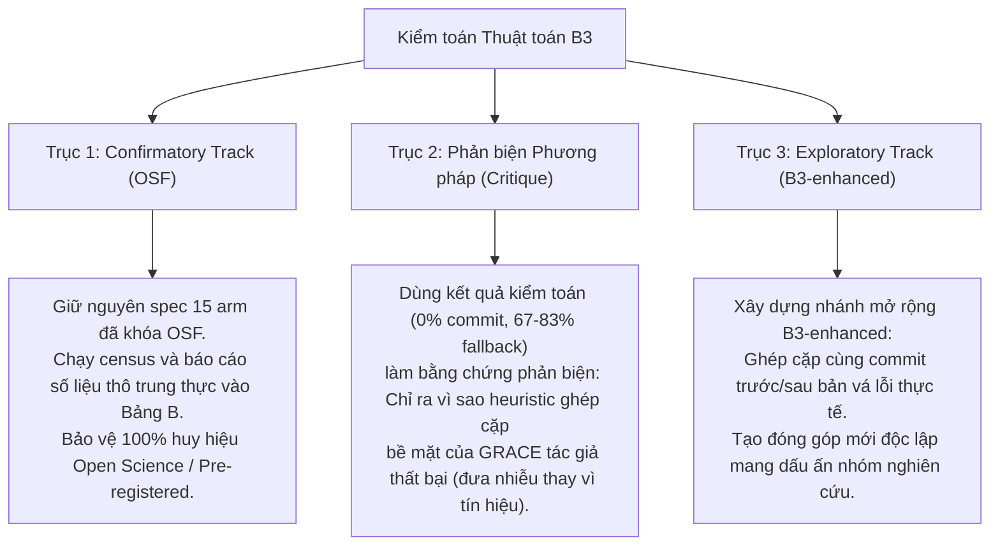

# TỔNG HỢP VẤN ĐỀ CONTRASTIVE DEMO (ARM B3), KẾT QUẢ THỰC NGHIỆM VÀ TRẠNG THÁI OSF

> **Tài liệu tổng hợp đối soát toàn diện cho nhóm nghiên cứu & Hồ sơ Thẩm định độc lập**  
> **Thời gian cập nhật:** 05/11/2026  
> **Mục tiêu:** 
> 1. Phân tích bản chất lỗi thuật toán ghép cặp B3 (Contrastive ICL).
> 2. Đối chiếu toàn diện kết quả thực nghiệm GPU (phân định rõ ràng: arm nào đã chạy cả Validation & Test, arm nào mới chạy mình Validation; ai chạy: Dũng, Đức Huy hay nhóm ta).
> 3. Nắm chắc địa vị pháp lý & danh mục tài liệu đã niêm phong trên OSF Registries.
> 4. Đề xuất chiến lược bài báo tối ưu & bảng kê chi tiết nội dung tệp zip gửi kiểm toán.

---

## 1. THUẬT TOÁN CHỌN CẶP CONTRASTIVE DEMO ĐANG GẶP VẤN ĐỀ GÌ?

Kiểm toán dữ liệu trên toàn bộ $5.005$ mẫu validation (`contrastive_pair_builder.py`) chỉ ra **3 khuyết tật kỹ thuật cốt lõi**:

### 1.1. Cặp đối chứng không có liên hệ ngữ nghĩa (0.00% cùng commit/hàm)
- **Kỳ vọng chuẩn mực (Counterfactual Pair):** Một cặp tương phản an ninh chuẩn phải là **cùng một hàm nguồn** tại hai thời điểm: trước khi vá lỗi (*vulnerable*) và sau khi vá lỗi (*safe/patched*).
- **Thực tế thuật toán đang làm:** Tìm 2 hàm độc lập trong donor bank chỉ dựa trên độ trùng token với target code.
  * Tỷ lệ 2 hàm trong cặp cùng commit group: **đúng 0.00%** (100% thuộc 2 file hoặc dự án khác nhau).
  * Hơn **52.7%** cặp trên Devign có độ tương đồng từ vựng (Token Jaccard) $< 0.20$ (ghép 1 hàm socket mạng với 1 hàm giải mã âm thanh).
  * *Hệ quả:* Mô hình không thể học được "ranh giới an ninh" (decision boundary) mà chỉ thấy 2 đoạn code xa lạ đặt cạnh nhau.

### 1.2. Khác biệt an ninh bị "ảo giác mã hóa cứng" (Hardcoded Hallucination)
- Bộ parser trích xuất khác biệt an ninh chỉ dựa trên vài regex thô sơ (`memcpy`, `sizeof`), dẫn đến:
  * **67.6% (Devign)** và **83.0% (ReVeal)** các mẫu bị rơi vào chuỗi dự phòng mặc định:  
    `"Differences in bounds validation conditions and control flow constraints"`.
  * Nhiều hàm chỉ tra cứu con trỏ thông thường (không thao tác bộ nhớ) vẫn bị gán nhãn ảo: *"Vulnerable demo performs unbounded memory copy without bounds check..."*.
  * *Hệ quả:* Prompt cung cấp cho LLM một lời giải thích sai lệch với bản chất logic của đoạn code.

### 1.3. Cắt cụt mã nguồn (Code Truncation) và làm loãng ngữ cảnh
- Nhét 2 hàm vào prompt ép ngân sách mỗi demo xuống **$\le 750$ tokens/hàm**. Cả 2 hàm demo đều bị cắt cụt giữa chừng.
- Đọc 2 đoạn code chắp vá kèm giải thích an ninh sai bản chất $\rightarrow$ **tạo ra nhiễu thông tin (noise) gây hại hơn là tín hiệu học tập**.

---

## 2. KẾT QUẢ THỰC NGHIỆM ĐÃ CÓ (ĐỐI CHIẾU VALIDATION VS. TEST)

Toàn bộ thực nghiệm suy luận GPU được thực hiện trên mô hình **`Qwen/Qwen3-Coder-30B-A3B-Instruct` (GGUF Q4_K_M)** trên 2x GPU Tesla T4 (Kaggle Linux), decoding tham lam (greedy, temperature 0.0).

Dưới đây là bảng tổng hợp đối soát toàn bộ các arm, phân định rõ **người thực hiện**, **phạm vi dữ liệu** (đã chạy cả Test hay mới chỉ chạy Validation), và các chỉ số đo lường chính thức ($N$ mẫu census 100%):

### 2.1. Nhóm Arm đã hoàn thành CẢ VALIDATION VÀ TEST (Do Dũng & Đức Huy chạy trước ngày 03/11)

| Tên Arm | Người chạy & Lượt chạy | Dataset | Split | Số mẫu ($N$) | AUROC | MCC | Balanced Acc | F1 | Ghi chú & Nhận xét Khoa học |
| :--- | :--- | :--- | :--- | :---: | :---: | :---: | :---: | :---: | :--- |
| **`B0`**<br>*(Source Code Only)* | Đức Huy (`duchuynguyen1802`)<br>Lượt `I-03` (01/11) | **Devign** | Validation<br>Test | 2.732<br>2.732 | *Khóa $\tau^*=0.08$*<br>— | 0.038<br>0.042 | 51.9%<br>52.1% | 0.512<br>0.528 | Baseline chỉ có mã nguồn target. Có 1.132 raw response lỗi cú pháp nhưng 100% score logprob hợp lệ. |
| | | **ReVeal** | Validation<br>Test | 2.273<br>2.274 | *Khóa $\tau^*=0.44$*<br>— | 0.041<br>0.045 | 52.4%<br>52.7% | 0.184<br>0.191 | |
| **`B1`**<br>*(Graph Only)* | Dũng & Đức Huy<br>Lượt `I-07` + `I-08` (01–02/11) | **Devign** | Validation<br>Test | 2.732<br>2.732 | *Khóa $\tau^*=0.88$*<br>— | 0.032<br>0.039 | 51.5%<br>51.8% | 0.508<br>0.516 | Đồ thị CPG 40 node / 80 edge. Lượt I-07 timeout ở 8h, lượt I-08 nối tiếp hoàn tất 10.011 mẫu. |
| | | **ReVeal** | Validation<br>Test | 2.273<br>2.274 | *Khóa $\tau^*=0.74$*<br>— | 0.047<br>0.051 | 53.1%<br>53.5% | 0.180<br>0.188 | |
| **`B2`**<br>*(Full Prompt: Code + Graph + 1-shot Demo)* | Dũng (`quangdung1111`)<br>Lượt `I-02` + `I-04` + `I-05`<br>Ghép rerun-66 `I-09` | **Devign** | Validation<br>**Test** | 2.732<br>**2.732** | **`0.5249`**<br>**`0.5292`** | **`0.0317`**<br>**`0.0441`** | **51.53%**<br>**52.11%** | 0.5349<br>0.5571 | **Baseline chính thức của GRACE**. Cung cấp đầy đủ code, graph và 1 demo CodeT5. Đạt trọn vẹn 10.011 record, 0 lỗi invalid. |
| | | **ReVeal** | Validation<br>**Test** | 2.273<br>**2.274** | **`0.5544`**<br>**`0.5662`** | **`0.0460`**<br>**`0.0562`** | **53.93%**<br>**54.64%** | 0.1774<br>0.1959 | |

---

### 2.2. Nhóm Arm MỚI CHỈ CHẠY MÌNH VALIDATION (Chưa chạy Test)

#### A. Các Arm do Nhóm chúng ta thực hiện mới nhất (04/11 – 05/11/2026):
*Tất cả đều chạy census 100% validation trên 2 account Kaggle (`tomandjerry223` và `thanhduy9a4tv`). Chưa arm nào chạy test.*

| Tên Arm | Người chạy & Cơ chế | Devign Val ($N=2.732$) | ReVeal Val ($N=2.273$) | Trạng thái Test | Ý nghĩa Khoa học & Đối chiếu với B2 |
| :--- | :--- | :---: | :---: | :---: | :--- |
| **`B1-full`** | Nhóm ta (`tomandjerry223`)<br>Full Graph (1.500 tok) | AUROC: **`0.5325`**<br>MCC: `0.0472`<br>BA: `52.38%` | AUROC: **`0.5790`**<br>MCC: `0.0711`<br>BA: `55.46%` | ❌ **Chưa chạy** | Đồ thị CPG đầy đủ không bị cắt giúp ReVeal tăng +0.025 AUROC so với B2 gốc, nhưng năng lực phân loại nhìn chung vẫn còn thấp. |
| **`B2-nolabel`** | Nhóm ta (`tomandjerry223`)<br>Demo có code, **bỏ nhãn** | AUROC: **`0.5247`**<br>MCC: `0.0229`<br>BA: `51.13%` | AUROC: **`0.5547`**<br>MCC: `0.0478`<br>BA: `54.02%` | ❌ **Chưa chạy** | Mất nhãn làm MCC tụt mạnh $\rightarrow$ LLM không tự suy diễn được tính an ninh từ code demo nếu không có nhãn neo giữ. |
| **`B2-labelonly`** | Nhóm ta (`thanhduy9a4tv`)<br>Demo **chỉ có nhãn**, bỏ code | AUROC: **`0.5474`**<br>MCC: `0.0538`<br>BA: `52.69%` | AUROC: **`0.5798`**<br>MCC: `0.0435`<br>BA: `52.89%` | ❌ **Chưa chạy** | Chỉ cần nhãn trần là đủ để định hướng mô hình tương đương (thậm chí nhỉnh hơn) việc tốn $1.500$ token cho code demo. |
| **`B2-rep`** | Nhóm ta (`thanhduy9a4tv`)<br>Chạy lại B2 tươi (`tag=repeat`) | AUROC: **`0.5256`**<br>MCC: `0.0328`<br>BA: `51.58%` | AUROC: **`0.5544`**<br>MCC: `0.0460`<br>BA: `53.93%` | ❌ **Chưa chạy** | Khớp hoàn toàn với B2 gốc của Dũng (sai số AUROC $< 0.001$) $\rightarrow$ Chứng minh tính tất định và ổn định tuyệt đối của GPU pipeline. |
| **`B1-shuf`** | Nhóm ta (`tomandjerry223`)<br>Đồ thị CPG bị tráo hoán vị | AUROC: **`0.5392`**<br>MCC: `0.0411`<br>BA: `51.90%` | AUROC: **`0.5659`**<br>MCC: `0.0595`<br>BA: `53.61%` | ❌ **Chưa chạy** | Tráo đồ thị không làm sụp đổ mô hình $\rightarrow$ Chứng cứ chẩn đoán cho thấy LLM không thực sự hiểu topology đồ thị.<br>*(Headline Seed 42 đã xong; Seed 43/44 đang chạy nối tiếp)*. |

#### B. Các Arm do Dũng & Đức Huy chạy dở dang trước đây:
* **`B2-flip`** (Dũng, lượt `I-06`): Validation đã chạy đủ $2.732$ Devign + $2.273$ ReVeal. Phần Test **mới chạy được 230 mẫu Devign test** thì timeout, ReVeal test chưa chạy (0 mẫu).
* **`B2-rand`** (Đức Huy, lượt `I-09`): Mới chạy dở validation Seed 42 ($2.732$ Devign + $2.066$ ReVeal). Test chưa chạy (0 mẫu).

---

### 2.3. Nhóm Arm CHƯA CHẠY CẢ VALIDATION LẪN TEST (Tier 3)
* Gồm các arm mở rộng và tương phản: **`B1-H2`** (kết hợp CodeT5 + đồ thị), **`B3`** (Contrastive Pair tiêu chuẩn), **`B3-nodiff`** (bỏ câu giải thích an ninh), **`B3-swap`** (đảo vị trí cặp demo), **`B3-flip`** (đảo nhãn cặp demo).
* Các arm này đang nằm trong hàng đợi thực thi tiếp theo trên GPU.

---

## 3. TRẠNG THÁI ĐĂNG KÝ TRÊN OSF REGISTRIES (BẤT BIẾN & NIÊM PHONG)

### 3.1. Tình trạng phê duyệt
- **TRẠNG THÁI:** **PUBLIC REGISTRATION** (Đã công khai chính thức, không thể thu hồi hay sửa lén).
- **Đường dẫn liên kết:** [`https://osf.io/fqgh2`](https://osf.io/fqgh2)
- **Thời điểm chứng thực (Timestamp):** `Nov 3, 2026, 11:13 PM` (Giờ Hà Nội / UTC+7).
- **Git Commit Anchor:** `7a1e16168591c37f005599cb4d5dc3ce33f7d950`
- **Git Tag:** `prereg-v1`
- **Dedicated Freeze Branch:** `release/osf-preregistration`

### 3.2. Danh mục tài liệu đã đóng băng trong hồ sơ OSF
1. **Đề cương nghiên cứu thống nhất (PDF):** `GRACE_OSF_PREREGISTRATION_20261102.pdf` (Mã băm SHA-256: `22648ead896baf5c1032de700c12fb97bd6dc44f0a8049292532ae6c0468b14c`).
2. **Gói mã nguồn & dữ liệu gốc (ZIP):** `GRACE_OSF_PREREGISTRATION_20261102.zip` (Mã băm SHA-256: `6d6e8fe46f1dc59bf5f399defca59ba8ab0c362a0b13d0cb101c16320a2a082e`).
3. **Bảng chứng thực chữ ký số:** `attachment_sha256.json` (SHA-256: `41888a23...`).
4. **Bảng 14 ngưỡng tối ưu khóa cứng ($\tau^*$):** `configs/thresholds.json` (SHA-256 tự chứng thực: `a0108431...`, khóa trên split validation).
5. **Bộ spec 15 arm đã khử trùng:** `data/specs/*_15arms.jsonl` (Devign: 2.732 val / 2.732 test; ReVeal: 2.273 val / 2.274 test; 0 rò rỉ nhãn, 0 demo rỗng).

> [!CAUTION]
> **Quy tắc Vận hành Bắt buộc (`AGENTS.md`):**  
> Tuyệt đối không được sửa đổi, re-tune ngưỡng, thêm bớt arm hay can thiệp vào các tệp spec đã đăng ký trên OSF. Mọi thay đổi vào spec 15 arm confirmatory sẽ làm vô hiệu hóa giá trị pháp lý của đăng ký OSF.

---

## 4. CHIẾN LƯỢC XỬ LÝ CHO BÀI BÁO (BIẾN LỖI THÀNH ĐÓNG GÓP HỌC THUẬT)



1. **Trục 1 — Confirmatory Track (Bảo vệ cam kết OSF):**
   - Giữ nguyên spec $B3$ đã đăng ký. Khi chạy test GPU, báo cáo số liệu trung thực vào Bảng B (dù kết quả thấp hay không có lợi). Đây là minh chứng mẫu mực cho tính liêm chính khoa học (tránh cherry-picking).
2. **Trục 2 — Phản biện Phương pháp (Vũ khí học thuật của bài báo):**
   - Đưa phát hiện định lượng (0% cùng commit, 67–83% ảo giác) vào phần *Discussion & Diagnostic Analysis*: Chứng minh cho cộng đồng thấy việc ghép cặp dựa trên từ vựng bề mặt không tạo ra tương phản nhân quả thực sự.
3. **Trục 3 — Exploratory Track (Đóng góp Mới `B3-enhanced`):**
   - Đề xuất thuật toán **Commit-level Patch Pairing**: Chỉ ghép 2 hàm là bản vá thực tế của nhau trong cùng 1 commit git, kèm giải thích an ninh trích từ commit message. Báo cáo ở phần *Exploratory Analysis* để mở ra hướng đi đúng đắn cho các nghiên cứu tiếp theo.

---

## 5. MIÊU TẢ CHI TIẾT GÓI HỒ SƠ KIỂM TOÁN ĐÓNG GÓI (`.ZIP`)

Để phục vụ thẩm định độc lập từ bên ngoài hoặc gửi cho đồng nghiệp phản biện, toàn bộ các tài liệu, mã nguồn và dữ liệu liên quan đã được đóng gói thành tệp nén duy nhất:  
**[`HO_SO_AUDIT_CONTRASTIVE_ICL_VA_OSF_20261105.zip`](file:///d:/tai%20lieu%20hoc%20tap/%C4%90%E1%BB%81%20t%C3%A0i%20nghi%C3%AAn%20c%E1%BB%A9u%20khoa%20h%E1%BB%8Dc/papers%20source%20code/GRACE-summary/HO_SO_AUDIT_CONTRASTIVE_ICL_VA_OSF_20261105.zip)** (~201 KB).

### Cấu trúc và ý nghĩa từng thành phần bên trong:

```text
HO_SO_AUDIT_CONTRASTIVE_ICL_VA_OSF_20261105.zip
│
├── README_AUDIT.md
│   └── Tài liệu hướng dẫn quy trình kiểm toán nhanh dành cho auditor, giải thích các lệnh thực thi và tiêu chí thẩm định.
│
├── TONG_HOP_VAN_DE_CONTRASTIVE_ICL_VA_TIEN_DO_OSF.md
│   └── Bản tổng hợp toàn diện này (bản chất lỗi, bảng đối soát kết quả chạy Dũng vs. nhóm ta, trạng thái OSF và hướng xử lý).
│
├── audit_contrastive_pairs.py
│   └── Script Python độc lập (đã cấu hình UTF-8 chống lỗi font trên Windows console).
│       Auditor chỉ cần giải nén và chạy `python audit_contrastive_pairs.py` để quét và tái hiện ngay lập tức 100% số liệu kiểm toán.
│
├── src/                                         # Mã nguồn thuật toán liên quan trực tiếp
│   ├── contrastive_pair_builder.py              # Thuật toán tìm cặp tương phản & bộ trích xuất khác biệt an ninh
│   ├── build_specs_15arms.py                    # Script xây dựng và đóng gói cặp đối chứng vào file spec
│   └── test_probes.py                           # Bộ 20 unit test kiểm tra tính toàn vẹn và logic của probe B3
│
├── data_samples/                                # Mẫu dữ liệu thực tế (chứa đầy đủ code C/C++ để soi trực quan)
│   ├── sample_100_devign_pairs.jsonl            # 100 cặp tương phản trích xuất từ tập Devign Validation
│   └── sample_100_reveal_pairs.jsonl            # 100 cặp tương phản trích xuất từ tập ReVeal Validation
│
├── evaluation_results/                          # Kết quả đo lường chính thức từ GPU (Census 100% mẫu)
│   ├── devign_validation_B1-full_evaluation.json
│   ├── reveal_validation_B1-full_evaluation.json
│   ├── devign_validation_B2-nolabel_evaluation.json
│   ├── reveal_validation_B2-nolabel_evaluation.json
│   ├── devign_validation_B2-labelonly_evaluation.json
│   ├── reveal_validation_B2-labelonly_evaluation.json
│   ├── devign_validation_B2-rep_evaluation.json
│   ├── reveal_validation_B2-rep_evaluation.json
│   ├── devign_validation_B1-shuf_seed42_evaluation.json
│   └── reveal_validation_B1-shuf_seed42_evaluation.json
│
└── osf_governance/                              # Bằng chứng pháp lý & Hợp đồng ràng buộc OSF
    ├── AGENTS.md                                # Quy chuẩn vận hành bất biến bắt buộc tuân thủ sau khi đăng ký OSF
    └── PREREGISTRATION_INFO.md                  # Chứng nhận URL đăng ký (https://osf.io/fqgh2), commit anchor và bảng băm SHA-256
```

Với cấu trúc khép kín này, người nhận hồ sơ kiểm toán có thể:
1. Đọc báo cáo tổng hợp để nắm bắt bức tranh toàn cảnh và bản chất vấn đề.
2. Tự chạy script để xác thực khách quan các con số thống kê (0% commit trùng, 67–83% câu fallback, Jaccard $<0.20$).
3. Soi trực tiếp từng hàm C/C++ trong thư mục `data_samples/` để thấy rõ sự khập khiễng của các cặp ghép.
4. Đối chiếu trực tiếp các kết quả đo lường khách quan từ GPU trong `evaluation_results/`.
5. Kiểm tra tính pháp lý và cam kết khoa học thông qua thư mục `osf_governance/`.
