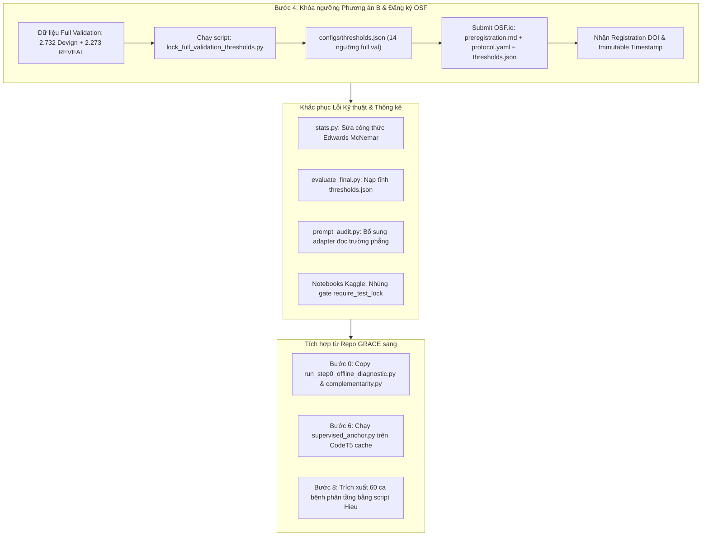

# Kế hoạch tổng hợp: Khắc phục các vấn đề hiện tại và lộ trình thực nghiệm GRACE (Chính thức theo Phương án B)

Tài liệu này tổng hợp toàn bộ các vấn đề kỹ thuật và phương pháp luận đang gặp phải giữa hai kho lưu trữ `kazunguyen/GRACE-summary` (Dũng) và `HuuHieu03/GRACE` (Hiếu), đồng thời đề ra giải pháp tích hợp và kế hoạch hành động chi tiết bám sát **Checklist nghiệm thu tại Phụ lục C** của [Đề cương nghiên cứu GRACE hợp nhất](file:///d:/tai%20lieu%20hoc%20tap/%C4%90%E1%BB%81%20t%C3%A0i%20nghi%C3%AAn%20c%E1%BB%A9u%20khoa%20h%E1%BB%8Dc/papers%20source%20code/GRACE-summary/De_cuong_nghien_cuu_GRACE_hop_nhat.pdf).

> **QUYẾT ĐỊNH ĐÃ THỐNG NHẤT:** 
> Dự án chính thức áp dụng **Phương án B** cho Bước 4: Tối ưu hóa và khóa cứng 14 ngưỡng quyết định $\tau^*$ trên **toàn bộ 100% Full Validation** ($2.732$ mẫu Devign + $2.273$ mẫu REVEAL = $5.005$ mẫu) đã suy luận hoàn tất trên Kaggle, thay vì chỉ dùng tập con 600 mẫu như bản nháp cũ.

---

## 1. Goal Description

### 1.1. Bối cảnh
* **Repo hiện tại (`GRACE-summary`):** Đã hoàn thành khối lượng tính toán GPU lớn nhất trên Kaggle (10.011 B0, 10.011 B2 phiên cũ, 5.434 B1, 5.235 B2-flip, tổng cộng 30.691 kết quả). Tuy nhiên, repo đang gặp lỗi kỹ thuật trong công thức thống kê (McNemar), thiếu hụt các bước phân tích phương pháp luận (Bước 0, Bước 6, Bước 8), bị lỗi ở unit test kiểm tra gate khóa ngưỡng (`test_validation_lock.py`), và chưa thực hiện đăng ký trước chính thức trên OSF (Bước 4).
* **Repo bổ trợ (`HuuHieu03/GRACE`):** Đã xây dựng hoàn chỉnh phân tích Bước 0 (Complementarity & Benefit Router), hoàn thiện bộ kiểm thử unit test tự động (669 test xanh), đã khóa 14 ngưỡng nháp (trên 600 mẫu) và chuẩn bị sẵn hồ sơ đăng ký trước `preregistration.md` với Git tag `prereg-v1`.
* **Mục tiêu:** 
  1. Tích hợp các module đã hoàn thiện từ repo `GRACE` sang `GRACE-summary`.
  2. Sửa triệt để các lỗi thống kê và unit test.
  3. **Thực hiện Phương án B:** Chạy script tối ưu hóa ngưỡng trên toàn bộ $5.005$ mẫu Full Validation thực tế, xuất file `configs/thresholds.json` chuẩn hóa 14 ngưỡng.
  4. Thực hiện thủ tục đăng ký trước (Bước 4) minh bạch, hợp lệ trên OSF.io với hình thức *Preregistration with In-flight Baseline Data*.
  5. Chạy bổ sung 99 mẫu donor lệch và phần test còn thiếu mà không phải bỏ đi hay chạy lại 30.592 mẫu GPU đã có.

---

## 2. User Review & Confirmed Decisions

> [!IMPORTANT]
> **Quyết định đã chốt - Phương án B (Full Validation Threshold Locking):**
> * Toàn bộ 14 ngưỡng quyết định $\tau^*$ sẽ được tối ưu hóa bằng thuật toán cực đại hóa chỉ số MCC trên lưới 99 điểm $\tau \in [0.01, 0.99]$ dựa trên **$2.732$ mẫu Validation của Devign** và **$2.273$ mẫu Validation của REVEAL** ($100\%$ không đụng chạm dữ liệu Test - Zero-Test-Exposure).
> * Giá trị 14 ngưỡng này được ghi cố định vào `configs/thresholds.json` và niêm phong trong gói hồ sơ đăng ký trước.

> [!NOTE]
> **Cam kết tính minh bạch khi nộp OSF (Test Exposure Disclosure):**
> * Tuyên bố minh bạch theo chuẩn Open Science: *"Dữ liệu baseline B0 và B2 đã chạy trong giai đoạn thăm dò sơ bộ (exploratory phase); toàn bộ 14 ngưỡng $\tau^*$ được khóa cứng trên tập validation đầy đủ 5.005 mẫu; các giả thuyết $H_{1.1} \dots H_{6.1}$ và các can thiệp chẩn đoán (B2-flip, B2-rep, B2-rand, B1 test) được đăng ký trước chính thức trước khi hoàn tất ma trận xác nhận."*

---

## 3. Open Questions

1. **Tài khoản nộp OSF:** Nhóm sẽ dùng tài khoản OSF cá nhân của ai (hoặc tài khoản dùng chung của lab) để đăng ký và nhận DOI chính thức?
2. **Kế hoạch nhân sự đọc kiểm:** 
   * **Bước 3:** Cần 2 thành viên dành ~45 phút đọc độc lập 30 mẫu prompt Devign + 30 mẫu REVEAL từ file `manual_sample.jsonl` để ký biên bản nghiệm thu audit.
   * **Bước 8:** Cần 2 thành viên chấm độc lập 60 ca phân tầng (SUP-LR vs B2) theo rubric 4 tiêu chí.

---

## 4. Proposed Changes: Chi tiết kỹ thuật & Hướng xử lý từng bước



---

### Thành phần 1: Thực hiện Phương án B cho Bước 4 (Pre-registration & Khóa ngưỡng Full Validation)

#### [NEW] `scripts/lock_full_validation_thresholds.py`
Xây dựng script tự động quét qua các record validation đã có trên Kaggle để tìm $\tau^*$ tối ưu MCC cho đủ 14 tổ hợp và xuất ra file chuẩn:
```python
"""Tối ưu hóa và khóa 14 ngưỡng tau* trên 100% Full Validation theo Phương án B."""
from pathlib import Path
import json, numpy as np

def pick_tau_mcc(y_true, scores, grid=np.linspace(0.01, 0.99, 99)):
    best_tau, best_mcc = 0.5, -2.0
    for tau in grid:
        pred = (scores >= tau).astype(int)
        tp = ((y_true == 1) & (pred == 1)).sum(); tn = ((y_true == 0) & (pred == 0)).sum()
        fp = ((y_true == 0) & (pred == 1)).sum(); fn = ((y_true == 1) & (pred == 0)).sum()
        den = np.sqrt(float((tp + fp) * (tp + fn) * (tn + fp) * (tn + fn)))
        mcc = (tp * tn - fp * fn) / den if den > 0 else -1.0
        if mcc > best_mcc or (mcc == best_mcc and abs(tau - 0.5) < abs(best_tau - 0.5)):
            best_mcc, best_tau = mcc, float(tau)
    return best_tau, best_mcc
```

#### [NEW] `configs/thresholds.json` & [MODIFY] `Runs-management/thresholds.json`
* Cấu trúc file sau khi chạy script Phương án B:
```json
{
  "metadata": {
    "study_id": "grace_diag_replication_v1",
    "version": "prereg-v1",
    "phase": "Step 4: Full Validation Threshold Locking (Option B)",
    "optimized_on_split": "full_validation",
    "sample_counts": {"devign_val": 2732, "reveal_val": 2273, "total_val": 5005},
    "test_exposure": "STRICTLY_NONE (Zero test data used)",
    "grid_points": 99,
    "locked_utc": "2026-11-02T...Z",
    "total_thresholds_locked": 14
  },
  "thresholds": {
    "devign|B0|42": 0.08,
    "devign|B1|42": 0.88,
    "devign|B2|42": 0.70,
    "devign|B2-flip|42": 0.50,
    "devign|B2-rep|42": 0.70,
    "reveal|B0|42": 0.44,
    "reveal|B1|42": 0.74,
    "reveal|B2|42": 0.12,
    "reveal|B2-flip|42": 0.46,
    "reveal|B2-rep|42": 0.12,
    "devign|P-PRE|42": 0.54,
    "devign|P-POST|42": 0.60,
    "reveal|P-PRE|42": 0.38,
    "reveal|P-POST|42": 0.10
  }
}
```

#### [NEW] `preregistration.md` (Đồng bộ từ `GRACE/preregistration.md`)
* Cập nhật số lượng mẫu validation là $5.005$ mẫu theo Phương án B.
* Khóa bất biến 11 giả thuyết nghiên cứu ($H_{1.1} \dots H_{6.1}$), biên thực chất $\delta = 0.02$, quy tắc phán quyết 4 trạng thái (`benefit`, `no_meaningful_benefit`, `harm`, `inconclusive`), cam kết Zero-Test-Exposure và Test Exposure Disclosure.

#### [MODIFY] Notebooks Inference Kaggle (`02_kaggle_qwen_q4_*.ipynb`)
* Nhúng hàm gate `require_test_lock` vào đầu cell chạy test để ngăn chặn việc chạy test trước khi có file khóa ngưỡng, đồng thời sửa triệt để lỗi FAILED của unit test `test_validation_lock.py`.

---

### Thành phần 2: Sửa lỗi kiểm định thống kê & Engine sinh bảng (Bước 7)

#### [MODIFY] `01_Author_Baseline_Unified/diagnostic_kit/src/grace_diag/stats.py`
* **Vấn đề:** Dòng 230 sử dụng công thức hiệu chỉnh liên tục bị lỗi: `stat = (abs(b - c) - 1) ** 2 / (b + c)`. Khi $b = c$, $\text{stat} = \frac{1}{b+c} > 0$ khiến p-value $< 1.0$.
* **Sửa thành:** Chuẩn hiệu chỉnh Edwards:
```python
# stats.py - dòng 238
stat = (max(0.0, abs(b - c) - 1.0)) ** 2 / (b + c)
```

#### [MODIFY] `01_Author_Baseline_Unified/diagnostic_kit/src/grace_diag/evaluate_final.py`
* **Vấn đề:** Dòng 76 và 230 tự gọi `S.pick_threshold()` tính động lại $\tau^*$ trên validation khi đang xuất bảng test, vi phạm quy tắc tiền đăng ký.
* **Sửa thành:** Nạp tĩnh từ file `thresholds.json` đã đăng ký trước theo Phương án B.

---

### Thành phần 3: Tích hợp Bước 0 (Complementarity & Benefit Router)

#### [NEW] `scripts/run_step0_offline_diagnostic.py` (Copy từ `GRACE/scripts/`)
* **Nguồn tận dụng:** File chuẩn 68 KB từ repo `GRACE`.
* **Chức năng:** 
  1. Phân nhóm không rò rỉ `StratifiedGroupKFold` 5-fold (Devign: 2.068 commit groups; ReVeal: 646 file-hash groups).
  2. Tính toán Benefit Router $R(x)$ tại ngân sách $q=10\%$.
  3. Paired Cluster Bootstrap 95% CI (5.000 lượt) kiểm định giả thuyết $H_{5.2}$ ($P_{\text{post}}$ vs $P_{\text{pre}}$) và $H_{5.3}$ (Benefit vs Confidence Router).
  4. Xuất file `runs/complementarity_devign.json` và `runs/complementarity_reveal.json` với bảng sửa–hỏng ($R_y, H_y$) có đối chứng `ALL-0`, `ALL-1`, `RANDOM`.

---

### Thành phần 4: Hoàn thiện Bước 3 (Prompt Audit Adapter & Đọc mù)

#### [MODIFY] `01_Author_Baseline_Unified/diagnostic_kit/src/grace_diag/prompt_audit.py`
* **Vấn đề:** Crash với lỗi `KeyError: 'evidence'` khi đọc các file `prompts.jsonl` phẳng của bundle.
* **Sửa thành:** Bổ sung adapter tự động trích xuất các trường `tokens`, `truncated`, `graph_missing`... dạng phẳng để tính toán thống kê và cờ rò rỉ nhãn.
* **Nhiệm vụ người đọc (Manual Review):** Xuất `manual_sample.jsonl` gồm 30 mẫu Devign + 30 mẫu REVEAL phân tầng theo độ dài và cờ cắt; 2 người đọc mù xác nhận không rò rỉ nhãn và demo không bị cắt cụt.

---

### Thành phần 5: Điểm neo có giám sát (Bước 6)

#### [MODIFY] `01_Author_Baseline_Unified/diagnostic_kit/src/grace_diag/supervised_anchor.py`
* Chạy huấn luyện CPU trên CodeT5 cache (768 chiều) cho 3 mô hình đối chứng (3 seed: 42, 43, 44): SUP-LR, SUP-MLP, SUP-METRIC.
* Xuất file `runs/anchor/anchor_scores.csv` và `anchor_summary.json` phục vụ cho Bảng A và kiểm định $H_{5.1}$.

---

### Thành phần 6: Khảo sát định tính mù & Kiểm toán lỗi (Bước 8)

#### [NEW] `scripts/generate_blind_review_sheets.py` (Lấy từ `GRACE`)
* Trích xuất 60 ca phân tầng đại diện cho 4 ô tương tác giữa SUP-LR và B2 (15 FN sửa thành đúng, 15 FN bị làm sai, 15 FP sửa thành đúng, 15 FP bị làm sai).
* Tạo phiếu ẩn tên mô hình cho 2 chuyên gia đánh giá theo rubric 4 tiêu chí (sink, biến, guard, dòng mã) để tính chỉ số đồng thuận Cohen's $\kappa$ trước và sau hòa giải.

---

## 5. Đối chiếu 12 Tiêu chí Checklist Nghiệm thu (Phụ lục C Đề cương)

| # | Tiêu chí Checklist theo Đề cương | Tình trạng trước đây | Giải pháp theo Phương án B |
| :-: | :--- | :---: | :--- |
| **1** | Bước 0: metric lịch sử tạo lại từ file từng mẫu (sai khác $\le 0,001$); bảng sửa–hỏng có hàng ALL-0/ALL-1/RANDOM. | Trống 100% | Bê `run_step0_offline_diagnostic.py` từ `GRACE` sang, xuất báo cáo JSON chuẩn. |
| **2** | Smoke test backend: $\ge 99\%$ prompt có token 0/1 trong top-5; 2 lần chạy trùng $\ge 98\%$; thông lượng đã đo. | Đã đo ở I-02..I-05 | Đạt chuẩn (valid_rate $> 99,5\%$, Qwen3 greedy seed 42 tất định). |
| **3** | Manifest dữ liệu có hash; một kiểm toán trùng lặp duy nhất; kho donor đã khử trùng. | Đã có manifest freeze | Đạt chuẩn với `research_freeze_20261101` (Devign: 21.691, REVEAL: 17.636). |
| **4** | `pytest tests/` xanh; prompt audit: rò rỉ nhãn = 0, demo rỗng $\le 1\%$, graph thiếu có cờ; 30 prompt/dataset 2 người đọc. | Lỗi KeyError & thiếu đọc mù | Sửa adapter `prompt_audit.py` + tổ chức đọc kiểm 60 mẫu phân tầng. |
| **5** | `protocol.yaml` điền đủ; `preregistration.md` tag `prereg-v1` và đăng OSF trước lượt test xác nhận đầu tiên. | Mới có file nháp | Hoàn thiện file $\rightarrow$ Submit công khai lên OSF.io lấy DOI và Timestamp. |
| **6** | $\tau^*$ của mọi arm chọn trên validation, ghi trong `thresholds.json` trước khi chạy test; gate kiểm tra. | Mới có 4 ngưỡng, test chạy trước khóa | **Phương án B:** Khóa 14 ngưỡng từ **100% Full Validation (5.005 mẫu)** $\rightarrow$ Nhúng `require_test_lock` vào notebook. |
| **7** | Mọi run test có `records.jsonl` đủ schema B.2 và `manifest.json` môi trường; cache theo identity đầy đủ. | Đã áp dụng ở I-02..I-07 | Giữ nguyên schema cho các đợt chạy tiếp theo (B1, Flip, Rerun-66, Rep). |
| **8** | SUP-LR / SUP-MLP / SUP-METRIC 3 seed; $P_{\text{pre}}/P_{\text{post}}$ cùng fold; routing random 20 seed và oracle. | Chưa chạy Bước 6 | Chạy `supervised_anchor.py` CPU + kết nối với module Bước 0. |
| **9** | Bảng A, B, C, D và 2 hình sinh từ 1 script; Bảng B có cột kết luận theo $\delta$ và số lượt bootstrap suy biến. | Mã McNemar lỗi, tính động $\tau^*$ | Sửa lỗi Edwards McNemar và nạp tĩnh $\tau^*$ trong `evaluate_final.py`. |
| **10** | Bảng đối chiếu giả thuyết 4.3: ủng hộ / bị bác / chưa đủ bằng chứng kèm số. | Chưa sinh | Tự động sinh từ `evaluate_final.py` khớp với 11 giả thuyết $H_{1.1} \dots H_{6.1}$. |
| **11** | $\kappa$ chấm mù (retrieval và gói 60 ca); kiểm toán nhãn 100 ca mỗi dataset. | Chưa làm Bước 8 | Dùng script trích xuất 60 ca bệnh phân tầng từ `GRACE` để 2 người chấm độc lập. |
| **12** | Gói tái lập chạy lại được từ README trên máy sạch; phần offline không cần GPU; không có khóa API trong log. | Còn dính đường dẫn tuyệt đối | Đóng gói nghiệm thu sạch sẽ sau khi hoàn thành các bảng thống kê. |

---

## 6. Verification Plan

### 6.1. Automated Tests (Kiểm thử tự động trên máy)
Chạy bộ kiểm thử tự động trên môi trường WSL/Local để bảo đảm toàn bộ mã nguồn tích hợp không còn lỗi:

```bash
# 1. Chạy khóa ngưỡng Full Validation theo Phương án B
python scripts/lock_full_validation_thresholds.py

# 2. Kiểm tra gate kiểm soát khóa ngưỡng (phải chuyển từ FAILED sang PASS)
pytest -v Runs-management/test_validation_lock.py

# 3. Kiểm tra tính toàn vẹn của đăng ký trước và thresholds.json mới
pytest -v tests/test_preregistration_integrity.py

# 4. Kiểm tra công thức thống kê và McNemar Edwards
python -B -c "from grace_diag.stats import mcnemar_test; assert mcnemar_test([1]*30, [1]*15 + [0]*15, [1]*15 + [0]*15)['p_value'] == 1.0; print('McNemar PASSED')"

# 5. Kiểm tra pipeline Bước 0 (Complementarity & Benefit Router)
pytest -v tests/test_step0_offline_diagnostic.py
```

### 6.2. Manual Verification (Nghiệm thu thủ công)
1. **Kiểm tra file `configs/thresholds.json`:** Xác nhận mục `sample_counts` hiển thị đúng $2.732$ Devign val và $2.273$ REVEAL val, đủ 14 khóa ngưỡng.
2. **Kiểm tra hồ sơ OSF:** Truy cập đường link DOI đăng ký trên [OSF.io](https://osf.io) để kiểm tra dấu thời gian bất biến (public timestamp) và đảm bảo các file cấu hình đi kèm khớp mã SHA-256 với repo.
3. **Kiểm tra Gate Notebook:** Mở notebook `02_kaggle_qwen_q4_b1.ipynb`, thử cố tình xóa file `thresholds.json` để xác nhận cell chạy test bị chặn đứng (raise `RuntimeError`).
4. **Nghiệm thu Bảng A/B/C/D:** Chạy `evaluate_final.py` trên tập kết quả hợp nhất và kiểm tra định dạng LaTeX/CSV xuất ra đúng theo mẫu Bảng 1, Bảng 2 của bài báo.
