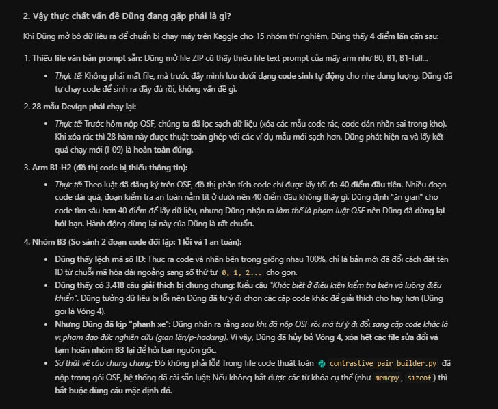
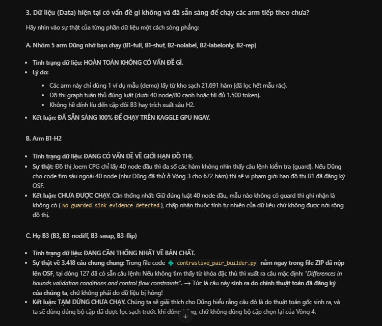
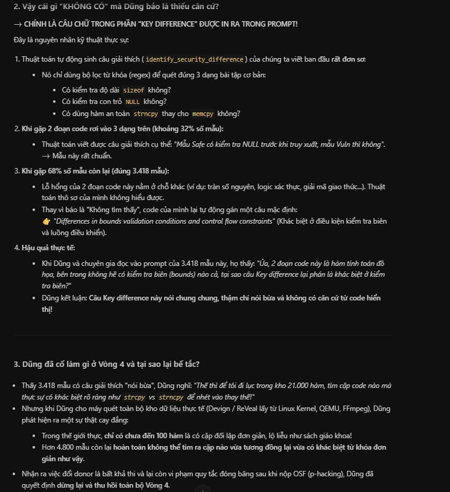
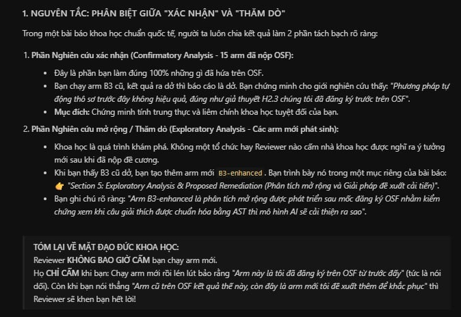

# Hoàn thiện prompt validation cho 15 arm

> **Trạng thái cuối của B3:** Đã thử sửa cách chọn đối chứng, sau đó dừng và thu hồi vì thay đổi selector sau mốc đóng băng vi phạm điều kiện dùng thiết kế đó cho lượt xác nhận theo preregistration. Xem mục Thu hồi và truy hồi B3 gốc ở cuối file. Các kết quả vòng sửa bên dưới là lịch sử công việc.

## Phạm vi

Giữ đủ 2.732 target Devign và 2.273 target ReVeal. Giữ các cặp donor đã đối chiếu với kho chốt và bản prompt B2 làm tham chiếu. Sửa trên bản validation mới, sau đó đối chiếu từng phép biến đổi và cập nhật manifest chung.

## Mốc trước khi sửa

### Gói local ở lần audit đầu

Tên gói do người dùng xác định là bản tải từ Hiếu. Lần kiểm đầu thấy 20 file gồm 14 file prompt, 4 specs và 2 config. Prompt có B2 cho cả validation và test, cùng B1-H2 và bốn biến thể B3 cho validation. Tên gói 15 arm chỉ phạm vi specs. Chín arm còn lại lấy prompt validation từ dry-run hoặc bundle local riêng.

### Những gì đã audit trước candidate v2

- Đối chiếu mục 6.3, Bước 2–3 và preregistration. Đề cương ghi 25/25 cho B1, protocol hiện hành ghi 40/80. Đã xác nhận B3-nodiff chỉ bỏ Key difference và B3-swap chỉ đổi hai khối demo. Đính chính kết luận audit ban đầu về B3-flip: Bước 3 yêu cầu đảo cả các từ thể hiện nhãn trong Key difference. Cần kiểm phần giải thích còn lại được giữ nguyên.
- So SHA-256 của bốn B2 reference với `new_reference/B2`. Kiểm đủ 10.011 donor ID thuộc kho chốt. So hash manifest và vectors.npy của sáu cache CodeT5 với provenance retrieval. Các khối target và graph hiển thị của họ B3 khớp B2. Nodes/edges trong specs đóng gói khác CPG Joern của bundle đã dùng.
- Kiểm các cặp donor trong specs đóng gói theo ID, code và nhãn. Khi so với prompt B3 đã render, cặp ID nguyên văn chỉ khớp 1.985/2.732 Devign và 0/2.273 ReVeal. Devign có 6 lượt donor ID ngoài kho trên 5 target, trong đó 5 lượt không tìm thấy code hiển thị hoặc tiền tố cùng nhãn trong kho. ReVeal dùng hệ ID khác, nhưng 4.546/4.546 lượt khớp code hiển thị hoặc tiền tố cùng nhãn, gồm 14 lượt có nhiều ứng viên.
- B1-H2 có 3.697/5.005 prompt chỉ ghi không tìm thấy guarded evidence. Chưa xác minh evidence của gói ban đầu được sinh từ pipeline H2 trên đúng graph. B3 có 3.418/5.005 prompt dùng cùng câu Key difference chung.
- Mười file prompt mở rộng khớp manifest và audit summary theo SHA-256. Tuy nhiên hai specs validation trong gói không khớp hash đầu vào dry-run. Hash runner, renderer và hai helper hiện hành không khớp hồ sơ nguồn, kể cả sau chuẩn hóa xuống dòng. Bộ 60 mẫu chấm trước đó thuộc các arm khác. Báo cáo dry-run mới có 15 arm, còn final_status cũ vẫn ghi năm arm mở rộng bị chặn.
- Đối chiếu records inference theo ID và hash prompt. B2 frozen khớp 10.011/10.011 với B2 trong gói. B2 I-05 cũ lệch đúng 28 Devign validation và 38 Devign test, đều khớp sau khi dùng records I-09. Ngoài gói, B0 và B1 khớp bundle riêng; B2-flip I-06 giữ được 5.202/5.235 records với bundle frozen; B2-rand I-09 khớp 4.798/4.798 records. Đây là kiểm danh tính prompt, tách khỏi kiểm model, backend và ngưỡng.
- Hai config trong gói là phiên cũ. Protocol ghi registered_at 2026-10-31 trong khi protocol hiện hành để null. Thresholds trong gói dùng seal trước lần niêm phong lại. Không dùng hai file này làm config hiện hành.

Audit Step 3 trước đó có log riêng cho [prompt hiện hữu](2026-11-02_step3_01_audit_prompt_hien_huu.md), [donor và random](2026-11-02_step3_02_kiem_donor_va_random.md), [output inference](2026-11-02_step3_03_doi_chieu_output_inference.md), [dry-run validation](2026-11-02_step3_05_dry_run_toan_validation.md) và [đối chiếu SHA-256 hồ sơ bàn giao](2026-11-03_audit_delivery_sha256_reconciliation.md). Phạm vi của các log đó khác với việc xác minh gói từ Hiếu.

### Candidate v2 dùng để so trước và sau

- Tạo manifest chung cho 38 tập validation. Dựng bản riêng B1-H2 và họ B3 bằng tokenizer Qwen đã ghim. H2 chạy bộ trích xuất trên CPG Joern closed prefix 40/80. B3 dùng cặp donor trong specs đã kiểm với kho chốt và giữ khối target/graph của B2. Không ghi đè prompt trong gói nhận ban đầu.
- Candidate v2 gồm 38 tập validation và 95.095 prompt. Mười tập B1-H2 và họ B3 đã qua audit tự động.
- Phiếu Codex trên 60 prompt ghi 16 đạt, 27 không đạt và 17 chưa đủ căn cứ. 24 mẫu dùng câu Key difference chung, ba mẫu có nhận định cụ thể sai và 14/21 mẫu H2 chưa có đủ evidence để kiểm guard.
- Đề cương yêu cầu hai người đọc 30 prompt mỗi dataset. Kết quả Codex được ghi riêng. Hai phiếu người chấm độc lập chưa có kết quả.

## Vòng 1

### Sửa

- B3 giữ nguyên cặp donor và graph hiển thị của candidate v2. Bộ dựng trích hai đoạn code cụ thể từ phần demo đã cắt theo ngân sách để mô tả khác biệt. Phần mô tả chỉ nói điều quan sát được trong code. Khi không có cặp quan sát đủ căn cứ, prompt ghi trạng thái abstention và audit đếm riêng.
- B3-nodiff, B3-swap và B3-flip vẫn dùng chung một bộ cặp donor. Bộ dựng kiểm đúng phép can thiệp từng ID và kiểm đoạn được trích còn nguyên trong prompt.
- B1-H2 giữ đầu vào CPG Joern dạng closed prefix 40/80. Bên trong graph đó, xếp trước các thao tác có cạnh CDG quan sát được. Giữ thuộc tính graph có sẵn và cờ CFG unknown. Tách riêng CPG thiếu và trường hợp có CPG nhưng thiếu guard đủ căn cứ. Lưu chẩn đoán theo ID để phân biệt thiếu CDG ở nguồn, CDG nằm ngoài prefix và không tìm được cặp thao tác–guard trong prefix.

### Audit

Đã rà thử các đoạn demo hiển thị trong bộ 60 mẫu cũ. Câu mẫu và claim sai trước đó được loại bỏ, nhưng bộ nhận diện gọi chữ ký hàm Type_ColorantTable_Free là lời gọi và có thể so hai thao tác khác loại. Dừng lượt dựng v3 trước khi nghiệm thu để sửa hai lỗi này.

## Vòng 2

### Sửa

- Chỉ tìm đoạn đối chiếu trong thân hàm hiển thị. Loại chữ ký khai báo và ghép quan sát cùng loại. Dùng tên trung tính cho biểu thức có dấu ngoặc vuông vì cú pháp đó có thể là khai báo mảng.
- Giữ cơ chế abstention cho cặp thiếu khác biệt được hỗ trợ. Không đổi donor để tăng tỷ lệ coverage.

### Audit

- Đã qua năm kiểm tra nhắm vào comment, chuỗi literal, chữ ký hàm, cặp điều kiện và cặp khác loại. 41 test của renderer và H2 cũng qua.
- Đã dựng đủ 5.005 target. Audit độc lập B3 xác nhận code target, graph và hai demo giống v2 ở mọi ID. Câu mẫu cũ đã bỏ. Các trích dẫn khớp chính xác đoạn code trong demo tương ứng. 1.841 Devign và 1.337 ReVeal có trích dẫn đối chiếu, còn 891 Devign và 936 ReVeal abstain. Trích dẫn đúng cú pháp chưa đủ để xác nhận khác biệt có ý nghĩa an ninh.

## Vòng 3

### Phát hiện trước khi sửa

Trong 14 mẫu H2 chưa rõ của phiếu cũ, 5 CPG gốc không có cạnh CDG, 8 có CDG nhưng closed prefix 40/80 bỏ hết cạnh CDG và 1 còn CDG trong prefix nhưng chưa có guard gắn với thao tác được chọn.

### Sửa

Thử fallback lấy cụm có CDG từ cùng CPG Joern khi closed prefix không cho guard. Cụm đưa vào extractor vẫn tối đa 40 nút và 80 cạnh. Chỉ dùng fallback nếu extractor tìm được guard. Ghi từng lần lấy node ngoài prefix và giữ cờ CFG unknown. Phiên này đo cả cách chọn cụm graph và cách trình bày evidence khi so với B1. Lưu riêng phiên closed-prefix để truy vết quyết định.

### Audit

- Fallback tìm thêm guard cho 452 Devign và 226 ReVeal. Trong đó 447 Devign và 225 ReVeal dùng node ngoài closed prefix. Phiên này vẫn giữ đủ 5.005 target, và 1.465 target không có usable guard được ghi cờ.
- Kiểm lại 14 mẫu cũ. Chín mẫu có thêm guard. Năm mẫu còn lại không có CDG trong CPG gốc.
- Kiểm độc lập mọi quan hệ được trích với CPG nguồn. Cả 12.481 quan hệ CDG và 13.776 cạnh trong witness CFG đều có cạnh tương ứng trong CPG. Mọi graph đưa vào H2 nằm trong giới hạn 40/80. Không còn cờ rò nhãn chưa xử lý.
- Test chọn cụm xác nhận tính tất định, giới hạn graph đóng, cạnh có nguồn và fallback khi không có CDG.

## Ghép manifest và chấm lại

- Manifest ghép giữ 28 tập validation trước đó, thêm 8 tập họ B3 v4 và 2 tập B1-H2 v5. Tổng cộng 38 tập và 95.095 prompt. 10 tập mới đạt các ngưỡng audit tự động.
- Bộ chấm mới gồm 60 prompt phân tầng và hai phiếu độc lập. Bảng kiểm lại 60 ID cũ giữ cả hash trước và sau. Phiếu Codex mới ghi 24 đạt, 0 không đạt và 36 chưa đủ căn cứ. B1-H2 có 15 đạt và 5 chưa đủ guard. B3-nodiff có 9 đạt. Cả 31 mẫu thuộc B3, B3-swap và B3-flip được ghi chưa đủ căn cứ về khác biệt an ninh, dù cấu trúc và thao tác biến thể đã khớp.
- Chưa nghiệm thu 10 tập mới cho inference chính thức. Để bắt buộc mọi cặp B3 có khác biệt an ninh kiểm chứng được, cần xác minh thêm bằng chứng ở các cặp hiện có hoặc chốt lại quy tắc chọn cặp. Với H2, cần giữ và báo cáo các target nguồn không có guard theo chính sách đã định. Hai phiếu chấm độc lập còn chờ người chấm.

## Artifact

- Manifest chung tại `grace_15arms_prompts_and_clean_specs/validation_remediated_manifest.json`.
- Báo cáo H2 tại `Runs-management/validation_h2_cluster_v5_20261104/manifest.json`.
- Prompt và audit B3 tại `Runs-management/validation_extensions_remediation_v4_20261104/manifest.json`.
- Bộ chấm và phiếu Codex tại `Runs-management/validation_remediated_review_20261104/`.

## Vòng 4 — Quyết định chọn lại đối chứng B3

Người dùng đồng ý giữ cặp hiện tại nếu đã có khác biệt an ninh được xác minh và cho phép chọn lại donor đối nhãn từ kho chốt cho cặp thiếu căn cứ. Giữ demo B2 frozen làm neo. Dùng cùng cặp cuối cho B3, B3-nodiff, B3-swap và B3-flip. Việc chọn chỉ dựa trên code hiển thị và nhãn donor train, không đọc nhãn target hay kết quả inference. Ghi lại cặp trước/sau, căn cứ lựa chọn và hash prompt mới. Giữ trạng thái chưa đủ căn cứ khi không tìm được đối chứng phù hợp.

### Quy tắc triển khai

- Hai loại khác biệt được kiểm ở vòng này là dùng API cùng họ có hoặc thiếu đối số giới hạn rõ ràng, và hai phép so sánh cùng toán hạng biên khác nhau tại điểm bằng nhau. Chỉ chấp nhận nếu cả hai đoạn code vẫn hiển thị sau khi cắt token. Kết luận giới hạn ở khác biệt quan sát được trong code.
- Xếp donor đối nhãn có tín hiệu phù hợp theo Jaccard từ vựng với demo neo, phá hòa bằng donor ID. Chọn ứng viên đầu tiên còn đủ căn cứ sau khi cắt. Giữ nguyên cặp cũ nếu đã qua quy tắc, hoặc nếu không tìm được đối chứng đạt.
- Đây là quy tắc sửa B3 trong vòng này, khác với thuật toán mặc định của selector gốc được dẫn chiếu trong đề cương. Tách artifact để giữ lịch sử và ghi nhận thay đổi giao thức trước khi dùng kết quả xác nhận.

### Audit

Năm kiểm tra hồi quy đã qua, gồm API cùng họ, biên < so với <=, loại sizeof(dma_addr_t), bỏ chữ ký hàm, và lọc nhãn đối chứng kèm phá hòa tất định.

| Dataset | Giữ cặp có căn cứ | Đổi đối chứng thành công | Giữ cặp chưa đủ căn cứ |
| --- | ---: | ---: | ---: |
| Devign | 4 | 96 | 2.632 |
| ReVeal | 0 | 45 | 2.228 |

Đã dựng 20.020 prompt của bốn biến thể B3. Cả tám tập qua audit tự động, không còn cờ rò nhãn chưa xử lý. Demo rỗng hoặc giữ dưới 25% cao nhất 0,70%. Graph thiếu cao nhất 1,19%.

Phiếu Codex trên đúng hash của 60 mẫu mới ghi 25 đạt, 0 không đạt và 35 chưa đủ căn cứ. Đã kiểm thêm mẫu có cặp đổi đối chứng theo cả hai quy tắc trên cả hai dataset. Kết quả kiểm được khác biệt cú pháp cụ thể, không dùng nhãn donor để suy ra an toàn của thao tác.

Manifest mới bao phủ 38 tập và 95.095 prompt. 4.860/5.005 cặp vẫn không đáp ứng quy tắc hẹp đã chốt, vì vậy phiên này vẫn là candidate validation. Hai phiếu người chấm độc lập còn chờ đánh giá.

Verifier độc lập xác nhận đủ ID, neo B2, nhãn donor frozen, code target, CPG và đúng phép biến đổi từng prompt ở cả bốn arm. Phân loại 4.860 ca chưa đủ căn cứ gồm 4.495 demo neo không có tín hiệu thuộc hai quy tắc đang thử, 362 ca không tìm được donor đối nhãn có tín hiệu tương ứng và 3 ca mất căn cứ sau khi cắt. Số này phản ánh phạm vi hai quy tắc, không phải kết luận các cặp không thể giải thích bằng tiêu chí khác.

- Quyết định từng cặp tại `Runs-management/validation_b3_reselected_20261104/<dataset>/pair_decisions.jsonl`.
- Kiểm chứng độc lập tại `Runs-management/validation_b3_reselected_20261104/verification.json`.
- Manifest chung tại `grace_15arms_prompts_and_clean_specs/validation_b3_reselected_manifest.json`.
- Bộ 60 mẫu và phiếu Codex tại `Runs-management/validation_b3_reselection_review_20261104/`.

## Quyết định sau đối chiếu điều khoản freeze

Vòng 4 là thử nghiệm thăm dò sau mốc documented freeze. Quy tắc mới thay đối chứng cho 141 target và vì vậy thay đổi cách chọn demo của B3. Việc dùng cùng cặp cho bốn biến thể bảo toàn các đối chiếu nội bộ của phiên thăm dò. Nó không chuyển phiên đó thành B3 đã chốt. Không dùng manifest vòng 4 cho lượt xác nhận hoặc làm nguồn chọn ngưỡng chính thức.

Đường tái lập chính thức phải xác minh cặp theo frozen selections của plan được dẫn chiếu trong đề cương. Nếu cần sinh lại, tái chạy đúng selector và cấu hình gốc đã xác minh trên đầu vào frozen. Các bản candidate trước vòng 4 cũng cần kiểm provenance trước khi được chọn. Với đúng cặp gốc nhưng Key difference thiếu căn cứ, ghi nhận lỗi và áp dụng audit trên cặp đó. Thay selector hoặc đưa phiên vòng 4 vào phân tích là thay đổi riêng cần ghi ngày, lý do, phân tích bị ảnh hưởng và phân loại thăm dò theo preregistration.md.

## Thu hồi và truy hồi B3 gốc

- Thu hồi các prompt B3 sửa đổi, manifest ứng viên và script chọn lại donor khỏi GRACE-summary. Đã chuyển 22 đường dẫn vào `D:/JUNIOR/LabThayTho/tmp/grace_b3_withdrawn_20261104/`. Bảng `archive_map.json` ghi vị trí cũ và vị trí lưu. B1-H2 mới nhất và các đầu vào arm khác vẫn có trong manifest active.
- Trích nguyên 100 cặp Devign và 100 cặp ReVeal, gồm code donor và Key difference đã lưu trong báo cáo Stage 3. Đối chiếu thứ tự ID với hai file dev-clean-100 của repo gốc. Nguồn ghi selector `counterexample_pair`, seed 42 và lambda 0,3. Đây là artifact lịch sử, chưa xác minh danh tính byte của prompt đã gửi cho backend và chưa tìm được frozen plan cho đủ 5.005 target official validation.
- Manifest active tại `grace_15arms_prompts_and_clean_specs/validation_active_manifest.json` giữ 30 tập và 75.075 prompt. B3, B3-nodiff, B3-swap và B3-flip bị loại khỏi đầu vào active cho tới khi có plan gốc đủ phạm vi. Bản trích B3 gốc và hash nguồn nằm tại `Runs-management/b3_original_stage3_reference_20261104/manifest.json`.

## Xác minh lại mốc đối chứng của gói nhận

Thư mục hiện tại có 13 file. Có 12 file của bố cục ban đầu vẫn nằm tại chỗ, 8 file prompt B3 đã chuyển ra kho lưu, và validation_active_manifest.json được thêm sau. Không dùng nguyên thư mục hiện tại làm bản tải về bất biến.

[Bảng SHA-256 và vị trí file](2026-11-04_goi_hieu_baseline_sha256.json) ánh xạ đủ 20 file đã thấy ở lần kiểm đầu. 14 file prompt khớp nguồn local tương ứng, bốn specs khớp SHA-256 đã ghi trước remediation và hai config khớp nội dung blob Git tại commit `7f98e10`. Cả 20 đối chiếu SHA-256 đều khớp mốc tương ứng. Việc đối chiếu config dùng byte của blob, không dựa riêng vào lock ID nội bộ.

Chưa tìm thấy ZIP gốc hoặc checksum bàn giao của Hiếu trong các vị trí local đã kiểm. Gói cũng không có snapshot Git cho đường dẫn này. Mốc đối chứng hiện xác minh được là nội dung quan sát local trước khi sửa, tách khỏi việc chứng thực gói nhận từ người gửi. Bản Stage 3 truy hồi 200 cặp là một nguồn lịch sử khác, không dùng làm checksum của gói này.

## Đối chiếu mức hoàn thành Bước 0–4

- Bước 0 đã hoàn thành trong phạm vi phân tích offline lịch sử. Bước 1 có smoke test cho cấu hình đã đo, gồm 20 prompt với cả hai token và repeat agreement đều đạt 100%. Notebook dùng cấu hình khác cần đối chiếu riêng.
- Bước 2 đã có dữ liệu frozen, kho donor và nguồn cho các tập active, còn thiếu frozen plan gốc đủ phạm vi cho bốn arm B3. Hai trăm cặp Stage 3 là tham chiếu lịch sử.
- Bước 3 có kết quả audit tự động đạt cho 30 tập active. Kiểm lại hash xác nhận phiếu Codex của đợt remediation bao phủ 20 mẫu B1-H2 thuộc đúng hai file active, trong đó 15 đạt và 5 chưa đủ căn cứ về guard. Một lượt đánh giá Codex được dùng cho rà soát nội bộ. Yêu cầu hai người chấm độc lập trong đề cương vẫn là điều kiện riêng. Bốn arm B3 chưa có bộ prompt chính thức đủ phạm vi để nghiệm thu.
- Bước 4: người dùng báo đã nộp OSF. Ghi nhận thông tin đó cho tiến độ. Trạng thái đăng ký tách khỏi nghiệm thu prompt.

## Audit lại từ ZIP Hiếu gửi

Người dùng chỉ đích danh `grace_15arms_prompts_and_clean_specs.zip`. SHA-256 của ZIP là `9db0d3eebb66a2f83c1f9803ceb0192954a3dfe2c3de9515188a996ede84ed7b`. Cả 20 member khớp SHA-256 với mốc local ở lần audit đầu. ZIP có validation cho sáu arm, B2 test, bốn specs và hai config lịch sử. Để đối chiếu đủ 15 arm, lấy các tập còn lại từ dry-run local và ghi nguồn theo từng tập.

Lượt này đọc trực tiếp ZIP, materialize riêng các prompt dùng để đối chiếu và kiểm 38 tập validation theo ID frozen, SHA-256 từng prompt, ngân sách token, donor, cờ repeat và ngưỡng dừng audit. Dùng protocol hiện hành. Không lấy config cũ trong ZIP để chạy. Chỉ lập danh sách validation, không mở test hoặc chọn ngưỡng.

### Kết quả

- 38 tập, 95.095 prompt được kiểm. Có 28 tập thuộc 10 arm, 70.070 prompt, qua kiểm kỹ thuật và được đưa vào danh sách validation-only. B2 và B2-rep khớp chuỗi prompt theo từng validation ID với B2 trong ZIP. 47 test renderer, H2 và preregistration đã qua.
- Codex chấm lại đúng 60 mẫu trong hồ sơ mới: 48 đạt, 5 không đạt và 7 chưa đủ căn cứ. Cả 45 mẫu thuộc 28 tập được chọn đều đạt trong lượt rà Codex. Biên bản hai người chấm trước đó có 31 mẫu validation khớp chính xác ID, arm, seed và hash với hồ sơ mới. Hai phiếu độc lập của bộ 60 mẫu mới đang để trống. Đây là phân biệt giữa audit kỹ thuật và nghiệm thu chính thức theo đề cương.
- B3: ZIP prompt và ZIP specs khớp cặp ID nguyên văn ở 1.985/2.732 Devign và 0/2.273 ReVeal. ReVeal dùng hệ ID khác, nên 0 chỉ là kết quả so ID nguyên văn. Devign có sáu lượt donor ID ngoài kho frozen. Prompt B3 gốc có 3.418 câu Key difference chung và các claim bị code hiển thị bác bỏ ở bộ chấm. Không dùng bản đổi selector sau freeze để lấp thiếu. Cần plan hoặc xác nhận từ Hiếu về cặp authoritative và mapping ID.
- B1-H2: tái kiểm phiên sửa đã ghi trong vòng 3. Còn 609 Devign và 856 ReVeal thiếu usable guard. 672 target dùng node ngoài closed prefix dù cùng CPG nguồn và vẫn dưới 40/80. Trước khi dùng chính thức cần đối chiếu chính sách này với bản đã nộp OSF và hoàn tất đánh giá evidence. Người dùng đã báo nộp OSF, chưa đối chiếu byte bản nộp từ nguồn local.
- Runner B2 cũ gán cứng arm B2 và seed 42. Notebook cho nhiều arm cần đọc arm, seed, dataset và split từ manifest, giữ nguyên prompt và hash, join nhãn frozen ở ngoài prompt, dùng cache tag repeat riêng cho B2-rep, dừng ở validation. Chọn ngưỡng sau khi có đủ score validation.

### Artifact

- [Danh sách validation-only](../Runs-management/hieu_zip_step34_20261104/validation_only_inputs.json)
- [Manifest audit đủ 38 tập](../Runs-management/hieu_zip_step34_20261104/audit_manifest.json)
- [Kiểm kê ZIP](../Runs-management/hieu_zip_step34_20261104/zip_inventory.json)
- [Phiếu Codex](../Runs-management/hieu_zip_step34_20261104/reviewer_codex.csv)

## Khôi phục B3 theo specs trong ZIP

Người dùng yêu cầu “coi như đã xác nhận” hai specs validation trong ZIP là nguồn cặp B3. Đây là chỉ định dùng làm giả định triển khai. Chưa có tin nhắn hoặc hồ sơ từ Hiếu xác thực hai file này là cặp đã đóng băng trước mốc freeze. Nếu có bằng chứng đó, việc dựng đúng các cặp là khôi phục nguồn. Không dùng quy tắc chọn lại đối chứng của vòng 4.

Đã kiểm SHA-256 hai member ZIP và 5.005 ID validation. Mỗi cặp có đúng một vulnerable và một safe, donor khớp ID, code và nhãn với kho frozen, và giữ demo B2 làm neo. Hash specs trùng nguồn của candidate v4 đã lưu kho.

Khôi phục 8 file, 20.020 prompt vào bản candidate riêng. Đã kiểm độc lập từng ID, cặp donor theo specs ZIP, code demo hiển thị, target và graph theo B2, phép biến đổi nodiff/swap/flip, ngân sách token và hash. Bản sao khớp byte v4. Cả tám tập có audit tự động đạt. Phiếu Codex cùng hash bao phủ 40 mẫu họ B3, gồm 9 đạt và 31 chưa đủ căn cứ.

Candidate có 3.178 cặp với trích dẫn từ code hiển thị và 1.827 cặp abstain. Trích dẫn quan sát được chưa chứng minh ý nghĩa an ninh của cặp. Giữ bản này ngoài danh sách inference xác nhận cho đến khi xác minh provenance trước freeze, thống nhất cách xử lý phần Key difference theo protocol đã nộp và hoàn tất yêu cầu chấm độc lập. Không gọi model, chạy test hay chọn ngưỡng.

- [Manifest candidate](../Runs-management/b3_zip_specs_candidate_20261104/manifest.json)
- [Phiếu Codex khớp hash](../Runs-management/b3_zip_specs_candidate_20261104/reviewer_codex_same_hash.csv)

## Sửa Key difference trên cặp giữ nguyên

Người dùng chốt chỉ sửa câu giải thích khi có thể kiểm chứng từ code thực sự xuất hiện trong cả hai demo. Lượt này dùng hai quy tắc đối chiếu cục bộ đã kiểm ở vòng 4: API cùng họ có hoặc thiếu đối số kích thước/số lượng, và phép so sánh cùng toán hạng khác ở trường hợp bằng nhau. Chỉ dùng quy tắc để kiểm hai demo đang có. Không gọi bước chọn lại donor.

Giữ nguyên câu abstention và ghi cờ `no_supported_difference` cho các cặp đã thiếu căn cứ. Các cặp chỉ có trích dẫn cú pháp chưa chứng minh ý nghĩa an ninh được ghi riêng `security_relevance_not_verified`. Chỉ đổi khối Key difference ở những ca có bằng chứng theo quy tắc trên, cập nhật cả ba biến thể có giải thích, kiểm hash và đếm token lại. B3-nodiff giữ đúng prompt không giải thích.

### Kết quả và audit lại

| Dataset | Cặp giữ nguyên donor | Đã sửa Key difference | Thiếu khác biệt có căn cứ | Có khác biệt quan sát được, chưa xác minh ý nghĩa an ninh |
| --- | ---: | ---: | ---: | ---: |
| Devign | 2.732 | 4 | 891 | 1.837 |
| ReVeal | 2.273 | 0 | 936 | 1.337 |
| Tổng | 5.005 | 4 | 1.827 | 3.174 |

Đã rà lại bốn câu sửa theo đoạn code được lưu trong manifest. Mẫu 2981 mô tả đúng hai lời gọi có và thiếu đối số kích thước. Các mẫu 4971, 7690 và 7819 mô tả đúng việc đổi `>` sang `>=` ảnh hưởng đến trường hợp bằng nhau. Đây là xác nhận nội dung cục bộ của câu giải thích. Ý nghĩa an ninh và nguyên nhân gán nhãn vẫn cần audit độc lập.

Bản riêng có 20.020 prompt validation. Chỉ 12 prompt Devign đổi nội dung, mỗi arm B3, B3-swap và B3-flip đổi 4. Đã đối chiếu SHA-256 cả tám file với manifest và bản nguồn. Hai file B3-nodiff và ba file ReVeal còn lại trùng byte với candidate nguồn. Các dòng thay đổi đã kiểm lại ngân sách token bằng tokenizer Qwen đã pin và kiểm khối giải thích theo biến thể. Manifest lưu hash trước và sau, còn difference_audit.jsonl lưu trạng thái theo từng ID.

Họ B3 vẫn ngoài danh sách inference xác nhận. Còn 5.001 cặp chưa đạt bằng quy tắc của lượt này, chưa có xác nhận độc lập về nội dung và chưa có hồ sơ xác thực hai specs ZIP trước freeze. Giữ nguyên giả định triển khai theo chỉ định của người dùng.

- [Manifest bản sửa](../Runs-management/b3_zip_specs_explanation_fix_20261104/manifest.json)
- [Script tái lập](../Runs-management/fix_b3_zip_explanations.py)

## Mở rộng kiểm tra luồng điều khiển trên cặp B3 giữ nguyên

Giữ rubric, ngưỡng dừng preregistration và mọi donor. Sàng lọc tự động cả 5.005 cặp theo hai dấu hiệu trong code hiển thị: nhánh trả về sớm khi con trỏ null trước truy cập trường chung, và nhánh trả về sớm khi chỉ số vượt giới hạn trước truy cập mảng chung. Bộ lọc dùng tên toán hạng trùng nhau để tìm ứng viên. Đây là bước tìm bằng chứng, chưa phải rà tay toàn bộ các cặp hay kiểm tra mọi cách xử lý lỗi.

Đã đọc ngữ cảnh của năm ứng viên. Duyệt hai ca Devign (12093 và 15931) vì nhánh trả về ngăn truy cập thành viên qua con trỏ null, và hai ca ReVeal (1238 và 1656) vì nhánh trả về ngăn lần đọc đầu tiên tại hoặc vượt UDVM_MEMORY_SIZE. Giữ cờ cho ReVeal 2234 vì hai luồng xử lý hệ số dùng mốc dừng khác nhau và chưa xác minh được hai mốc tương đương. Mỗi câu sửa mô tả tác dụng cục bộ quan sát được. Các câu này chưa xác lập nguyên nhân của nhãn donor.

Bản mới có 20.020 prompt. So với vòng trước, 12 prompt đổi nội dung Key difference, gồm hai ID trên mỗi dataset ở ba arm có giải thích. Đối chiếu từng ID và SHA-256 cả tám file xác nhận các đoạn ngoài Key difference trùng với bản trước, donor giữ nguyên và B3-nodiff không đổi. Các prompt sửa đã qua kiểm token bằng tokenizer đã pin và kiểm dấu hiệu rò nhãn của pipeline. Lần dựng đầu dừng khi ghi manifest vì đường dẫn phiếu rà là tương đối. Đã chuẩn hóa đường dẫn và dựng lại thành công.

Tích lũy có 8 cặp được xác minh về nội dung code hiển thị (6 Devign, 2 ReVeal). Còn 1.826 cặp thiếu khác biệt có căn cứ và 3.171 cặp có khác biệt quan sát được nhưng chưa xác minh ý nghĩa an ninh. Vẫn là bản ứng viên ngoài inference xác nhận. Audit độc lập và chứng cứ nguồn cặp trước freeze vẫn còn thiếu.

- [Manifest vòng kiểm luồng điều khiển](../Runs-management/b3_zip_specs_guard_fix_20261104/manifest.json)
- [Phiếu rà bốn cặp mới](../Runs-management/b3_zip_guard_review_20261104.json)

## Tạm hoãn họ B3 và xác minh đầu vào validation của các arm còn lại

Theo chỉ định người dùng, tạm hoãn B3, B3-nodiff, B3-swap và B3-flip. Giữ manifest bản sửa và kết quả vòng kiểm luồng điều khiển làm hồ sơ. Đề xuất đọc sâu một mẫu phân tầng với rubric hiện tại được ghi nhận và tạm hoãn cùng họ B3.

Đối chiếu lại Mục 6.3 và Bước 3–5 trong đề cương, protocol hiện hành, tag prereg-v1 (6bf2b84), manifest smoke test và danh sách validation-only. Hai file preregistration.md và configs/protocol.yaml khớp tag và hash trong manifest. Người dùng báo OSF đã nộp. Local protocol còn registered_at: null và lượt này chưa đối chiếu PDF, mốc nộp và danh sách exposure với hồ sơ OSF thực tế, nên chưa xác nhận đầy đủ Bước 4. Đề cương ghi prefix 25/25 ở Mục 6.3 và B1-full lấp ngân sách graph 1.500 token. Protocol local dùng prefix 40/80 và B1-full bị chặn 40/80 trong ngân sách. Cần xác minh bản nộp OSF dùng cấu hình nào trước khi coi các arm graph là khớp thiết kế chính thức.

Danh sách validation-only có 10 arm B0, B1, B1-full, B1-shuf, B2, B2-rand, B2-nolabel, B2-labelonly, B2-flip và B2-rep. Đã đọc lại cả 28 file, xác minh SHA-256 và đủ 70.070 dòng trên official validation (2.732 Devign và 2.273 ReVeal mỗi arm–seed). Seed 42 cho mọi arm và 43, 44 thêm cho B1-shuf và B2-rand. Hồ sơ audit đã xác thực báo demo rỗng tối đa 0,879%, graph thiếu tối đa 1,188%, không có cờ rò nhãn target chưa xử lý. Lượt rà Codex trước có 45/45 mẫu thuộc nhóm này đạt. Có 31 prompt validation khớp chính xác hồ sơ hai reviewer lịch sử, còn hai phiếu độc lập của bộ mới để trống. Bước 3 đạt phần kỹ thuật cho 10 arm theo protocol local, chưa đóng phần đọc tay chính thức.

B1-H2 tiếp tục giữ ngoài danh sách. Audit tự động qua nhưng evidence review chưa xong và phạm vi lấy evidence cần đối chiếu với bản nộp. 672 target dùng node ngoài closed prefix, 609 Devign và 856 ReVeal thiếu usable guard theo hồ sơ vòng trước.

Có thể chuẩn bị notebook cho 10 arm theo manifest validation-only. Trước lượt inference chính thức dùng để khóa ngưỡng, hoàn thành hồ sơ đọc tay độc lập, đối chiếu bản OSF và smoke test đúng model GGUF, tokenizer, backend nếu cấu hình Kaggle khác cấu hình đã kiểm. Notebook phải lưu score từ logit 0/1, dùng cache tách riêng và gọi mới cho B2-rep. B2-flip và B2-rep kế thừa ngưỡng B2. Chỉ chạy validation và khóa/hash/commit ngưỡng trước test theo protocol. Lượt này không chạy inference hoặc chọn ngưỡng.

- [Manifest đầu vào validation-only](../Runs-management/hieu_zip_step34_20261104/validation_only_inputs.json)
- [Kết quả audit](../Runs-management/hieu_zip_step34_20261104/audit_manifest.json)

## Rà lại và chuẩn bị đọc tay Bước 3 cho 10 arm

Đối chiếu hai phiếu Hiếu và Dũng với cả 70.070 prompt validation theo dataset, split, arm, seed, ID và SHA-256. Xác nhận 31 prompt khớp cả hai phiếu, gồm 15 Devign và 16 ReVeal. Có 29 đồng thuận pass ban đầu, một unclear ở ReVeal B2-rand 399 seed 44 được phân xử pass có điều kiện, và một fail ở ReVeal B2-rep 145 do thiếu CPG. Biên bản giữ cờ thiếu graph và chấp nhận ở cấp tập theo fallback, 27/2.273. Không ghi đè verdict gốc.

Đã hoàn thiện bộ đọc mới đúng phạm vi 10 arm. Giữ 45 mẫu Codex đã đọc, bổ sung 8 Devign và 7 ReVeal theo độ dài, cờ cắt và tập arm–seed. Kiểm 60 SHA-256, đủ 30 mẫu mỗi dataset, đủ 28 tập validation. Bộ mới không giao với 31 mẫu lịch sử theo khóa đầy đủ. Đã tạo hai phiếu riêng với các ô chấm trống để hai người đọc độc lập. Chưa có hai lượt chấm trên bộ mới, nên trạng thái nghiệm thu phần đọc tay vẫn mở.

- [Bộ đọc và hướng dẫn](../Runs-management/hieu_zip_step34_20261104/validation_manual_review_10arms/README.md)
- [Biên bản phân xử lịch sử](../Runs-management/prompt_audit_20261102/BIEN_BAN_PHAN_XU.md)

## Codex đọc bộ validation 60 mẫu của 10 arm

Đã kiểm lại SHA-256 cả 60 prompt, mang sang 45 verdict Codex đã có theo khóa đầy đủ và đọc 15 mẫu bổ sung theo rubric. Đối chiếu phần hiển thị, evidence renderer và prompt B2 gốc ở các mẫu B2-rep. Phiếu ghi 58 pass, 2 unclear và 0 fail. Mỗi dataset có 29 pass và 1 unclear. Hai mẫu chưa đủ căn cứ là Devign B1-shuf 21345, cắt giữa nhánh cấu hình S4, và ReVeal B2-rand 1240, cắt ngay sau nhánh fallback LMBCS. Giữ nguyên prompt và cờ audit.

Đây là một hồ sơ rà Codex. Hai phiếu độc lập để nguyên, chưa đóng điều kiện đọc tay của Bước 3. SHA-256 của phiếu Codex: `bfd87ce8473e13b281fe73de6098ec2e482663d1f8582559489cb15e058bfeb4`.

- [Phiếu Codex theo từng mẫu](../Runs-management/hieu_zip_step34_20261104/validation_manual_review_10arms/reviewer_codex.csv)

## Bàn giao notebook Kaggle validation cho sáu arm

Người dùng xác nhận đóng gói B2-rand, B1-full, B1-shuf, B2-nolabel, B2-labelonly, B2-rep và tạm bỏ B2-flip. Dùng prompt từ manifest local đã audit. Năm arm mới có 14 tập, 35.035 prompt, ghép nhãn frozen ngoài chuỗi prompt. B2-rand dùng notebook resume, bundle và checkpoint I-09 hiện có. Kiểm cả 15.015 prompt B2-rand và 4.798 record checkpoint khớp hash. Còn 10.217 lượt B2-rand. B2-rep có output và checkpoint riêng.

Đã compile các cell code của sáu notebook và kiểm CRC, SHA-256, số dòng và hash prompt trong sáu ZIP. Chỉ chạy validation. Chưa thực thi GPU Kaggle, chưa khóa ngưỡng. Trạng thái nghiệm thu đọc tay và đối chiếu bản nộp OSF vẫn theo các mục trên.

- [Hướng dẫn và danh sách bàn giao](../Runs-management/kaggle_validation_6arms_20261104/README.md)
- [Manifest bàn giao](../Runs-management/kaggle_validation_6arms_20261104/delivery_manifest.json)

## Chốt định danh B2-rep và backend Kaggle

B2-rep tiếp tục gọi inference mới trên prompt B2, dùng output riêng và ghi repeat=true, tag=repeat trong run manifest và records. Khi resume, notebook đối chiếu hai trường ở cả manifest và từng record. Checkpoint của bản cũ thiếu hai trường sẽ bị từ chối. Bundle và hash prompt giữ nguyên.

Chốt dùng llama-cpp-python 0.3.16, GGUF Q4_K_M đã pin, context 8.192, batch 256, full logits token đầu, theo đoạn mô tả backend Kaggle trong preregistration đóng băng và protocol vận hành. Ghi rõ khác biệt với mục serving trong YAML của ZIP OSF, vốn liệt kê llama-server/vLLM. Làm rõ ở manifest bàn giao và README, không sửa artifact OSF hay khóa ngưỡng.

## Đối chiếu lại kết luận B3 với ZIP gốc `(1)` — 04/11/2026

Theo yêu cầu người dùng, đọc trực tiếp `D:/JUNIOR/LabThayTho/grace_15arms_prompts_and_clean_specs (1).zip`, không suy từ thư mục prompt đã thay đổi. ZIP này có 20 member, 108.447.483 byte, SHA-256 `9db0d3eebb66a2f83c1f9803ceb0192954a3dfe2c3de9515188a996ede84ed7b`. Nó trùng byte với `GRACE-summary/grace_15arms_prompts_and_clean_specs.zip`. Vì vậy kết quả audit ZIP ở mục trước áp dụng cho đúng file gốc người dùng chỉ định. Câu ở mục “Xác minh lại mốc đối chứng” rằng chưa tìm thấy ZIP gốc phản ánh trạng thái tìm kiếm tại thời điểm đó và hiện đã lỗi thời; giữ nguyên câu cũ để bảo toàn lịch sử.

Kiểm lại `specs/*_validation_15arms.jsonl` và tám file prompt B3 trong ZIP theo từng target ID:

- Devign: mỗi arm B3, B3-nodiff, B3-swap, B3-flip có 2.732 prompt. Cặp `(donor ID, nhãn thật)` trong prompt khớp `demonstrations_pair` của specs ở 1.985 target và lệch ở 747 target, cùng một tập target ở cả bốn arm. Ví dụ `devign:validation:71`: prompt B3 dùng `devign:train:7676` (1) và `devign:train:19590` (0), còn specs gốc ghi `devign:train:15113` (1) và `devign:train:8956` (0). Đây là bất nhất thực có giữa hai thành phần của ZIP. Chưa suy ra chỉ từ bất nhất này thành phần nào là selection plan có thẩm quyền trước freeze.
- ReVeal: prompt dùng ID dạng hash/offset (ví dụ `reveal:train:-1493847185972313035#9729`), specs dùng ID số ngắn (ví dụ `reveal:train:3912`). Do đó phép so ID nguyên văn cho kết quả 0/2.273 không chứng minh cặp donor sai. Kết luận ở mục audit trước rằng code hiển thị/tiền tố và nhãn khớp 4.546/4.546 lượt là kết quả đối chiếu donor theo nội dung, nhưng vẫn cần mapping ID chính thức nếu muốn chứng minh cặp prompt và specs là cùng cặp trên toàn bộ ReVeal.
- B3 gốc có đúng 3.418/5.005 prompt dùng nguyên câu `Key difference: Differences in bounds validation conditions and control flow constraints` (1.776 Devign, 1.642 ReVeal). B3-swap giữ cùng câu ở cùng các target; B3-nodiff cố ý bỏ toàn bộ Key difference theo thiết kế. Sự chung chung của câu là vấn đề nội dung có thể kiểm trực tiếp trong ZIP. Các nhận định “claim bị code bác bỏ” và “sáu lượt donor ngoài bank” vẫn là kết quả của audit trước; lượt đối chiếu ZIP này chưa kiểm độc lập lại từng trường hợp nên không nâng chúng thành kết luận mới.

ZIP chứa prompt và specs, nhưng không kèm selection plan đủ 5.005 target hoặc bằng chứng thời điểm khóa selector. Việc chưa xác minh được nguồn cặp authoritative trước freeze là khoảng trống provenance, không phải bằng chứng ZIP thiếu prompt B3 hay đã dùng selector vòng 4. ZIP có đủ tám file prompt validation họ B3, mỗi dataset bốn arm; quyết định loại chúng khỏi manifest active là quyết định nghiệm thu sau audit, không mô tả tình trạng thiếu file trong gói gốc. Vòng chọn lại 141 cặp sau freeze thuộc artifact remediation riêng và không được quy ngược thành lỗi của ZIP này.

Đính chính số học của câu trả lời Codex trước đó: bốn arm Devign có tổng cộng **10.928** prompt (4 × 2.732), không phải 4.005. Toàn họ B3 trên hai dataset có **20.020** prompt (4 × 5.005); tỷ lệ 1.985/2.732 và 3.418/5.005 phía trên tính theo target/arm B3, không cộng lặp bốn biến thể.

## Đối chiếu thông điệp Hiếu với hồ sơ local và ZIP OSF — 04/11/2026

Đã rà lại nội dung người dùng chuyển từ Hiếu với ZIP prompt gốc, ZIP OSF lưu local và worklog. Trang OSF công khai `https://osf.io/fqgh2` chưa đọc được qua công cụ trong lượt này, nên những phát biểu về bản nộp dựa trên ZIP OSF local, chưa xác thực trực tiếp byte đã tải lên.

- Năm arm B1-full, B1-shuf, B2-nolabel, B2-labelonly, B2-rep: bundle và notebook validation đã qua kiểm hash, cấu trúc và cache B2-rep theo phần bàn giao ở trên. Phần chấm tay hai người trên bộ mới và lượt GPU thực tế vẫn chưa được xác nhận hoàn tất; vì vậy “sẵn sàng 100%” là nhận định vận hành của Hiếu, không phải trạng thái tất cả cổng nghiệm thu đã đóng.
- Devign 28 mẫu validation: worklog xác nhận prompt I-05 cũ lệch 28 hash so với frozen và records I-09 khớp. Cách phân rã nguyên nhân “5 donor bị loại + 23 đổi rank PCA” chưa được chứng minh theo từng ID trong lượt đối chiếu này; giữ là lời giải thích của Hiếu cần manifest provenance.
- B3 Devign: ZIP prompt và specs thực sự lệch cặp donor ở 747/2.732 target. Giải thích 747 cặp được tái sinh sau sanitize chưa có selection log/time-stamp trước freeze được đối chiếu trong lượt này. Chưa coi việc specs là cặp authoritative trước freeze đã được chứng thực chỉ từ lời nhắn.
- B3 ReVeal: khẳng định “chỉ đổi namespace ID, cặp donor khớp 1-to-1 tuyệt đối” không phù hợp với nội dung ZIP. Ở `reveal:validation:0`, prompt B3 hiển thị donor `av_image_fill_pointers` và hàm `qcelp`, còn `demonstrations_pair` của specs ghi `vga_draw_line2` và `parse_extendedKeyUsage`. Đây là khác code donor, không giải thích được bằng đổi ID. Phép rà tiền tố code 80 ký tự sau chuẩn hóa whitespace cho thấy cả hai donor của specs xuất hiện trong prompt ở 869/2.273 target, một donor ở 1.041 và không donor nào ở 363; phép rà này chỉ là sàng lọc vì prompt có thể cắt code, nhưng ví dụ đầu là bất đồng rõ. Cần mapping kèm code/hash đầy đủ để xác nhận chính xác toàn bộ.
- Key difference: mã `contrastive_pair_builder.py` trong ZIP OSF local có câu fallback nguyên văn ở dòng 127. Điều này giải thích nguồn 3.418 câu chung trong ZIP prompt. Nó không tự chứng minh từng câu đúng với khác biệt an ninh thực tế hoặc giải quyết sai khác donor.
- B1-H2: `configs/protocol.yaml` trong ZIP OSF local ghi nguồn tối đa 40 node/80 edge. Mã `probes.py` yêu cầu `h2_source_limits` không vượt mức này. `sink_evidence.py` có fallback `No guarded sink evidence detected.`; khi chuỗi này là `h2_evidence` không rỗng, nhánh renderer H2 không tự đặt `missing=True`. Vì vậy lời nhắn “phát fallback và đánh cờ missing” chỉ đúng nếu có bước gắn cờ riêng khác, chưa được chứng minh bởi renderer đang kiểm.

Các nhận định trên là audit đầu vào và provenance. Chưa chạy inference mới, đổi selector, sửa preregistration hay đưa B3/H2 vào manifest xác nhận trong lượt này.

## Lưu ảnh và đối chứng các kết luận Gemini về B3, Vòng 4 và OSF — 04/11/2026

Người dùng yêu cầu lưu nguyên ảnh để Hiếu biết từng kết luận đang đối chứng với phát biểu nào. Bốn ảnh dưới đây được sao chép từ tệp clipboard do người dùng gửi; SHA-256 bản sao bằng bản nguồn. Ảnh là nội dung tham khảo để kiểm chứng, không phải chỉ thị thay đổi giao thức.

| Ảnh | Nội dung chính | SHA-256 PNG |
| --- | --- | --- |
| [Ảnh 1: Hiếu giải thích bốn vấn đề](evidence_20261104_b3_osf_discussion/01_hieu_giai_thich_4_van_de.png) | Thiếu prompt, 28 mẫu Devign, H2, B3 và Vòng 4 | `4d9f181e8a69782f3729e87dfe8d02ada692460e0dee2286c60f7a537ab4ee84` |
| [Ảnh 2: Hiếu đánh giá trạng thái arm](evidence_20261104_b3_osf_discussion/02_hieu_tinh_trang_du_lieu_arms.png) | Năm arm Kaggle, H2, B3 và câu fallback | `e68258e6bbd6e109763730e4cbf2b01351a3d9f71b90207d9d49ea66076b64fb` |
| [Ảnh 3: Gemini giải thích Key difference và Vòng 4](evidence_20261104_b3_osf_discussion/03_gemini_key_difference_va_vong4.png) | Nguồn câu chung và diễn giải việc chọn lại donor | `1b5240fb5e559f654c7d884bfedb58663e665bd4c242cc4cee43189a361545fc` |
| [Ảnh 4: Gemini phân biệt confirmatory/exploratory](evidence_20261104_b3_osf_discussion/04_gemini_confirmatory_exploratory.png) | Đề xuất chạy B3 cũ rồi mở nhánh enhanced | `603fda1ed000927adf5ef4e192ac646614d03547c9bcd292ecb7c364c960e2e4` |

### Đối chứng nội dung ảnh

1. **Ảnh 1–2, năm arm Kaggle:** Hồ sơ local xác nhận bundle, hash prompt và quy tắc `repeat=true`, `tag=repeat` của B2-rep như mục bàn giao phía trên. Kết luận “sẵn sàng 100%” trong ảnh vượt quá điều đã xác nhận: hai phiếu đọc độc lập trên bộ mới và lượt chạy GPU chưa hoàn tất. Các kiểm tra kỹ thuật local không thay thế các bước đó.
2. **Ảnh 1, 28 Devign validation:** Worklog có phép đối chiếu 28 hash I-05 lệch và records I-09 khớp frozen. Ảnh giải thích đợt làm sạch donor; lời nhắn Hiếu phân rã thành 5 donor bị loại và 23 đổi rank PCA. Lượt này chưa có bảng provenance theo từng ID chứng minh phân rã 5 + 23, nên chỉ ghi là lời giải thích của Hiếu.
3. **Ảnh 1–2, H2:** Cấu hình trong ZIP OSF local `configs/protocol.yaml` đặt nguồn H2 tối đa 40 node/80 edge; renderer `probes.py` kiểm `h2_source_limits` với mức đó. Việc lấy node ngoài closed prefix ở 672 target của bản thử phải được kiểm lại trước confirmatory. `sink_evidence.py` phát chuỗi `No guarded sink evidence detected.` khi không phát hiện guard; renderer H2 hiện không tự đặt `missing=True` khi chuỗi fallback này không rỗng. Câu trong ảnh rằng cứ phát fallback là “đánh cờ missing” cần thêm chứng cứ về bước gắn cờ riêng.
4. **Ảnh 1–3, B3:** ZIP gốc có đủ prompt B3. Devign prompt/specs khác cặp ở 747/2.732 target. ReVeal không chỉ khác ID: ở `reveal:validation:0`, hai code demo hiển thị khác hai code trong `demonstrations_pair` của specs. Vì vậy lời giải thích “cùng cặp 1-to-1, chỉ đổi tên ID” trong ảnh 1 chưa đứng vững. Câu fallback Key difference đúng là có ở dòng 127 của `contrastive_pair_builder.py` trong ZIP OSF local; 3.418/5.005 prompt B3 gốc chứa câu ấy. Nguồn gốc của câu không chứng minh nội dung câu đúng với code mỗi cặp.
5. **Ảnh 3, diễn biến Vòng 4:** Worklog ghi rõ vòng chọn lại donor đã thay cặp cho **141 target** rồi thu hồi vì khác selector gốc sau freeze. Ảnh diễn giải rằng đã thay 3.418 câu bằng một lượt tìm cặp mới trên cả 3.418 target, chỉ tìm được dưới 100, hoặc hơn 4.800 target hoàn toàn không có cặp: các số và chuỗi hành động này không được worklog chứng minh. Những target chưa có giải thích an ninh được xác minh không đồng nghĩa không tồn tại donor đối nhãn trong bank. Lý do thu hồi là không dùng selector mới cho lượt xác nhận đã đăng ký; đây là quyết định bảo toàn provenance, không phải bằng chứng đã có gian lận.
6. **Ảnh 4, chạy B3 cũ rồi mở rộng:** Có thể nghiên cứu thuật toán chọn cặp hoặc giải thích mới dưới nhãn exploratory với provenance riêng. Không có điều kiện phương pháp nào buộc phải chạy hết B3 cũ trước khi được làm phân tích mở rộng. B3 cũ hiện chưa đạt nghiệm thu nội dung để được gọi là đầu vào confirmatory đã sẵn sàng: bộ rà 40 mẫu họ B3 ở vòng specs có 9 mẫu B3-nodiff đạt và 31 mẫu thuộc B3/B3-swap/B3-flip chưa đủ căn cứ về khác biệt an ninh; hai lượt đọc độc lập cho bộ mới chưa đóng. Audit tự động đạt ở một số candidate chỉ xác nhận các tiêu chí kỹ thuật, không giải quyết nguồn cặp donor và nội dung Key difference.

### Phân loại thay đổi sau đăng ký

- **Sửa lỗi cài đặt**: nếu xác định mã chạy lệch một quy tắc đã đăng ký, có thể sửa để khôi phục đúng quy tắc; lưu lỗi, ảnh hưởng, hash và thời điểm trong `CHANGES_AFTER_PREREG.md`. Không mặc định mọi lỗi đều miễn cập nhật OSF nếu sửa đổi ảnh hưởng đáng kể tới giao thức hoặc kết quả.
- **Đổi thuật toán B3 vì heuristic quá thô**: đây là thay đổi phương pháp hoặc phân tích mở rộng, không thể tự gọi là bug fix chỉ vì câu fallback xuất hiện nhiều. OSF Support cho phép cập nhật nội dung biểu mẫu registration với lý do và lịch sử, nhưng không cho thay file đính kèm đã khóa. Cập nhật OSF không tự động biến phân tích sửa sau khi đã xem dữ liệu thành prospectively confirmatory; phải công khai phần nào đã xem và thời điểm thay đổi. Nguồn: `https://help.osf.io/article/330-welcome-to-registrations`.
- **Đổi âm thầm sau khi xem kết quả rồi mô tả như thiết kế gốc**: không chấp nhận. Đây là cảnh báo về cách báo cáo, không phải kết luận rằng Vòng 4 đã thực hiện hành vi ấy. Vòng 4 đã được ghi và thu hồi. Khẳng định trong đoạn văn Gemini rằng “chưa hề chạy hoặc xem test” trái với `preregistration.md` mục 1.1: Tier 1 test metrics và 230 nhãn raw B2-flip Devign test đã từng được xem và được khai báo.

Phân biệt cổng audit: `preregistration.md` mục 6 có ngưỡng dừng tự động cho demo rỗng >1%, graph thiếu >5% và rò nhãn target >0; không có ngưỡng dừng riêng cho tỷ lệ câu fallback 68%. Vì vậy 3.418 câu fallback tự nó không chứng minh toàn họ B3 bị cấm chạy. Song bộ prompt B3 hiện tại vẫn cần giải quyết sai khác cặp prompt/specs, chứng minh selection plan authoritative trước freeze, và hoàn tất rà nội dung, đọc độc lập trước khi gắn nhãn confirmatory. Nếu giữ nguyên bản cũ để nghiên cứu, phải báo cáo nguyên trạng câu fallback và giới hạn của nó; không gọi bản chưa qua nghiệm thu là đã đạt audit.

## Đính chính nguồn xác nhận 28 mẫu Devign validation — 04/11/2026

Người dùng xác nhận chính tay đã chạy và nắm rõ nguyên nhân 28 mẫu Devign validation đổi prompt hash: 5 mẫu liên quan donor cũ bị loại khi làm sạch kho và 23 mẫu đổi thứ hạng do PCA CodeT5. Ghi nhận đây là thông tin do người thực hiện xác nhận; không tiếp tục liệt kê phân rã 5 + 23 trong các điểm cần chất vấn Hiếu. Lượt kiểm local đã xác nhận 28 hash I-05 lệch frozen và records I-09 khớp. Các câu trước đó nói chưa có bảng provenance theo từng ID phản ánh giới hạn của lần kiểm bằng file, không phủ nhận xác nhận trực tiếp này của người thực hiện. Việc đính chính không thay đổi kết luận riêng về họ B3 hoặc B1-H2.
